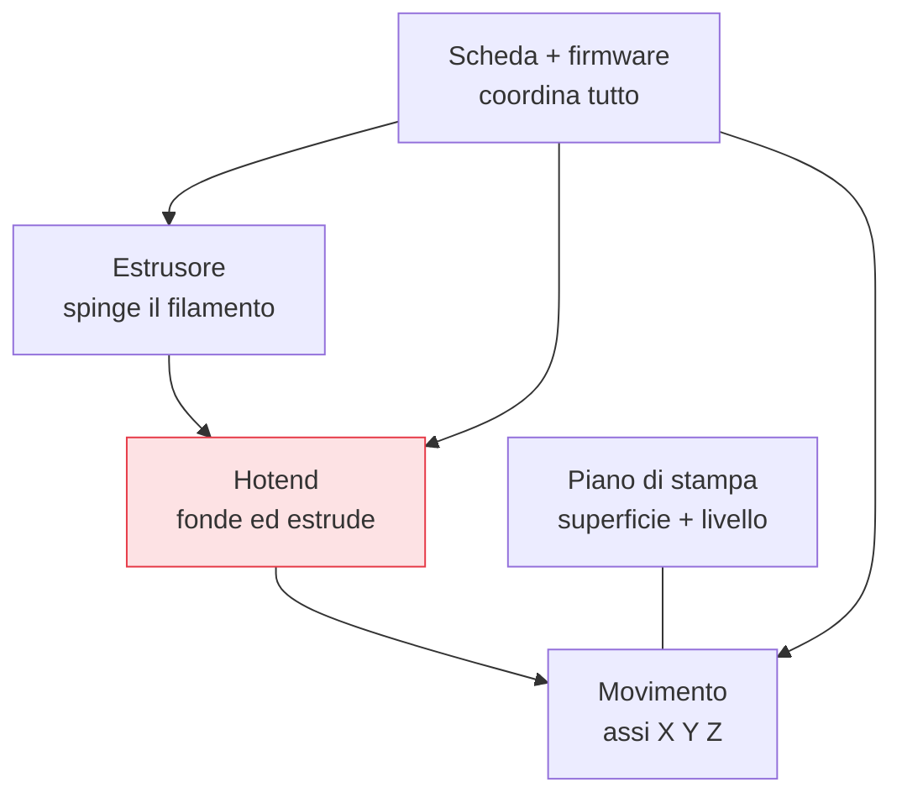

## Perché conta

Sapere [cosa fa]() la stampante non basta per risolvere i
problemi: bisogna sapere *con quali parti* lo fa, perché ogni difetto nasce da un componente preciso.
Un pezzo che non estrude, un filo che scorre male, un asse che vibra — ognuno punta a un sottosistema.
Questo capitolo è la mappa dell'hardware: non per smontare tutto, ma per sapere *dove guardare*.

## I sottosistemi



Cinque sottosistemi che lavorano insieme: chi *spinge* il filamento, chi lo *fonde*, chi *muove* la
testa nello spazio, la *superficie* su cui si costruisce, e il *cervello* che coordina.

## L'hotend: dove la plastica fonde

Il cuore caldo. I suoi pezzi, dall'alto in basso:

```text {hl_lines=[2,4]}
heat break (gola)   → zona STRETTA che separa il caldo dal freddo: qui il filo deve restare solido
heat block          → blocco riscaldato con la resistenza e il termistore (misura la temperatura)
nozzle              → ugello finale, il foro (tipico 0.4mm) da cui esce la plastica
heatsink + ventola  → raffreddano la parte ALTA, così il filo fonde SOLO in fondo
```

Il concetto chiave è la **heat break**: il filamento deve restare solido fin quasi al nozzle e fondere
solo all'ultimo. Se il calore "risale" (heat creep), il filo si ammorbidisce troppo in alto e
**intasa** la gola — una delle cause più comuni di stampe fallite a metà.

## Estrusore: diretto o bowden

Il motore che spinge il filamento può stare in due posti, con un compromesso netto:

- **Diretto (direct drive)**: il motore è *sulla testa*, vicino al nozzle. Controllo preciso del
  filamento (ottimo per materiali flessibili e per ridurre lo *stringing*), ma la testa è più pesante
  → più inerzia, velocità massime un po' più basse.
- **Bowden**: il motore è *fisso sul telaio* e spinge il filo dentro un tubo fino alla testa. Testa
  leggera e veloce, ma il tubo introduce "gioco": il controllo del ritiro ([retraction]())
  è meno reattivo e va calibrato con più cura.

Nessuno dei due è "migliore": è un compromesso tra precisione del filamento e leggerezza della testa.

## Movimento, piano e cervello

- **Assi X/Y/Z**: muovono testa e piano. Cinghie allentate, pulegge lente o guide sporche causano
  difetti geometrici (*ghosting*, dimensioni sbagliate). La meccanica dev'essere rigida e pulita.
- **Piano di stampa**: superficie (vetro, PEI, flessibile) su cui aderisce il primo strato.
  Il suo *livello* e la sua *pulizia* determinano il successo del [primo layer]() —
  il fattore numero uno di fallimento.
- **Scheda e firmware** (Marlin, Klipper): coordinano motori e temperature eseguendo il
  [G-code](). Il firmware contiene anche le calibrazioni
  persistenti (passi dei motori, limiti, compensazioni).


<details>
<summary><strong>Domanda:</strong> dato che l'intasamento del nozzle è così comune, conviene stampare sempre a temperatura più alta per evitare che la plastica non fonda bene e blocchi tutto?</summary>
<p>È un rimedio intuitivo ma spesso controproducente, perché confonde due cause opposte di intasamento che
richiedono interventi contrari — e alzare la temperatura cura la prima mentre <em>peggiora</em> la
seconda, che è anche la più frequente. Gli intasamenti hanno fondamentalmente due origini. La prima è la
sotto-fusione: la plastica non raggiunge una temperatura sufficiente a scorrere, tipico se stampi troppo
freddo o troppo veloce per quel materiale; qui, sì, alzare la temperatura (o rallentare) aiuta. Ma la
seconda origine, il famigerato <em>heat creep</em>, è l'opposto: il calore risale lungo la gola oltre la
zona prevista, il filamento si ammorbidisce <em>troppo in alto</em> — dove dovrebbe essere ancora solido
e rigido per spingere — si gonfia, forma un tappo molle nella parte stretta e blocca tutto, spesso a metà
di una stampa lunga. Se rispondi a questo alzando ancora la temperatura, estendi la zona calda ancora più
in su e aggravi esattamente il meccanismo che causa il blocco. La cura dell'heat creep va nella direzione
contraria: assicurarti che la <em>ventola di raffreddamento dell'heatsink</em> funzioni e abbia buon
flusso (è lei che tiene fredda la parte alta), controllare che la gola sia pulita e ben assemblata, non
lasciare la stampante in pausa con l'hotend caldo e fermo (il calore risale senza il filo che scorre a
portarlo via), e semmai stampare leggermente più <em>freddo</em> o più veloce. C'è poi una terza causa,
meccanica e indipendente dalla temperatura: residui carbonizzati o impurità nel nozzle, che si risolvono
con una pulizia (cold pull) o sostituendo l'ugello. La morale: non esiste una temperatura "sempre più
alta" che previene gli intasamenti, perché gli intasamenti non hanno una causa sola. La temperatura
giusta è quella calibrata per il materiale (il capitolo sulla calibrazione la trova con la temp tower);
andarci sopra "per sicurezza" degrada la qualità (stringing, dettagli sbavati) e, nel caso dell'heat
creep, aumenta proprio il rischio che volevi evitare. Diagnostica la causa — fonde male o si blocca in
alto o è sporco — e agisci su quella.</p>
</details>


## Conclusione

Una stampante FDM è cinque sottosistemi — estrusore, hotend, movimento, piano, scheda — e ogni difetto
punta a uno di essi: conoscerli significa sapere dove guardare. L'hotend fonde con la heat break come
punto critico, l'estrusore è diretto o bowden con compromessi opposti, e il piano governa il primo
layer. La macchina però non fa nulla senza istruzioni, e quelle nascono da un modello 3D tradotto in
comandi da eseguire. Ma prima di tradurre un modello serve sapere *cosa* le dai da fondere: ogni
plastica ha temperature, resistenza e capricci diversi. Sono i filamenti e i materiali, prossimo
capitolo.
