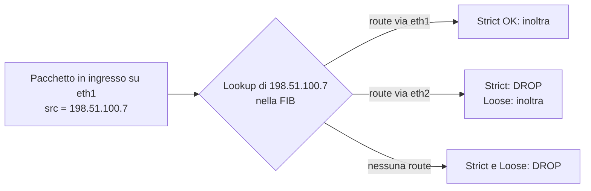

## Perché conta

IP non verifica chi scrive l'indirizzo sorgente: il campo `Source Address` è dichiarato dal mittente. Quasi ogni attacco
di *reflection* ne dipende. Nell'[amplificazione DDoS]() o
nell'[abuso di NTP]() l'attaccante manda richieste piccole con sorgente
uguale alla vittima; il server risponde alla vittima con un traffico $A$ volte più grande, dove
$A = B_{\text{risposta}} / B_{\text{richiesta}}$. Anche i flood SYN, lo scan "idle" e il bypass di ACL basate su IP usano
sorgenti false.

Il rimedio è vecchio di oltre vent'anni (BCP 38, RFC 2827) ed è ancora applicato a macchia di leopardo: finché
un singolo ISP o datacenter lascia uscire pacchetti con sorgente falsa, il problema resta di tutti.

## Come funziona

L'idea: ogni punto di *ingresso* in una rete accetta solo pacchetti la cui sorgente è plausibile per quel punto.
Un cliente con il prefisso `203.0.113.0/24` non deve mai emettere sorgenti diverse. In forma di insieme,
l'interfaccia $i$ accetta un pacchetto con sorgente $s$ solo se $s \in P_i$, dove $P_i$ è l'insieme dei prefissi
leciti raggiungibili da $i$. Gli approcci differiscono per come si costruisce $P_i$:

| Modalità | Regola | Quando usarla |
|---|---|---|
| ACL statica (BCP 38) | lista manuale dei prefissi del cliente | accesso, singolo prefisso |
| uRPF strict | la route verso $s$ deve uscire da $i$ | reti singlehomed, simmetriche |
| uRPF feasible-path | $s$ è raggiungibile da $i$ anche su un percorso alternativo | multihoming |
| uRPF loose | $s$ esiste in FIB su qualunque interfaccia | transito, scarta solo bogon e non instradati |



Il vantaggio di uRPF è che riusa la tabella di forwarding, quindi non richiede liste da mantenere. Il rischio è il
*routing asimmetrico*: se la risposta legittima rientra da un altro link, strict mode scarta traffico buono.

## L'attacco

Verificare se la propria rete permette di uscire con sorgente falsa è semplice (solo su reti che si amministrano):

```bash
# invia un SYN con sorgente falsa; in un'altra macchina si controlla se arriva
sudo hping3 -S -p 80 -a 192.0.2.99 -c 3 203.0.113.50

# alternativa con scapy
python3 -c "from scapy.all import *; send(IP(src='192.0.2.99', dst='203.0.113.50')/ICMP(), count=3)"

# lato ricevente: arriva con la sorgente falsa?
sudo tcpdump -ni eth0 'icmp and src host 192.0.2.99'
```

Se il pacchetto arriva, l'upstream non filtra. Il progetto Spoofer del CAIDA misura la stessa cosa su scala
Internet. L'impatto concreto è la riflessione: l'attaccante usa come sorgente la vittima e un resolver aperto
come specchio, con un rapporto di 30-50× per DNS con risposte grandi. Una singola connessione da 10 Mbit/s può
così produrre circa 0,5 Gbit/s sulla vittima.

## La difesa

Su un host o router Linux il controllo uRPF è il parametro `rp_filter` (1 = strict, 2 = loose); in aggiunta si
scartano i bogon con nftables:

```bash {hl_lines=[2,3,6]}
# /etc/sysctl.d/90-antispoof.conf
net.ipv4.conf.all.rp_filter = 1
net.ipv4.conf.default.rp_filter = 1
net.ipv4.conf.all.log_martians = 1
# loose se il routing è asimmetrico
net.ipv4.conf.wan0.rp_filter = 2
```

```nft {hl_lines=[5,7,9]}
table inet antispoof {
    set bogons4 { type ipv4_addr; flags interval;
        elements = { 0.0.0.0/8, 127.0.0.0/8, 169.254.0.0/16, 192.0.2.0/24, 224.0.0.0/3 } }
    chain prerouting {
        type filter hook prerouting priority -300; policy accept;
        iifname "wan0" ip saddr { 10.0.0.0/8, 172.16.0.0/12, 192.168.0.0/16 } counter drop
        iifname "wan0" ip saddr @bogons4 counter drop
        # il LAN-side deve uscire solo con il proprio prefisso (BCP 38)
        iifname "lan0" ip saddr != 10.10.0.0/24 counter drop
        iifname "wan0" ip saddr 203.0.113.0/24 counter drop
    }
}
```

Le righe evidenziate scartano dal lato WAN gli indirizzi privati e bogon, impongono su LAN la sorgente corretta (la
parte che protegge Internet) e bloccano sorgenti *proprie* arrivate dall'esterno (il classico trucco "land"). Sui
router di ISP e campus l'equivalente è:

```text
interface GigabitEthernet0/1
 ip verify unicast source reachable-via rx allow-self-ping
! feasible-path / loose: reachable-via any
```

Con `reachable-via any` si usa la modalità loose, adatta ai link di transito. Per IPv6 vale lo stesso principio,
con `ipv6 verify unicast source reachable-via rx`. In rete di accesso si somma [DHCP snooping con IP Source Guard](),
che lega porta, MAC e IP a livello 2. Il successo si misura con i contatori: un `counter` che cresce su `iifname "lan0"`
indica un host compromesso che sta cercando di falsificare la sorgente, un evento da portare nel
[SIEM]().

## Lab

Con due container su bridge diverse e un router Linux in mezzo (`lan0` = 10.10.0.0/24, `wan0`):

1. Dal client invia `hping3 -S -a 192.0.2.99 -c 3` verso un host dietro `wan0` e osserva con `tcpdump` sul lato WAN.
2. Applica la regola `iifname "lan0" ip saddr != 10.10.0.0/24 counter drop` e ripeti: cosa cambia nel contatore?
3. Con `rp_filter=1` rendi il routing asimmetrico (due percorsi di ritorno): quale pacchetto legittimo viene perso e quale impostazione lo risolve?


<details><summary>Soluzione</summary>
<ol>
<li>Senza filtri il router inoltra e <code>tcpdump</code> vede i SYN con sorgente 192.0.2.99, che non appartiene alla LAN.</li>
<li>Dopo la regola nessun pacchetto raggiunge il lato WAN e il contatore (<code>nft list ruleset</code>) sale di 3. Il test mostra che il filtraggio vale all'ingresso, vicino alla sorgente.</li>
<li>In strict mode il traffico di ritorno da un'interfaccia diversa da quella indicata dalla FIB viene scartato (compare in <code>dmesg</code> con <code>log_martians</code>). Si risolve con <code>rp_filter=2</code> (loose) o con feasible-path sui link multihomed.</li>
</ol>
</details>


## Conclusione

L'anti-spoofing è un bene comune: costa poco a chi lo applica e protegge soprattutto gli altri. Regola pratica:
ACL o strict uRPF sui bordi di accesso, feasible-path o loose sui link di transito, scarto dei bogon ovunque, contatori nel
SIEM. Chi lo implementa contribuisce anche alle azioni minime di MANRS.

**Prossimo nella serie:** [Torna alla roadmap]()
