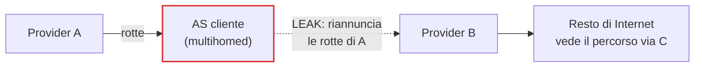

## Perché conta

Nel [post su BGP e RPKI]() abbiamo visto come la validazione dell'origine
(ROV, RFC 6811) smaschera chi annuncia un prefisso che non è suo. Ma il caso più frequente di incidenti BGP
non è un hijack: è il **route leak**. Un AS riannuncia a un terzo le rotte apprese da un provider o da un peer,
trasformandosi senza volerlo in un transito gratuito per una fetta di Internet. Il prefisso ha l'origine corretta,
la ROA è valida, e il traffico finisce comunque su un link piccolo che non regge: blackout, o intercettazione se
il leaker è malevolo.

Il motivo è strutturale: BGP non sa nulla delle relazioni commerciali tra AS. Le conosce solo la configurazione
di chi gestisce il router, e un filtro dimenticato basta.

## Come funziona

Le relazioni tra AS sono tre: **customer→provider** (si paga per il transito), **peer** (scambio gratuito di
rotte dei propri clienti), e il caso del route server di un IXP. La regola economica è il modello *valley-free*:
un percorso legittimo sale verso i provider, attraversa al massimo un link peer e poi scende verso i clienti:

$$\text{AS\_PATH} \;\in\; \text{up}^{*}\;\,\text{peer}^{\le 1}\;\,\text{down}^{*}$$

Un leak è una "valle": la rotta scende e poi risale (cliente → altro provider, o peer → altro peer).



Due meccanismi complementari lo contrastano:

- **BGP Roles + OTC (RFC 9234)**: ogni sessione dichiara il ruolo locale (`provider`, `customer`, `peer`,
  `rs-server`, `rs-client`) nell'OPEN. Se i due lati non sono coerenti la sessione non sale. Le rotte che
  scendono verso un cliente o un peer ricevono l'attributo **Only To Customer (OTC)**, che da quel momento le
  rende non ripropagabili verso provider e peer.
- **ASPA**: il proprietario di un AS pubblica in RPKI un oggetto firmato con l'elenco dei propri provider
  autorizzati. Un router che valida l'`AS_PATH` può verificare che ogni salto "in salita" sia verso un provider
  dichiarato: se non lo è, il percorso è una valle.

## L'attacco

Un leak non richiede exploit: basta una policy di export mancante. In FRR, un cliente multihomed senza filtri
in uscita inoltra tutto quello che impara:

```text
router bgp 64500
 neighbor 192.0.2.1 remote-as 64501      ! provider A
 neighbor 198.51.100.1 remote-as 64502   ! provider B
 address-family ipv4 unicast
  neighbor 192.0.2.1 route-map PERMIT-ALL in
  neighbor 198.51.100.1 route-map PERMIT-ALL out   ! riannuncia le rotte di A a B
```

Dal lato osservatore, il segnale è un `AS_PATH` in cui un AS piccolo compare tra due grandi provider:

```bash
# percorsi per un prefisso che passano per l'AS sospetto (64500) tra due transiti
vtysh -c "show bgp ipv4 unicast 203.0.113.0/24 bestpath"
vtysh -c "show bgp ipv4 unicast regexp _64501_64500_64502_"
```

Un `AS_PATH` come `64502 64500 64501 ...` è la firma classica: B arriva ad A passando da un cliente di entrambi.

## La difesa

**1. Ruoli e OTC sul singolo link.** In FRR (da 8.x) il ruolo si dichiara per neighbor; `strict-mode`
impone che anche il peer lo supporti:

```text {hl_lines=[3,5,7]}
router bgp 64500
 neighbor 192.0.2.1 remote-as 64501
 neighbor 192.0.2.1 local-role customer strict-mode
 neighbor 198.51.100.1 remote-as 64502
 neighbor 198.51.100.1 local-role customer strict-mode
 neighbor 203.0.113.9 remote-as 64510
 neighbor 203.0.113.9 local-role provider
```

Con questa configurazione le rotte apprese dai due provider arrivano marcate con OTC (l'AS del provider che le
ha ricevute dall'alto) e il nostro router **non le esporta** verso l'altro provider. Le regole di RFC 9234,
in sintesi:

| Direzione | Condizione | Azione |
|---|---|---|
| Ricezione da provider/peer | OTC assente | imposta OTC = AS del vicino |
| Ricezione da customer | OTC presente | rotta leak, inammissibile |
| Ricezione da peer | OTC ≠ AS del vicino | rotta leak, inammissibile |
| Invio a customer/peer | OTC assente | imposta OTC = AS locale |
| Invio a provider/peer | OTC presente | non inviare |

**2. ASPA lungo il percorso.** L'oggetto dichiara chi può fare da provider per un AS (struttura concettuale,
non il formato binario RPKI):

```text
ASPA  customer-AS: 64500   provider-AS-list: [64501, 64502]
```

Il verificatore percorre l'`AS_PATH` e, per ogni coppia adiacente, controlla `provider+(a, b)`. Se trova un
salto "in salita" non autorizzato il percorso è **Invalid** e va scartato o declassato (local-pref). Differenza
chiave rispetto agli OTC: ASPA protegge anche chi non ha ruoli configurati con il vicino diretto, ma deve essere
adottata dai proprietari degli AS lungo il percorso e il draft è ancora in evoluzione; va trattata come
difesa in profondità.

**3. Il minimo indispensabile, sempre.** Prefix-list in uscita per i clienti, `maximum-prefix` sui peer e
filtri sull'`AS_PATH` in ingresso (nessun AS di transito di primo livello dietro un cliente) restano il primo
strato: ROV, OTC e ASPA li completano, non li sostituiscono.

## Lab

Con [containerlab]() crea tre nodi FRR: `A` (AS 64501),
`B` (AS 64502) e `C` (AS 64500, cliente di entrambi), più un prefisso `203.0.113.0/24` originato da A.

1. Senza ruoli né filtri su C, verifica con `show bgp` su B che il percorso verso il prefisso passi per `C`.
2. Aggiungi `local-role customer` su C verso A e B (e `provider` sul lato opposto). Quale percorso vede ora B?
3. Perché `strict-mode` è importante se A non supporta ancora RFC 9234?


<details><summary>Soluzione</summary>
<ol>
<li>B ha due percorsi: diretto (<code>64501</code>) e via C (<code>64500 64501</code>). Se B preferisce il secondo (local-pref o AS_PATH più corto per via di configurazioni asimmetriche), il suo traffico verso A transita sul link di C: è il leak.</li>
<li>Le rotte che C impara da A arrivano con OTC=64501; C non le esporta a B (regola «invio a provider con OTC presente»). B vede solo il percorso diretto.</li>
<li>Senza <code>strict-mode</code> la sessione sale anche se il vicino non invia il capability Role, e in quel caso nessun OTC viene impostato dal lato A: il leak resta possibile. Con <code>strict-mode</code> la sessione non si stabilisce, rendendo evidente la mancata adozione.</li>
</ol>
</details>


## Conclusione

Il route leak è un problema di *intenzioni*, non di firme: ROV dimostra chi è il proprietario del prefisso, ma non
chi può trasportarlo. BGP Roles con OTC chiude il problema link per link, a costo quasi nullo, mentre ASPA estende
il controllo all'intero `AS_PATH`. Insieme a RPKI e ai filtri di base formano la difesa in profondità del
routing inter-dominio.

**Prossimo nella serie:** [Torna alla roadmap]()
