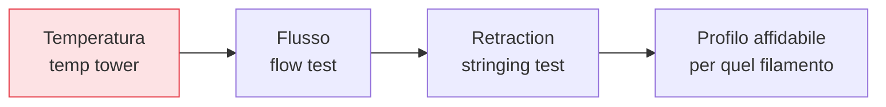

## Perché conta

Con il [primo layer]() sotto controllo, restano i difetti
di "qualità": fili sottili, pareti ruvide, dimensioni imprecise, angoli sbavati. Qui entra la
**calibrazione**, ciò che distingue una stampante che "funziona" da una che stampa *bene*. Il
principio è uno solo e vale per tutto: **cambia un parametro alla volta**, misura, poi passa al
successivo. Chi cambia dieci impostazioni insieme non imparerà mai quale contava.

## Il metodo: un test, un parametro



L'ordine conta: prima la **temperatura** (influenza tutto il resto), poi il **flusso** (le
dimensioni), infine la **retraction** (i fili). Ogni materiale — anzi, ogni *bobina* — può richiedere
valori leggermente diversi: la calibrazione si rifà quando cambi filamento in modo significativo.

## 1. Temperatura: la temp tower

Una **temp tower** è un modello che stampa segmenti a temperature decrescenti (es. da 220 a 190 °C).
Esamini il risultato e scegli la temperatura che dà il miglior compromesso:

```text {hl_lines=[2,3]}
Troppo CALDA  → fili, sbavature, sbalzi cadenti, dettagli persi
Troppo FREDDA → strati che non si fondono (pezzo fragile, delaminazione), estrusione irregolare
Giusta        → superfici lisce, ponti puliti, buona adesione tra strati, pochi fili
```

Si parte dall'intervallo consigliato dal produttore del filamento e lo si restringe con la torre. È la
base: una temperatura sbagliata rende inutile ogni altra regolazione.

## 2. Flusso: le dimensioni corrette

Il **flow rate** (o *extrusion multiplier*) regola *quanta* plastica esce. Si calibra stampando un
cubo cavo a parete singola e misurando lo spessore della parete con un calibro:

```text {hl_lines=[2]}
Parete misurata vs attesa (es. 0.40mm):
  misuri 0.44 → esce troppa plastica → riduci il flusso
  misuri 0.36 → ne esce troppo poca  → aumentalo
→ un flusso giusto dà dimensioni accurate, pareti nette, niente over/under-extrusion
```

Troppa plastica (*over-extrusion*) fa pareti gonfie e "elephant foot"; troppo poca
(*under-extrusion*) lascia buchi e pareti deboli. Il flusso giusto rende il pezzo dimensionalmente
accurato — cruciale per gli incastri del capitolo sulla [progettazione]().

## 3. Retraction: contro i fili

Quando la testa si sposta senza stampare, la plastica fusa può colare e lasciare **fili** (*stringing*)
o sbavature. La **retraction** risucchia un po' di filamento prima di ogni spostamento per creare
depressione nel nozzle. Due parametri:

- **Distanza**: quanto filamento ritirare. Poco → fili; troppo → rischio di risucchiare aria e buchi.
- **Velocità**: quanto in fretta. I sistemi [bowden]()
  richiedono distanze maggiori dei direct drive per via del gioco nel tubo.

Si calibra con un *retraction test* (due torrette con molti spostamenti tra loro): si cerca la
distanza minima che elimina i fili. Ricorda però che molti fili vengono da temperatura troppo alta o
[filamento umido](): calibra la temperatura *prima* della
retraction, o inseguirai il sintomo sbagliato.


<details>
<summary><strong>Domanda:</strong> ho fili (stringing) ovunque. Perché non aumento semplicemente la retraction finché spariscono, invece di perdere tempo con temp tower e asciugatura del filamento?</summary>
<p>Perché lo stringing è un <em>sintomo</em> con almeno tre cause diverse, e la retraction ne cura solo
una; inseguirlo gonfiando la retraction quando il colpevole è un altro ti porta in un vicolo cieco dove
peggiori la stampa senza risolvere. Le tre cause principali dei fili sono: temperatura troppo alta (la
plastica è troppo fluida e cola per gravità appena la testa si muove), filamento umido (l'acqua
intrappolata bolle nel nozzle e spruzza materiale creando fili e sbavature che <em>nessuna</em> retraction
elimina, perché il problema è vapore, non pressione), e retraction insufficiente (davvero troppo poco
risucchio). Nota l'ordine di probabilità: su materiali come PETG e TPU, e su filamenti aperti da tempo,
l'umidità e la temperatura sono colpevoli molto più frequenti della retraction mal tarata. Ora, cosa
succede se rispondi a tutto alzando la retraction? Hai un tetto oltre il quale fai danni: una distanza di
ritiro eccessiva risucchia aria e plastica non fusa nel nozzle, causando under-extrusion al ripristino
(buchi, pareti deboli), può indurre jam e, sui direct drive, macina il filamento. Quindi se la vera causa
è la temperatura o l'umidità, continuerai ad alzare la retraction senza vedere miglioramenti reali,
finché entri nella zona in cui introduci difetti <em>nuovi</em> — e a quel punto hai due problemi invece
di uno. Il metodo corretto è proprio quello della calibrazione per isolamento: prima la temp tower,
perché se stampi 15°C troppo caldo i fili spariscono abbassando la temperatura e in più migliorano
dettagli e sbalzi; poi verifichi l'umidità (crepitii, superficie opaca? asciuga il filo); e <em>solo
allora</em>, se i fili restano, calibri la retraction cercando la distanza <em>minima</em> che li
elimina. Così risolvi la causa vera con l'intervento giusto e tieni la retraction al valore più basso
possibile, che è anche il più sicuro. Alzare la retraction "finché spariscono" non è una scorciatoia: è
scommettere che la causa sia sempre la stessa e pagare con difetti nuovi quando non lo è. La calibrazione
sistematica sembra più lenta, ma è l'unica che ti dà un profilo affidabile invece di un parametro gonfiato
che nasconde il problema reale.</p>
</details>


## Conclusione

Calibrare significa regolare un parametro alla volta nell'ordine giusto: temperatura (temp tower) →
flusso (dimensioni) → retraction (fili), rifacendola quando cambi filamento. È ciò che trasforma una
stampante che funziona in una che stampa bene. Ora la macchina è affidabile sui pezzi semplici; quelli
complessi hanno sbalzi e geometrie che sfidano la fisica della FDM, e richiedono supporti e un
orientamento intelligente. Prossimo capitolo.
