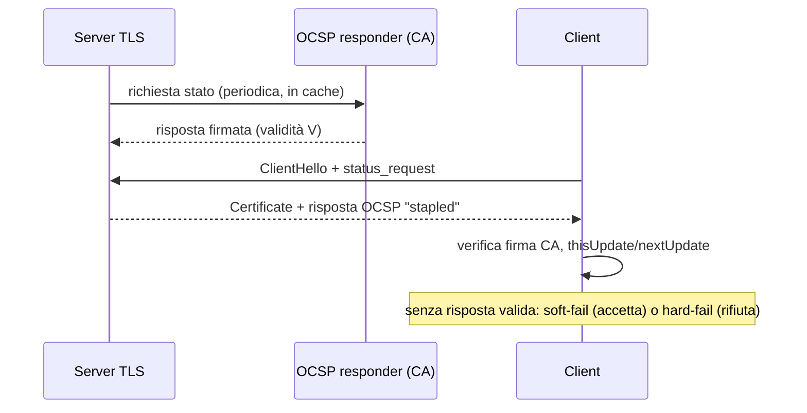

## Perché conta

Un certificato TLS è valido per mesi, ma la chiave privata può essere rubata il giorno dopo l'emissione (backup esposto, server compromesso, bug come Heartbleed). Serve un modo per dire ai client "non fidarti più di questo certificato": la **revoca**. Il problema è che, nella pratica, la revoca funziona male: molti client la controllano in modo opportunistico e, se il controllo fallisce, **proseguono lo stesso**. Chi ha rubato la chiave può quindi sfruttare proprio quel buco. Il tema completa [TLS deep dive](), [PKI e fiducia]() e [Certificate Transparency]().

## Come funziona

Esistono due meccanismi classici. Le **CRL** ([RFC 5280](https://www.rfc-editor.org/rfc/rfc5280)) sono liste firmate di numeri di serie revocati, pubblicate dalla CA a intervalli. **OCSP** ([RFC 6960](https://www.rfc-editor.org/rfc/rfc6960)) è una query per singolo certificato a un *responder* della CA. Entrambi hanno costi: le CRL crescono, OCSP rivela al responder quali siti visiti e aggiunge una dipendenza di rete. L'**OCSP stapling** ([RFC 6066](https://www.rfc-editor.org/rfc/rfc6066), estensione `status_request`) sposta la query sul server: è lui a scaricare la risposta firmata e ad allegarla all'handshake.



La finestra in cui un certificato rubato resta utilizzabile dopo la revoca è limitata dalla validità $V$ della risposta in cache. Se il certificato è revocato al tempo $t_r$ e il server ha fatto stapling un tempo $u$ prima, il client può ancora accettarlo per al più

$$E_{\max} = V - u \le V, \qquad V = 7\,\text{giorni} \Rightarrow E_{\max} \le 168\ \text{ore}$$

Con soft-fail però la finestra non è nemmeno limitata: se l'attaccante blocca il responder, $E$ diventa praticamente illimitato (fino alla scadenza naturale del certificato).

## L'attacco

L'attaccante ha la chiave privata rubata e si mette in posizione man-in-the-middle (vedi [ARP spoofing]() o [DNS rebinding]()). Presenta il certificato revocato e, per evitare che il client scopra la revoca, **scarta o rallenta** le richieste verso il responder. Si osserva con:

```bash
# Stato OCSP come lo vede un client (stapling incluso)
openssl s_client -connect example.org:443 -status -servername example.org </dev/null 2>/dev/null \
  | sed -n '/OCSP response/,/^---/p'

# Query manuale al responder indicato nel certificato
openssl x509 -in cert.pem -noout -ocsp_uri
openssl ocsp -issuer chain.pem -cert cert.pem -url http://ocsp.example-ca.test \
  -CAfile chain.pem -no_nonce
```

Con un firewall che blocca la porta 80 verso il responder, `openssl ocsp` va in timeout e i browser che applicano il soft-fail mostrano comunque la pagina. È il motivo per cui la revoca "online" da sola non è una garanzia di sicurezza.

## La difesa

**1. Stapling sul server**, con verifica della catena e una risoluzione DNS affidabile:

```nginx {hl_lines=[3,4,5,6]}
server {
    listen 443 ssl;
    ssl_stapling on;
    ssl_stapling_verify on;
    ssl_trusted_certificate /etc/ssl/chain.pem;
    resolver 10.0.0.53 valid=300s;
    ssl_certificate     /etc/ssl/fullchain.pem;
    ssl_certificate_key /etc/ssl/privkey.pem;
}
```

Il server deve poter raggiungere il responder in uscita: se applichi [egress filtering](), aggiungi un'eccezione esplicita per quegli host.

**2. Must-Staple.** L'estensione TLS Feature ([RFC 7633](https://www.rfc-editor.org/rfc/rfc7633)) nel certificato dichiara che il server **deve** allegare una risposta OCSP valida; un client che la supporta rifiuta l'handshake se manca, trasformando il soft-fail in hard-fail. Per una CA interna con OpenSSL:

```ini {hl_lines=[3]}
[ v3_server ]
basicConstraints = CA:FALSE
tlsfeature = status_request
subjectAltName = @alt_names
```

Attenzione: con Must-Staple un server che non riesce ad aggiornare la risposta va **offline per i client**, quindi serve monitoraggio sull'età dello staple.

**3. Certificati a vita breve.** Se $L$ è la durata del certificato, l'esposizione massima senza alcuna revoca è $L$. Passando da 365 a 10 giorni la finestra si riduce di un fattore $365/10 = 36{,}5$ e il problema della revoca perde peso. È l'idea delle CA automatizzate (ACME) e di [SSH Certificates](). Da ricordare: alcune CA pubbliche stanno riducendo o dismettendo il servizio OCSP a favore di durate brevi e CRL, quindi verifica cosa offre la tua CA prima di basarti su Must-Staple.

**4. Monitorare.** Un controllo semplice, da eseguire da cron e inviare al [SIEM]():

```bash
openssl s_client -connect example.org:443 -status </dev/null 2>/dev/null \
  | grep -q "OCSP Response Status: successful" || echo "ALERT: nessuno staple"
```

## Lab

1. Crea una CA di test con `openssl ca` e un certificato server con `tlsfeature = status_request`.
2. Avvia `openssl ocsp -index index.txt -port 2560 -rsigner ocsp.pem -rkey ocsp.key -CA ca.pem` e configura nginx con stapling.
3. Revoca il certificato (`openssl ca -revoke`), poi blocca la porta 2560 con `nft` e riprova con un client che applica soft-fail e uno con Must-Staple. Cosa cambia? Calcola $E_{\max}$ con $V=4$ giorni e $u=1$ giorno.


<details><summary>Soluzione</summary>
<p>Con il responder raggiungibile e la revoca registrata, la risposta OCSP riporta <code>revoked</code> e il client rifiuta. Bloccando la porta 2560 il client in soft-fail accetta il certificato (nessuna risposta = nessuna prova di revoca), mentre quello che onora Must-Staple chiude l'handshake se nginx non ha una risposta fresca. Per il calcolo: $E_{\max} = V - u = 4 - 1 = 3$ giorni.</p>
</details>


## Conclusione

La revoca è il punto debole storico della PKI: CRL pesanti, OCSP invadente e client in soft-fail. La combinazione che regge è stapling sul server, Must-Staple dove i client lo applicano e, soprattutto, certificati a vita breve con rinnovo automatico, perché un certificato che scade presto non ha quasi bisogno di essere revocato.

**Prossimo nella serie:** un nuovo approfondimento sul perimetro di rete · [Torna alla roadmap]()
