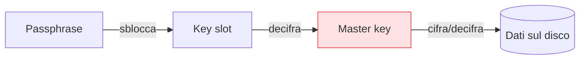

## Perché conta

[Secure Boot]() protegge ciò che parte, ma non i dati su un
disco *rimosso*. Un laptop rubato, un disco dismesso senza wipe, una VM copiata dal datastore: in tutti
questi casi, se il disco è in chiaro, i dati sono regalati — password, chiavi, database, tutto. La
**cifratura a riposo** è la rete di sicurezza finale: se qualcuno ottiene il supporto fisico, trova
rumore invece di informazioni. Su Linux lo standard è **LUKS**.

## Come funziona LUKS (cifratura a busta)

LUKS non cifra i dati direttamente con la tua passphrase. Usa una **master key** casuale per cifrare il
volume, e la master key è a sua volta cifrata dalla passphrase (o da una keyfile) in uno degli otto
**key slot**. Questo disaccoppiamento ha due vantaggi concreti: puoi **cambiare la passphrase** senza
ri-cifrare il disco (cambi solo lo slot), e puoi avere **più passphrase/chiavi** valide (slot diversi)
per lo stesso volume.



## Creare e aprire un volume

```bash
# formatta un dispositivo come LUKS (DISTRUTTIVO: cancella il contenuto)
cryptsetup luksFormat /dev/sdb1

# apri il volume: crea un device mappato in /dev/mapper/dati
cryptsetup open /dev/sdb1 dati
mkfs.ext4 /dev/mapper/dati
mount /dev/mapper/dati /mnt/dati

# chiudere
umount /mnt/dati
cryptsetup close dati
```

## Gestire le chiavi

```bash
cryptsetup luksDump /dev/sdb1          # stato del volume e key slot usati
cryptsetup luksAddKey /dev/sdb1        # aggiunge una seconda passphrase/keyfile (nuovo slot)
cryptsetup luksChangeKey /dev/sdb1     # cambia una passphrase (senza ri-cifrare i dati)
cryptsetup luksKillSlot /dev/sdb1 1    # revoca lo slot 1 (es. chiave compromessa)
```

Poter revocare uno slot è l'interruttore d'emergenza: se una chiave trapela, la elimini senza toccare
i dati.

## Montaggio automatico al boot

Perché un volume LUKS si apra all'avvio, si dichiara in `/etc/crypttab` e lo si monta da `/etc/fstab`:

```text {hl_lines=[2,4]}
# /etc/crypttab   (nome  device  keyfile/none  opzioni)
dati   UUID=xxxx-...   none   luks         # 'none' = chiede la passphrase all'avvio
# /etc/fstab
/dev/mapper/dati   /mnt/dati   ext4   defaults,nosuid,nodev   0 2
```

Nota le opzioni `nosuid,nodev` del [capitolo sui permessi speciali](): valgono anche qui.

## Cosa protegge e cosa no

```text {hl_lines=[1,4]}
Protegge: disco spento e rimosso/rubato → dati illeggibili senza la passphrase
NON protegge: sistema ACCESO e sbloccato → i dati sono in chiaro per il sistema vivo
  (un attaccante che compromette la macchina accesa legge tutto: LUKS è trasparente da lì)
Nota cloud/server: la passphrase all'avvio richiede una console; per i server headless
  si usano keyfile protette, TPM (clevis/tang) o sblocco via rete — con trade-off propri
```

LUKS difende dal furto del supporto, non dalla compromissione del sistema in esecuzione — per quello
servono tutti gli altri capitoli. È complementare, non sostitutivo.

## Conclusione

LUKS rende illeggibile il disco a riposo, con cifratura a busta che permette di cambiare e revocare le
chiavi senza ri-cifrare: la protezione giusta contro furto e dismissione del supporto. Torniamo ora al
sistema in esecuzione e a un tema di privilegi: superare il modello root-tutto-o-niente con un controllo
più fine, le [capabilities](), prossimo capitolo.
