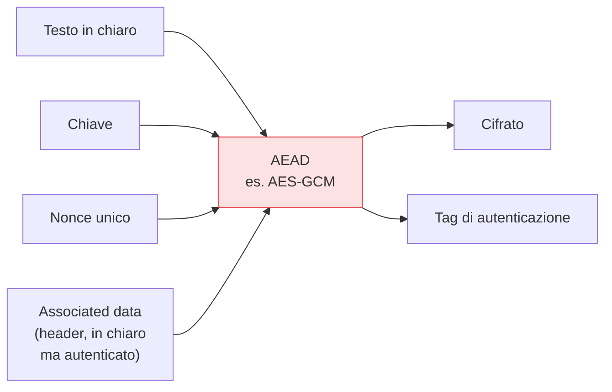

## Perché conta

La [serie]() parte dal mattone più usato: la
**cifratura simmetrica**, dove la stessa chiave cifra e decifra. È veloce e protegge quasi tutti i
dati a riposo e in transito. Ma "uso AES" è una frase incompleta e spesso pericolosa: AES è un
*cifrario a blocchi*, e come lo si applica — la **modalità operativa** — decide se il sistema è sicuro
o completamente rotto.

## Il problema delle modalità: ECB

AES cifra blocchi da 16 byte. Un messaggio è più lungo: come si incatenano i blocchi? La modalità più
ingenua, **ECB**, cifra ogni blocco in modo indipendente. Risultato disastroso: blocchi di testo in
chiaro identici producono blocchi cifrati identici.

```text {hl_lines=[3]}
Testo in chiaro con pattern ripetuti (es. un'immagine, dati strutturati)
  ECB  → gli stessi blocchi → gli stessi cifrati → il pattern TRASPARE
  (il famoso "pinguino ECB": cifri l'immagine e la vedi ancora)
→ ECB non nasconde la struttura. NON usare MAI ECB.
```

La lezione generale: la riservatezza non dipende solo dal cifrario, ma da come lo usi. Serve che testi
identici producano cifrati *diversi* — ottenuto introducendo un valore variabile per ogni cifratura.

## Nonce e IV: il valore che cambia tutto

Le modalità sicure usano un **nonce** (o IV, initialization vector): un valore che rende ogni
cifratura unica anche con la stessa chiave e lo stesso testo. La regola ferrea:

> Un nonce non si riusa **mai** con la stessa chiave.

Riusare un nonce rompe la sicurezza in modi gravi e specifici per modalità — in GCM, come vedremo, è
catastrofico. Il nonce non è segreto (viaggia in chiaro col messaggio), ma deve essere *unico*.

## AEAD: cifrare e autenticare insieme

Ecco l'errore storico più comune: cifrare *senza* autenticare. Un cifrato non autenticato può essere
**modificato** da un attaccante senza che te ne accorga — ribaltare bit, troncare, riordinare. La
riservatezza non implica l'integrità. La soluzione moderna è **AEAD** (Authenticated Encryption with
Associated Data): cifra *e* autentica in un'unica operazione.



Il **tag** garantisce che il cifrato (e gli *associated data*, dati che viaggiano in chiaro ma vanno
protetti da manomissione, come un header) non siano stati alterati. In decifratura, se il tag non
combacia, l'operazione *fallisce* invece di restituire dati manomessi. Cifratura e integrità in un
colpo solo, senza doverle combinare a mano (dove si sbaglia).

## La risposta giusta oggi

```text {hl_lines=[2,3]}
Devo cifrare dei dati simmetricamente. Cosa uso?
  AES-GCM                → se hai accelerazione hardware AES (quasi tutti i server/CPU moderni)
  ChaCha20-Poly1305      → se non ce l'hai (mobile, embedded): veloce in software, nessun timing leak
  entrambi sono AEAD: cifratura + autenticazione. Nonce unico per ogni messaggio.
→ NON: ECB (rotto), CBC senza MAC (manipolabile), roll-your-own.
```

GCM e ChaCha20-Poly1305 sono le due scelte di default. Entrambe AEAD, entrambe standard, entrambe con
lo stesso vincolo non negoziabile: **nonce unico**.


<details>
<summary><strong>Domanda:</strong> perché riusare un nonce in AES-GCM è "catastrofico" e non solo una debolezza minore come in altre modalità?</summary>
<p>Perché in GCM il riuso del nonce non degrada la sicurezza gradualmente, la demolisce su due fronti in
una volta sola. Primo, la riservatezza, ed è il meccanismo comune a tutte le cifrature a flusso: GCM
genera un keystream a partire da chiave e nonce, e cifra facendo lo XOR del testo con quel keystream. Se
usi lo stesso nonce con la stessa chiave per due messaggi, generi lo <em>stesso</em> keystream per
entrambi; facendo lo XOR dei due cifrati il keystream si cancella e ottieni lo XOR dei due testi in
chiaro, da cui, con un po' di analisi, si recuperano i messaggi. Fin qui è il classico disastro del
"two-time pad", condiviso con CTR e con ogni cifrario a flusso. Ma GCM aggiunge un secondo crollo, suo
specifico e più grave: l'<em>autenticazione</em>. Il tag di GCM è calcolato con una funzione (GHASH) che
usa una chiave di autenticazione derivata, e due tag prodotti sotto lo stesso nonce danno all'attaccante
abbastanza informazioni per recuperare quella chiave di autenticazione segreta. Una volta che ce l'ha,
non può più solo leggere: può <em>forgiare</em> tag validi per messaggi arbitrari di sua scelta, cioè
l'intera garanzia di integrità di GCM svanisce, non per i due messaggi incriminati ma in generale per
quella chiave. È la differenza che rende il riuso del nonce in GCM una categoria a sé: in CBC un IV
prevedibile o riusato indebolisce la riservatezza in modi fastidiosi ma circoscritti; in GCM perdi
riservatezza <em>e</em> la capacità di autenticare, e quest'ultima in modo che compromette la chiave di
autenticazione per sempre. Ecco perché il vincolo "nonce unico" in GCM non è una buona pratica tra le
tante, è la condizione senza la quale la modalità non ha alcuna proprietà di sicurezza. Nei sistemi dove
garantire l'unicità è difficile (molte istanze che cifrano in parallelo senza coordinarsi, rischio di
riavvii che azzerano un contatore) la pratica è generare il nonce in modo casuale con un margine ampio, o
usare varianti pensate apposta per resistere al riuso come AES-GCM-SIV, che degrada in modo molto più
clemente se l'unicità viene a mancare.</p>
</details>


## Conclusione

La cifratura simmetrica protegge la riservatezza, ma la modalità operativa decide tutto: ECB è rotto,
cifrare senza autenticare è manipolabile, e la risposta moderna è AEAD (AES-GCM o
ChaCha20-Poly1305), con nonce unico come vincolo sacro. AEAD ci ha già dato un assaggio di
*integrità* tramite il tag. Ma l'integrità ha un mattone proprio, più fondamentale e usato ovunque,
anche fuori dalla cifratura: le funzioni di hash, prossimo capitolo.
