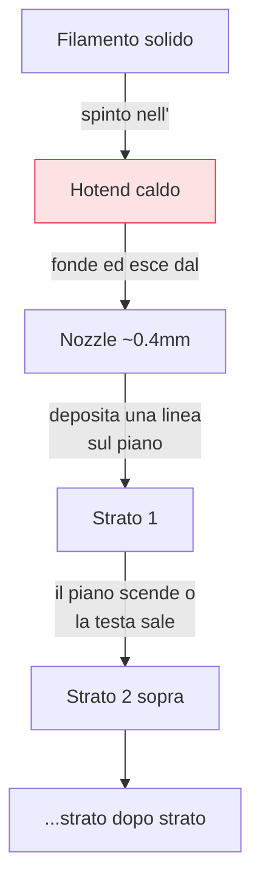

## Perché conta

La [serie]() parte dal principio fisico, perché capirlo
spiega in anticipo quasi ogni problema che incontrerai. La **FDM** costruisce un oggetto in un modo
sorprendentemente semplice: fonde un filo di plastica e lo deposita, strato dopo strato, finché la
forma è completa. Tutto il resto — materiali, calibrazione, difetti — discende da questa idea e dai
suoi limiti naturali.

## Il principio: strato su strato



Un motore spinge il filamento in una camera calda (**hotend**) dove fonde; la plastica fusa esce da
un ugello (**nozzle**), tipicamente da 0,4 mm, e viene "disegnata" sul piano. Finito uno strato, la
testa sale (o il piano scende) dell'altezza di un layer e si ricomincia. L'oggetto nasce come una
pila di contorni 2D sovrapposti. Questa natura "a fette" è la chiave di tutto.

## I tre nemici naturali

Dal principio discendono tre debolezze strutturali che tornano in ogni capitolo della serie:

```text {hl_lines=[1,2,3]}
1. Adesione tra strati  → ogni layer deve FONDERSI col precedente, o il pezzo si delamina
2. Ritiro (warping)     → la plastica si contrae raffreddandosi → gli angoli si sollevano
3. Sbalzi (overhang)    → non puoi depositare plastica nel VUOTO → servono supporti o geometria furba
```

- **Adesione tra strati**: un pezzo FDM è intrinsecamente *anisotropo* — più debole lungo l'asse Z
  (tra gli strati) che nel piano. La temperatura giusta fa fondere ogni layer nel precedente.
- **Ritiro termico**: la plastica calda si contrae raffreddandosi; se il raffreddamento è disomogeneo,
  il pezzo si deforma (*warping*), tipicamente sollevando gli angoli dal piano.
- **Sbalzi**: non si può depositare plastica nel vuoto. Oltre un certo angolo servono
  [supporti]() o una progettazione che li eviti.

Tenendo a mente questi tre vincoli, moltissime scelte diventano ovvie.

## I parametri che toccherai sempre

Tre grandezze ricorrono in ogni stampa e in ogni capitolo:

- **Temperatura**: del nozzle (per fondere bene) e del piano (per l'adesione e contro il warping).
- **Velocità**: quanto in fretta la testa si muove. Più veloce = più rischi (meno adesione, più
  vibrazioni).
- **Flusso**: quanta plastica esce. Troppa o troppo poca rovina pareti e dimensioni.

Non c'è un valore "giusto" universale: dipendono dal materiale e dalla macchina, ed è il motivo per
cui la [calibrazione]() è un capitolo a sé.


<details>
<summary><strong>Domanda:</strong> se i pezzi FDM sono più deboli lungo Z per via dell'adesione tra strati, come faccio a stampare un oggetto che deve resistere a uno sforzo in quella direzione?</summary>
<p>È la domanda che separa chi stampa gingilli da chi stampa pezzi funzionali, e la risposta non è "non si
può" ma "progetta e orienta pensando a dove arriva la forza". Il punto di partenza è accettare la fisica:
un pezzo FDM è un laminato, una pila di strati incollati l'uno all'altro, e come ogni laminato è molto più
resistente <em>nel</em> piano degli strati che nella direzione che li separa. Una trazione o una flessione
che tende a <em>sfogliare</em> gli strati trova solo la forza del legame tra layer, che è una frazione
della resistenza del materiale pieno. La leva più potente che hai è quindi l'<em>orientamento di
stampa</em>: ruota il modello nello slicer in modo che lo sforzo principale corra lungo gli strati, non
attraverso di essi. Il classico esempio è un gancio o una staffa: stampato "in piedi" si spezza alla base
perché il carico sfoglia gli strati; stampato "sdraiato" il carico corre lungo i filamenti continui ed è
molto più robusto. Il prezzo è spesso più supporti o una finitura peggiore su alcune facce, ed è il
compromesso tipico del capitolo sull'orientamento. La seconda leva è il <em>riempimento e le pareti</em>:
la resistenza di un pezzo dipende più dal numero di <em>perimetri</em> (le pareti esterne) che dalla
percentuale di infill — aumentare le pareti a 3-4 contorni dà spesso più forza strutturale che riempire
di più l'interno. La terza leva è la <em>temperatura</em>: stampare un po' più caldo e con meno
raffreddamento aumenta l'adesione tra strati (a scapito della nitidezza dei dettagli), quindi per i pezzi
funzionali si privilegia la fusione tra layer sulla bellezza. La quarta è la <em>scelta del materiale</em>:
alcuni polimeri hanno un'adesione tra strati intrinsecamente migliore o si prestano a trattamenti
(il ricottura/annealing di certi materiali migliora la coesione). E se davvero servono proprietà
isotrope o carichi elevati in tutte le direzioni, si entra nel territorio dei materiali rinforzati con
fibra o si ammette che la FDM non è lo strumento giusto e si ricorre a tecniche diverse. Ma per la
stragrande maggioranza dei pezzi funzionali domestici, orientamento intelligente + pareti abbondanti +
buona adesione tra strati risolvono il problema senza esotismi.</p>
</details>


## Conclusione

La FDM fonde un filo e lo deposita strato su strato: da qui nascono i suoi tre limiti — adesione tra
layer, ritiro termico, sbalzi — e i tre parametri che toccherai sempre: temperatura, velocità, flusso.
Capito *cosa* fa la macchina, il passo successivo è conoscere *com'è fatta*: le parti fisiche che
rendono possibile (e talvolta difficile) questo processo. È l'anatomia della stampante, prossimo
capitolo.
