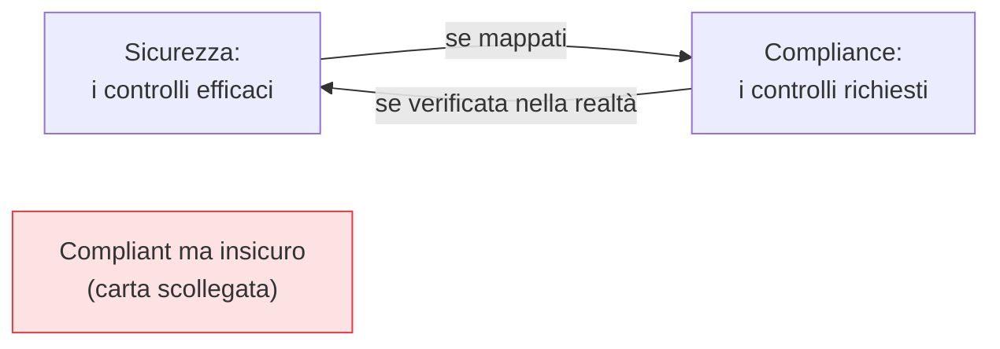

## Perché conta

Prima o poi arriva la domanda: *siamo conformi?* A una norma (GDPR, NIS2), a uno standard (ISO 27001,
SOC 2, PCI DSS), a una policy interna. È facile liquidare la compliance come burocrazia staccata dalla
sicurezza reale — e una compliance fatta male lo è davvero, carta che non riflette la realtà tecnica.
Ma fatta bene, è l'opposto: è il linguaggio con cui si dichiarano i controlli che contano, si verifica
che siano in atto, e si *dimostra* a terzi — clienti, revisori, autorità — che lo sono.

## Compliance non è sicurezza (ma si rinforzano)



Essere *compliant* non significa essere *sicuri*: si può spuntare ogni casella e avere comunque buchi
gravi, se i controlli sono formali e non verificati nella realtà. E si può essere molto sicuri senza una
certificazione. Il valore nasce quando le due coincidono: i controlli di sicurezza reali (quelli dei
capitoli precedenti) **mappati** sui requisiti, e i requisiti **verificati** sullo stato effettivo
dell'ambiente.

## Dalla compliance periodica a quella continua

Il modello tradizionale è l'**audit periodico**: una volta l'anno qualcuno raccoglie evidenze a mano,
scatta una fotografia, e per il resto dell'anno non si sa. Nel cloud, dove tutto è interrogabile via
API, si può fare molto meglio — la **compliance continua**:

```text {hl_lines=[2,3]}
Audit periodico (vecchio):      fotografia annuale, manuale, subito obsoleta
Compliance continua (cloud):    ogni controllo è una regola valutata di continuo
  - lo stato di conformità è sempre noto, non una volta l'anno
  - le evidenze si raccolgono in automatico (chi, cosa, quando)
  - uno scostamento si vede subito, non all'audit successivo
```

È lo stesso motore del [CSPM]() e della [policy as
code](), riletto in chiave di compliance: i framework
(CIS, NIST) diventano insiemi di controlli automatici, lo stato è sempre misurato, e le evidenze per
l'auditor si generano dai log invece che raccoglierle a mano.

## La governance: decidere a monte

Sotto i controlli tecnici c'è la **governance**: chi decide le policy, chi può creare account e risorse,
chi approva le eccezioni, chi è responsabile di cosa. Senza governance, i controlli migliori si erodono —
qualcuno concede l'eccezione "una tantum" che diventa permanente, nessuno possiede davvero la sicurezza
di un progetto. La governance definisce la *catena di responsabilità* che tiene in vita i controlli nel
tempo, e si appoggia sui confini della [landing zone e dei
guardrail]() per renderla concreta.


<details>
<summary><strong>Domanda:</strong> la compliance è spesso vista dai tecnici come burocrazia che ruba tempo alla sicurezza vera. Se devo scegliere dove investire, non è meglio mettere energie nei controlli reali e trattare la compliance come un male necessario minimo?</summary>
<p>È una falsa scelta che nasce da una compliance fatta male, e la risposta giusta non è ignorarla ma
<em>fonderla</em> con i controlli reali, perché fatta bene non ruba tempo alla sicurezza: la struttura,
la finanzia e la rende dimostrabile. Il punto dolente è vero: la compliance come esercizio separato —
raccogliere screenshot a mano una volta l'anno per soddisfare un auditor, mantenere documenti che
nessuno rilegge, spuntare caselle scollegate dalla realtà tecnica — è spreco, e peggio, dà una falsa
sicurezza. Ma quel modello è obsoleto proprio nel cloud. Quando esprimi i requisiti di compliance come
<em>gli stessi</em> controlli automatici che già usi per la sicurezza (CSPM, policy as code, audit
trail), la compliance smette di essere lavoro aggiuntivo e diventa un <em>sottoprodotto</em> di ciò che
fai comunque: le evidenze si generano dai log, lo stato è sempre noto, l'audit è una query, non un
progetto trimestrale. A quel punto la compliance ti <em>restituisce</em> tre cose preziose. Primo,
<em>priorità e completezza</em>: i framework sono liste di controlli ragionati che ti dicono cosa non
dimenticare — un antidoto al "proteggo ciò che mi viene in mente". Secondo, <em>budget e mandato</em>:
"serve per la compliance" sblocca risorse e attenzione del management che "sarebbe più sicuro" spesso non
ottiene — la compliance è la leva politica della sicurezza. Terzo, <em>fiducia dimostrabile</em>: i tuoi
clienti ti chiederanno la certificazione, e poterla mostrare apre contratti. La scelta saggia non è
"sicurezza invece di compliance" né il contrario: è costruire i controlli reali <em>e</em> mapparli sui
requisiti, così che un lavoro solo serva entrambi gli scopi. Chi le separa paga due volte; chi le fonde
paga una volta e raccoglie due benefici.</p>
</details>


## Conclusione

La compliance non è sicurezza, ma fonderle — controlli reali mappati sui requisiti e verificati in
continuo, con evidenze automatiche — le rende entrambe più forti, mentre la governance definisce la
catena di responsabilità che le tiene in vita. Resta un'ultima verità: per quanto si prevenga, un
incidente prima o poi arriva. Come rispondere nel cloud chiude la serie: [incident response nel
cloud]().
