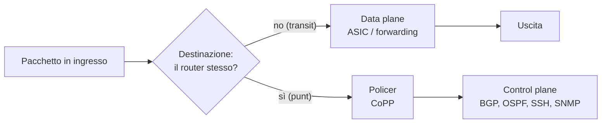

## Perché conta

Un router fa due mestieri molto diversi. Il **data plane** inoltra i pacchetti che *attraversano* il
dispositivo, di solito in hardware (ASIC), a velocità di linea. Il **control plane** esegue BGP, OSPF,
SSH, SNMP, ICMP: gestisce i pacchetti *destinati al router stesso*, e lo fa su una CPU general purpose,
ordini di grandezza più lenta. Un attaccante non ha bisogno di saturare i link: gli bastano poche migliaia
di pacchetti al secondo verso un indirizzo del router per portare la CPU al 100%, far cadere le sessioni
BGP per mancati keepalive e trasformare un problema locale in un'instabilità di routing.

Questo articolo si lega a [DDoS](), che parla di
saturazione dei link, e a [SNMP e SNMPv3](): qui il bersaglio non
è la banda ma la CPU del dispositivo di rete.

## Come funziona

Il traffico arriva sull'interfaccia e una decisione di lookup lo manda su due strade: il percorso veloce
(transit) oppure la *punt path*, cioè la coda verso la CPU. Tutto ciò che è diretto a un indirizzo del
router, più certi casi particolari (pacchetti con IP options, TTL scaduto, ARP/ND, multicast di
routing), viene "punted".



Il policing tipico usa un **token bucket**: un secchio di capacità $b$ pacchetti si riempie a un ritmo
$r$ token al secondo; ogni pacchetto consuma un token e, se il secchio è vuoto, viene scartato. Il numero
massimo di pacchetti accettati in un intervallo $T$ è quindi

$$N_{\max}(T) = b + r \cdot T$$

Il burst $b$ assorbe i picchi legittimi (una riconvergenza BGP genera molti messaggi insieme), mentre $r$
è il tetto sostenuto. Dimensionarli per classe di traffico è il cuore del CoPP.

## L'attacco

Il bersaglio sono i servizi raggiungibili sul router. Un flood di pacchetti verso la porta TCP 179 (BGP) o
verso SSH, anche da sorgenti spoofate, costringe la CPU a elaborare handshake e a scartare i pacchetti
nello stack. Con `hping3` da un host di lab:

```bash
# SYN flood verso la porta BGP del router di test, sorgenti casuali
hping3 -S -p 179 --flood --rand-source 192.0.2.1

# flood ICMP echo verso il loopback del router
hping3 --icmp --flood 192.0.2.1
```

Se la sessione BGP condivide la stessa coda di punt del flood, i keepalive vengono scartati insieme al
resto: allo scadere dell'hold timer la sessione cade, le route vengono ritirate e il danno supera di molto
il costo dell'attacco. Il caso peggiore è quello in cui l'attaccante è a più hop di distanza: senza
filtri, qualunque host raggiunga l'indirizzo di loopback può parlare con il control plane.

## La difesa

Tre livelli, dal più esterno al più interno.

**1. ACL di infrastruttura.** Gli indirizzi dei router (loopback, link di transito) non devono essere
raggiungibili dall'esterno della rete: si scarta all'ingresso, sui bordi, tutto il traffico con
destinazione nello spazio di infrastruttura, tranne ciò che serve davvero (vedi
[anti-spoofing e BCP 38]() per il filtro sulle sorgenti).

**2. GTSM (RFC 5082).** Per i peer adiacenti, il mittente invia con TTL 255 e il ricevente accetta solo
TTL 255: un pacchetto che ha attraversato anche un solo router ha TTL minore e viene scartato. Un
attaccante remoto non può quindi aprire o disturbare la sessione.

**3. CoPP.** Policing per classe del traffico verso la CPU. L'equivalente su un router Linux, in nftables:

```bash {hl_lines=[8,9,12,13]}
table inet cp {
  set peers { type ipv4_addr; elements = { 198.51.100.2 } }

  chain input {
    type filter hook input priority 0; policy drop;
    ct state established,related accept
    iif lo accept
    ip saddr @peers tcp dport 179 ip ttl 255 accept       # BGP: solo peer, solo TTL 255 (GTSM)
    ip saddr @peers tcp sport 179 ip ttl 255 accept
    ip saddr 10.0.0.0/24 tcp dport 22 ct state new limit rate 5/minute burst 10 packets accept
    icmp type echo-request limit rate 10/second burst 20 packets accept   # ICMP: tetto sostenuto
    ip protocol ospf ip ttl 1 accept
    counter drop comment "tutto il resto verso il router"
  }
}
```

Le righe evidenziate sono il nucleo: BGP ammesso solo da peer noti con TTL 255, ICMP con un token bucket
da $r = 10$ pkt/s e $b = 20$. Il resto della policy è `drop`: ciò che non serve non arriva alla CPU.
Per sapere se i limiti sono giusti guarda i contatori (`nft list ruleset`) in condizioni normali e usali
come base, poi metti un allarme sui drop nel [SIEM](). Su
Cisco/Juniper lo stesso schema si esprime con class-map e policy-map applicate al control plane.

## Lab

Con containerlab, due router Linux `r1` e `r2` con una sessione BGP (FRR) e un host `atk`:

1. Applica la policy sopra su `r1`, poi lancia da `atk` il SYN flood verso la porta 179 di `r1`. La
   sessione BGP tra `r1` e `r2` resta su? Perché?
2. Togli la regola con `ip ttl 255` e riprova il flood da `atk`, che è a due hop: cosa cambia?
3. Con $b = 20$ e $r = 10$, quanti echo-request al massimo passano in 5 secondi?


<details><summary>Soluzione</summary>
<ol>
<li>La sessione resta su: l'indirizzo di <code>atk</code> non è nel set <code>peers</code>, quindi i suoi
SYN finiscono nella regola finale di <code>drop</code> senza consumare il budget riservato al peer.
Verifica con il contatore della regola <code>drop</code>, che cresce mentre i keepalive di <code>r2</code> passano.</li>
<li>Se l'attaccante spoofa l'indirizzo di <code>r2</code> la regola sulle sorgenti non basta più; con il
controllo del TTL il flood arriva con TTL inferiore a 255 e viene scartato. Togliendolo resta solo il
filtro sulla sorgente, aggirabile con lo spoofing.</li>
<li>$N_{\max}(5) = 20 + 10 \cdot 5 = 70$ pacchetti.</li>
</ol>
</details>


## Conclusione

Il control plane è la parte più fragile e più preziosa di un router: poca CPU, tutta la logica di routing.
La difesa è a strati: ACL di infrastruttura per non esporre gli indirizzi, GTSM per i peer adiacenti,
policing per classe per garantire che i protocolli critici non siano mai affamati dal rumore. Misura il
traffico normale prima di fissare i limiti e allarma sui drop.

**Prossimo nella serie:** [Torna alla roadmap]()
