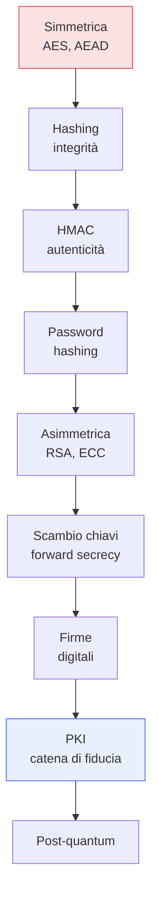

## Perché questa serie

Usi la crittografia centinaia di volte al giorno senza pensarci: ogni sito in HTTPS, ogni messaggio
cifrato, ogni password salvata, ogni aggiornamento firmato. Quando funziona è invisibile. Quando la si
implementa male — ed è facile — i dati trapelano in silenzio, e nessun test funzionale se ne accorge.
Questa serie in **10 capitoli** spiega la crittografia *applicata*: non le dimostrazioni matematiche,
ma *quale* primitiva usare, *perché*, e quali errori evitare.

## La regola d'oro

Prima di tutto il resto, una regola che vale più di ogni capitolo:

> **Non inventare la tua crittografia, e non implementare primitive a mano.** Usa librerie
> affermate, revisionate, e le loro impostazioni predefinite sicure.

La crittografia fallisce in modi silenziosi: un nonce riusato, un confronto non a tempo costante, un
padding mal gestito. Capire *come* funziona serve a usarla bene e a riconoscere gli errori — non a
riscriverla. Tutta la serie è pensata con questo spirito.

## La mappa

Si parte dai mattoni più semplici (cifrare e verificare l'integrità) e si sale fino a come TLS, le
firme del software e la PKI li combinano. L'ultimo capitolo guarda avanti: cosa cambia quando
arriveranno i computer quantistici.

## I tre obiettivi della crittografia

Tutto ruota attorno a tre proprietà, e confonderle è l'errore concettuale più comune:

- **Riservatezza**: nessuno legge il messaggio tranne il destinatario. → cifratura.
- **Integrità**: il messaggio non è stato alterato. → hash, MAC.
- **Autenticità**: il messaggio viene davvero da chi dice. → MAC, firme.

Cifrare *non* garantisce integrità; un hash *non* garantisce autenticità. Gran parte della serie è
imparare quale strumento dà quale garanzia, e come combinarli senza lasciare buchi.

## A chi si rivolge

A chi scrive software e deve scegliere come cifrare dati, salvare password, verificare firme — senza
essere un crittografo. Diamo per note le basi (byte, encoding, un po' di aritmetica); tutto il resto
lo costruiamo. Questa serie è il complemento naturale di temi già trattati come il
[TLS]() e la [Certificate Transparency]().

Partiamo dal mattone più usato di tutti: la cifratura simmetrica, prossimo capitolo.
