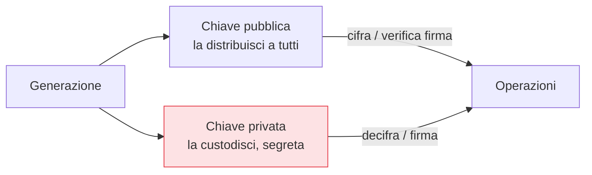

## Perché conta

Tutta la serie finora ha usato **chiavi condivise**: per cifrare, verificare o autenticare, le due
parti dovevano già possedere lo stesso segreto. Ma come fai a condividere quel segreto con un server
che non hai mai contattato, su una rete ostile, *prima* di avere un canale sicuro? È il problema della
distribuzione delle chiavi, e per decenni non ha avuto soluzione pratica. La
**crittografia asimmetrica** (a chiave pubblica) lo risolve con un'idea rivoluzionaria: due chiavi
diverse ma legate.

## Due chiavi, una coppia



Le due chiavi sono matematicamente legate ma non si deducono l'una dall'altra in pratica. Due usi
speculari:

- **Cifratura**: chiunque cifra con la tua chiave *pubblica*; solo tu, con la *privata*, decifri.
- **Firma**: tu firmi con la *privata*; chiunque verifica con la *pubblica*. (Il capitolo sulle firme
  lo approfondisce.)

La chiave pubblica può stare su un cartellone: la sicurezza sta tutta nel tenere segreta la privata.

## La funzione trapdoor

Il cuore matematico è una **funzione trapdoor**: facile da calcolare in un verso, infattibile
all'inverso *a meno che* tu non abbia un'informazione segreta (la chiave privata). RSA la costruisce
sulla fattorizzazione:

$$ n = p \times q $$

Moltiplicare due primi grandi $p$ e $q$ è banale; **fattorizzare** $n$ per ritrovarli è infattibile se
$n$ è abbastanza grande. La chiave pubblica usa $n$; la privata sfrutta la conoscenza di $p$ e $q$. ECC
usa invece la difficoltà del *logaritmo discreto su curve ellittiche* — problema diverso, stessa idea:
facile avanti, infattibile indietro.

## RSA contro ECC

```text {hl_lines=[2,3]}
Sicurezza equivalente a ~128 bit simmetrici:
  RSA  → chiave di ~3072 bit
  ECC  → chiave di ~256 bit   (curva P-256, o Curve25519)
→ ECC ottiene la stessa sicurezza con chiavi molto più piccole: meno banda, meno CPU.
```

A parità di sicurezza, ECC usa chiavi *molto* più corte: operazioni più veloci, meno dati da
trasmettere, ideale per mobile e per il traffico di rete. Per questo i sistemi moderni preferiscono le
curve ellittiche (Curve25519, P-256), riservando RSA ai contesti dove è già radicato. In entrambi i
casi: usa dimensioni adeguate (RSA ≥ 3072 bit, curve note e sicure) e librerie affermate.

## L'asimmetrica NON sostituisce la simmetrica

Un equivoco diffuso. La crittografia asimmetrica è **lenta** e adatta solo a piccoli dati, e nessuno
cifra un file o un flusso TLS con RSA. Nella pratica si usa un modello **ibrido**:

```text {hl_lines=[2,3]}
Modello ibrido (quello reale, es. TLS):
  1. asimmetrica → concorda/consegna una CHIAVE di sessione simmetrica (piccolo dato)
  2. simmetrica  → cifra tutti i dati veri con AES-GCM (veloce)
→ l'asimmetrica risolve la distribuzione della chiave, la simmetrica fa il lavoro pesante.
```

L'asimmetrica serve a stabilire il segreto condiviso; poi lavora la simmetrica. I due mondi sono
complementari, non in competizione — ed è esattamente così che funziona il
[TLS]().


<details>
<summary><strong>Domanda:</strong> se la chiave pubblica basta per cifrare, come fa chi la riceve a essere sicuro che sia davvero la mia e non quella di un impostore nel mezzo?</summary>
<p>Hai messo il dito sul vero limite della crittografia a chiave pubblica: risolve brillantemente la
<em>distribuzione</em> del segreto, ma da sola non risolve l'<em>autenticità</em> della chiave pubblica
stessa, e senza quella l'intera costruzione è vulnerabile a un attacco man-in-the-middle. Lo scenario è
esattamente quello che descrivi: vuoi cifrare per me, ma su una rete ostile un attaccante intercetta la
comunicazione e ti consegna la <em>sua</em> chiave pubblica spacciandola per la mia. Tu cifri felicemente
con quella, lui decifra con la propria privata, legge (o altera) il messaggio, lo ri-cifra con la mia
vera chiave pubblica e me lo inoltra: nessuno dei due si accorge di nulla. La matematica asimmetrica ha
funzionato perfettamente — ha solo protetto un dialogo con la persona sbagliata. Il problema, nota, non è
crittografico ma di <em>fiducia</em>: come lego una chiave pubblica a un'identità reale di cui mi fido?
Esistono due famiglie di risposte, ed entrambe sono argomenti di capitoli successivi di questa serie.
La prima è la <strong>PKI</strong> (public key infrastructure): una terza parte fidata, la Certificate
Authority, firma un certificato che attesta "questa chiave pubblica appartiene a questo dominio/identità";
tu ti fidi della chiave perché ti fidi della CA che l'ha firmata, e la catena di fiducia risale fino a
radici che il tuo sistema conosce già. È il modello del web e del TLS. La seconda è la verifica
<em>fuori banda</em> o su base di fiducia distribuita: confrontare manualmente l'impronta (fingerprint)
della chiave attraverso un canale indipendente — come fai, anche senza saperlo, accettando la fingerprint
di un host SSH al primo accesso — oppure modelli a ragnatela di fiducia come quello storico di PGP. In
ogni caso il punto da portare a casa è che la crittografia asimmetrica sposta il problema dalla
"condivisione di un segreto" alla "autenticazione di una chiave pubblica", che è un problema più
gestibile ma non banale, e va risolto esplicitamente con la PKI o con la verifica dell'impronta. Una
chiave pubblica di cui non puoi verificare l'origine non è ancora sicurezza: è sicurezza in attesa di
un'identità fidata a cui agganciarsi.</p>
</details>


## Conclusione

La crittografia asimmetrica usa due chiavi legate da una funzione trapdoor (RSA sulla fattorizzazione,
ECC sul logaritmo discreto): risolve la distribuzione del segreto, con ECC preferibile per le chiavi
più corte, e si usa in modello ibrido perché è lenta. Ma cifrare con la chiave pubblica non è il modo
migliore di concordare un segreto condiviso: esiste un meccanismo più elegante, che dà anche una
proprietà preziosa chiamata forward secrecy. È lo scambio di chiavi, prossimo capitolo.
