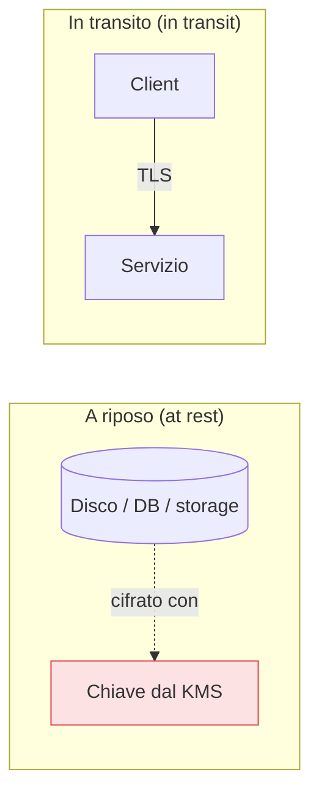

## Perché conta

La cifratura è l'ultima rete di sicurezza: quando l'identità, la rete e la configurazione hanno
fallito e un attaccante mette le mani sui dati, la cifratura decide se trova informazioni o solo
rumore. Nel cloud è quasi sempre disponibile, spesso attiva di default, e costa poco o nulla in
prestazioni grazie all'accelerazione hardware. La domanda non è più "cifrare sì o no", ma **dove, come,
e soprattutto chi tiene le chiavi**.

## I due fronti: a riposo e in transito



- **A riposo**: dischi, database, storage a oggetti, backup, snapshot. Si appoggia alla
  [crittografia a busta del KMS]() vista prima: i dati sono
  cifrati con chiavi dati, le chiavi dati con la master.
- **In transito**: ogni byte che viaggia in rete, protetto da **TLS**. Vale non solo verso Internet ma
  anche *dentro* la tua rete cloud: tra servizi, verso il database, tra microservizi. "Rete privata"
  non significa "rete fidata".

## Chi tiene le chiavi: il vero controllo

Chi controlla la chiave controlla i dati. Le opzioni, dalla più comoda alla più controllata:

```text {hl_lines=[3]}
Chiavi gestite dal provider   → comode, zero gestione, il provider può tecnicamente accedervi
Chiavi gestite da te nel KMS  → tu decidi rotazione, revoca e policy d'uso (raccomandato)
BYOK (bring your own key)     → importi la tua chiave nel KMS del provider
HYOK / external key           → la chiave resta fuori dal cloud, sotto il tuo controllo totale
```

Per la maggior parte dei casi, **chiavi tue gestite nel KMS del provider** è il giusto equilibrio:
controlli policy, rotazione e revoca (revocare la chiave rende i dati illeggibili all'istante, un
"interruttore d'emergenza" potente), senza l'onere operativo di custodire hardware. BYOK e chiavi
esterne servono a requisiti di compliance o sovranità del dato più stringenti.

## La cifratura non sostituisce il controllo d'accesso

Un equivoco frequente: "i dati sono cifrati, quindi sono al sicuro". La cifratura a riposo protegge
contro chi ruba il *supporto fisico* o un backup — non contro chi ha i permessi IAM per leggere i dati
*attraverso il servizio*, perché per lui la decifratura è trasparente. Un bucket cifrato ma pubblico
resta un data breach. La cifratura è *complementare* al controllo d'accesso, non un suo sostituto.


<details>
<summary><strong>Domanda:</strong> se il provider offre la cifratura a riposo attiva di default e gestisce lui le chiavi, perché dovrei complicarmi la vita con chiavi mie nel KMS? I dati sono già cifrati.</summary>
<p>Perché "cifrati con chiavi del provider" e "cifrati con chiavi tue" proteggono da minacce diverse, e
la differenza conta proprio nei casi che ti tengono sveglio la notte. Con le chiavi gestite dal provider
ottieni la protezione base — se qualcuno ruba un disco fisico dal data center, trova rumore — ed è già
meglio di niente. Ma non ottieni tre cose. Primo, il <em>controllo della revoca</em>: con una chiave tua
puoi, in caso di incidente o sospetto, revocarla e rendere i dati immediatamente illeggibili a chiunque,
incluse applicazioni compromesse che avevano i permessi — è un interruttore d'emergenza che le chiavi del
provider non ti danno. Secondo, la <em>separazione dei poteri</em>: con chiavi tue, l'accesso ai dati
richiede sia il permesso sul servizio sia il permesso sulla chiave KMS, due controlli IAM distinti che
puoi affidare a ruoli diversi — così nessuna singola identità, da sola, decifra tutto. Terzo, la
<em>garanzia verso terzi e la compliance</em>: molti requisiti normativi e contrattuali chiedono che il
cliente, non il provider, controlli le chiavi; con chiavi tue hai log d'uso delle chiavi, policy
esplicite e la possibilità di dimostrare chi può decifrare cosa. Sul "complicarmi la vita": gestire una
chiave nel KMS del provider è questione di pochi clic o poche righe di IaC — non stai custodendo hardware,
stai solo spostando la proprietà logica della chiave dal provider a te. Il costo è minimo, il controllo
che guadagni è sostanziale. Le chiavi del provider vanno bene per dati a basso rischio; per tutto ciò che
conta, le chiavi tue sono lo standard ragionevole.</p>
</details>


## Conclusione

Cifrare a riposo e in transito è la rete di sicurezza finale, ma il controllo vero sta nelle chiavi:
gestirle tu nel KMS dà revoca, separazione dei poteri e compliance, mentre la cifratura resta
complementare — mai sostitutiva — del controllo d'accesso. Il servizio dove questi principi si
scontrano più spesso con la realtà degli incidenti è lo storage a oggetti, i famigerati bucket. È il
prossimo capitolo, [sicurezza dello storage a oggetti]().
