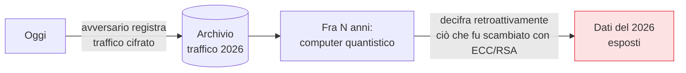

## Perché conta

Tutta la [crittografia asimmetrica]() della serie — RSA,
ECC, Diffie-Hellman, le firme — poggia su problemi che i computer classici non sanno risolvere:
fattorizzazione e logaritmo discreto. Un **computer quantistico** abbastanza grande, invece, li
risolverebbe con l'algoritmo di Shor, mandando in frantumi RSA ed ECC. La macchina non esiste ancora a
quella scala. Eppure il problema è *già oggi*, e questo capitolo chiude la serie spiegando perché e
cosa fare.

## Cosa si rompe e cosa no

Una distinzione cruciale e spesso fraintesa:

```text {hl_lines=[2,4]}
Crittografia ASIMMETRICA (RSA, ECC, DH, firme)
  → algoritmo di Shor: ROTTA da un computer quantistico grande
Crittografia SIMMETRICA (AES) e HASH (SHA-2/3)
  → algoritmo di Grover: solo DIMEZZA la sicurezza → AES-256 resta solido (= 128 bit post-quantum)
```

Il quantistico non "rompe tutto". Contro la simmetrica, l'algoritmo di Grover offre solo un
dimezzamento della forza: raddoppiando la dimensione della chiave (usare AES-256) si resta al sicuro. A
cadere è l'**asimmetrica** — proprio i meccanismi che stabiliscono chiavi e provano identità. Lì serve
una matematica nuova.

## "Harvest now, decrypt later"

Perché preoccuparsene se la macchina non c'è? Per un motivo che rende la minaccia *presente*:



Un avversario con risorse può **registrare oggi** il traffico cifrato e conservarlo, in attesa della
macchina che un domani lo decifrerà. Tutto ciò che deve restare segreto *per molti anni* — segreti di
stato, dati sanitari, proprietà intellettuale — è già a rischio oggi, anche se il quantistico arriverà
tra dieci anni. È il motivo per cui la migrazione non può aspettare che la minaccia sia operativa.

## I nuovi algoritmi

Il NIST ha standardizzato i primi algoritmi **post-quantum (PQC)**, basati su problemi matematici
(soprattutto reticoli) che si ritengono difficili anche per i computer quantistici:

- **ML-KEM** (ex **Kyber**, FIPS 203): per lo scambio/incapsulamento di chiavi — il sostituto di
  (EC)DH.
- **ML-DSA** (ex **Dilithium**, FIPS 204) e **SLH-DSA** (SPHINCS+, basato su hash): per le firme — i
  sostituti di ECDSA/RSA.

Hanno chiavi e messaggi più grandi dei loro predecessori ellittici, il che pesa su banda e handshake.
Per questo la migrazione è un lavoro ingegneristico, non un semplice cambio di libreria.

## La migrazione ibrida, già iniziata

La transizione non aspetta: è **già in corso**, in forma ibrida. L'approccio prudente combina il
vecchio e il nuovo in un unico scambio:

```text {hl_lines=[2]}
Scambio di chiavi ibrido:  ECDHE (classico)  +  ML-KEM (post-quantum)
  → il segreto deriva da ENTRAMBI: sei sicuro se almeno uno regge
  → protegge dal quantistico futuro E da eventuali debolezze dei nuovi algoritmi (ancora giovani)
```

I browser e le librerie TLS stanno già dispiegando scambi ibridi: così la forward secrecy del
[capitolo sullo scambio di chiavi]() diventa anche
*post-quantum*, e il traffico registrato oggi resta protetto anche domani. Cosa puoi fare: usare
**AES-256** dove serve longevità, preferire librerie che supportano gli ibridi, e sapere *dove* usi
crittografia asimmetrica (crypto-agility) per poterla aggiornare quando sarà il momento.


<details>
<summary><strong>Domanda:</strong> se i computer quantistici capaci di rompere RSA non esistono ancora e forse mancano molti anni, investire ora nella migrazione post-quantum non è allarmismo prematuro?</summary>
<p>Sembra prematuro solo se guardi la data in cui la macchina diventerà operativa; diventa evidentemente
urgente appena consideri i tre orizzonti temporali che vanno <em>sommati</em>, un ragionamento noto come
"teorema di Mosca". La domanda giusta non è "quando arriverà il computer quantistico?" ma "per quanti anni
i miei dati devono restare segreti, e quanto tempo mi serve per migrare?". Chiamiamo X gli anni di
segretezza richiesti dai dati che cifro oggi, Y gli anni che la mia organizzazione impiega a migrare
davvero tutta la crittografia (storicamente lunghissimi: pensa a quanto ci è voluto per abbandonare
SHA-1), e Z gli anni che mancano a un computer quantistico utile. Se X + Y > Z, sei già in ritardo: i dati
che proteggi adesso saranno ancora sensibili quando la macchina esisterà, ma li avrai migrati troppo
tardi. Ed è qui che entra la minaccia "harvest now, decrypt later", che smonta l'idea di allarmismo:
l'attacco non richiede che il quantistico esista <em>ora</em>, richiede solo che un avversario registri
<em>ora</em> il traffico cifrato e lo conservi. La cattura avviene oggi, la decifratura domani — quindi
per qualunque dato che debba restare riservato oltre l'arrivo stimato della macchina, la finestra di
rischio è <em>già aperta</em>, non si aprirà in futuro. Per un messaggio effimero che non conta più fra
un'ora, ignorare il post-quantum è ragionevole; per segreti di stato, cartelle cliniche, chiavi di lungo
periodo, proprietà intellettuale, l'esposizione è concreta adesso. C'è poi un argomento di prudenza
ingegneristica che rende la migrazione sensata a prescindere dalle date: adottare oggi gli scambi
<em>ibridi</em> (classico + post-quantum insieme) non comporta quasi nessun rischio — se gli algoritmi
nuovi si rivelassero deboli, ti protegge ancora quello classico; se il classico cade al quantistico, ti
protegge quello nuovo — e nel frattempo costruisci la <em>crypto-agility</em>, cioè la capacità di sapere
dove usi la crittografia e di cambiarla rapidamente, che è un bene a sé indipendentemente dai quanti. In
breve: non è allarmismo, è pianificazione calibrata sulla longevità dei dati. Chi tratta solo dati a vita
breve può attendere; chi tratta segreti di lungo periodo e sa quanto è lenta una migrazione reale dovrebbe
aver già cominciato, perché il nemico può aver già iniziato a raccogliere.</p>
</details>


## Conclusione

Il computer quantistico romperebbe l'asimmetrica (RSA, ECC, DH, firme) ma non la simmetrica robusta
(AES-256): la minaccia "harvest now, decrypt later" rende il problema attuale, e la risposta sono gli
algoritmi NIST post-quantum (ML-KEM, ML-DSA) dispiegati in forma ibrida, già oggi. Qui si chiude la
serie **Crittografia applicata**: dai mattoni — cifrare, verificare, autenticare — fino alla fiducia e
al futuro. Il filo rosso resta quello del primo capitolo: non inventare la tua crittografia, scegli le
primitive giuste, e capiscile abbastanza da riconoscere quando qualcosa non torna.
