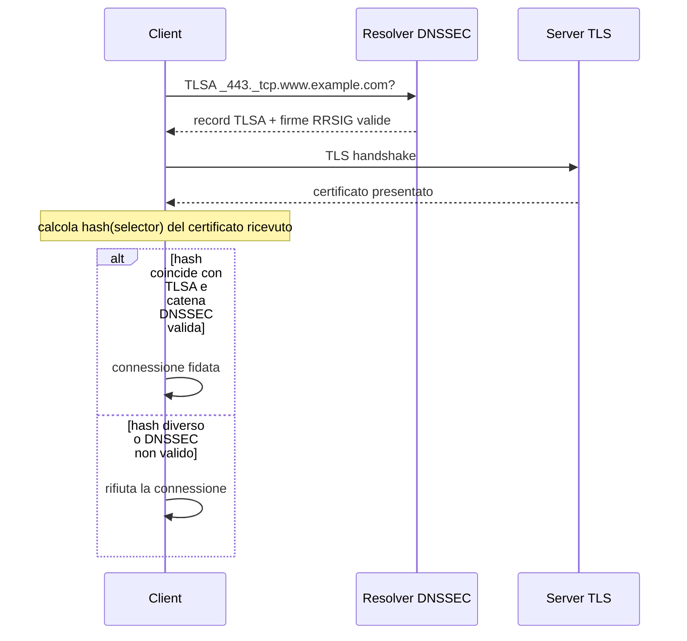

## Perché conta

Il modello di fiducia TLS classico è "tutti i browser e sistemi operativi accettano circa 150 Certification
Authority, e ciascuna può emettere un certificato valido per *qualsiasi* dominio". Basta che una sola CA venga
compromessa, costretta da un governo o semplicemente commetta un errore di validazione — è successo più volte,
da DigiNotar nel 2011 a diversi incidenti minori registrati nei log di
[Certificate Transparency]() — perché un attaccante ottenga un
certificato illegittimo per il tuo nome. Certificate Transparency aiuta a *scoprirlo dopo*, ma non impedisce
che un client accetti quel certificato nel frattempo.

DANE (RFC 6698) attacca il problema da un'altra direzione: pubblica l'ancora di fiducia direttamente nel DNS,
sotto forma di record `TLSA`, e protegge quel record con [DNSSEC](https://www.iana.org/dnssec). Chi controlla
le firme DNSSEC della tua zona — tu — decide quali certificati sono legittimi per il tuo nome, indipendentemente
da quante CA esistono nel mondo.

## Come funziona

Un record `TLSA` vive sotto un nome speciale che codifica porta e protocollo, nella forma
`_porta._protocollo.host`. Per HTTPS su `www.example.com`:

```
_443._tcp.www.example.com. IN TLSA 3 1 1 d2abde240d7cd3ee6b4b28c54df034b9...
```

Quattro campi dopo il tipo:

- **Usage** (0–3): `0`/`1` validano anche tramite la PKI pubblica (CA constraint / certificate pinning
  classico), `2`/`3` ignorano le CA e si fidano solo del DNS (`3` è il più comune: *DANE-EE*, pinning diretto
  della chiave del certificato end-entity).
- **Selector** (0–1): `0` pinna il certificato intero, `1` solo la sua chiave pubblica (SubjectPublicKeyInfo) —
  utile perché la chiave può restare la stessa attraverso un rinnovo del certificato.
- **Matching type** (0–2): `0` dato raw, `1` SHA-256, `2` SHA-512 del campo selezionato.
- **Dati di associazione**: l'hash (o il dato raw) da confrontare con quanto il server presenta in TLS.

Un client DANE-aware fa due verifiche indipendenti:



Senza DNSSEC il meccanismo non vale nulla: un attaccante on-path potrebbe falsificare sia il certificato che il
record TLSA. È per questo che DANE è, di fatto, un'applicazione di DNSSEC — non un'alternativa a esso.

## Il limite: dove DANE non arriva

DANE non è un "attacco" da dimostrare con un exploit: è un meccanismo di difesa, e il suo punto debole è
operativo, non un bug sfruttabile. Il problema principale è l'adozione lato client: nessun browser maggiore
(Chrome, Firefox, Safari) verifica TLSA per HTTPS, per scelta di design — i proponenti di Chrome e Firefox
hanno ritenuto DNSSEC troppo fragile come unico fattore di fiducia su scala globale, dopo discussioni pubbliche
durate anni. DANE per HTTPS resta quindi un controllo che solo strumenti dedicati (`openssl`, `kdig`, librerie
come `getdns`) verificano davvero.

Dove DANE è invece ampiamente operativo è SMTP (RFC 7672): molti grandi provider di posta (tra cui diversi
operatori `.de` e `.nl`, oltre a Mailbox.org e Posteo) pubblicano TLSA per i propri MX e, quando un mittente
lo supporta, rifiutano la consegna in chiaro o verso un server che presenta un certificato diverso da quello
pinnato — mitigando il downgrade a cui SMTP opportunistico (`STARTTLS` senza verifica) è altrimenti esposto, e
che un attaccante on-path può forzare semplicemente rimuovendo l'annuncio `STARTTLS` in transito.

Per verificare se un MX pubblica TLSA, senza bisogno di alcun exploit, basta interrogare il DNS:

```bash
# TLSA del server di posta, e verifica che la zona sia firmata (richiede un resolver DNSSEC-validating)
kdig +dnssec TLSA _25._tcp.mx1.example.com
```

## La difesa (ovvero: come attivarlo)

**1. Firmare la zona con DNSSEC.** Prerequisito assoluto; senza questo passo i record TLSA sono inutili e
anzi un falso senso di sicurezza. La maggior parte dei DNS hosting (Cloudflare, Route 53, PowerDNS, BIND con
`dnssec-policy`) lo attiva con un comando o una casella di spunta.

**2. Generare e pubblicare il record TLSA.** Con OpenSSL, per il certificato end-entity usato da un MX:

```bash
openssl x509 -in /etc/ssl/certs/mail.crt -noout -pubkey \
  | openssl pkey -pubin -outform DER \
  | openssl dgst -sha256 -hex | awk '{print $2}'
# incollare l'hash risultante in:
# _25._tcp.mail.example.com. IN TLSA 3 1 1 <hash>
```

Usare *selector 1* (chiave pubblica, non certificato intero) e pubblicare **due** record TLSA — uno per la
chiave corrente e uno per quella del prossimo rinnovo — evita l'interruzione di servizio nella finestra tra
rinnovo del certificato e propagazione del nuovo TLSA (RFC 7671 ne parla esplicitamente).

**3. Attivare la verifica DANE lato Postfix**, per chi invia posta verso domini che la pubblicano:

```postfix {hl_lines=[2,3,5]}
# /etc/postfix/main.cf
smtp_dns_support_level = dnssec
smtp_tls_security_level = dane
smtp_tls_CAfile =
smtpd_tls_security_level = may
smtp_tls_loglevel = 1
```

Le righe evidenziate: `smtp_dns_support_level = dnssec` impone che le risposte DNS usate per il TLS siano
validate DNSSEC (altrimenti Postfix non alza mai il livello di sicurezza a `dane`); `smtp_tls_security_level
= dane` dice a Postfix di cercare un TLSA per il destinatario e, se lo trova, di autenticare *solo* tramite
quello (bypassando la PKI pubblica); se il domino di destinazione non pubblica TLSA, Postfix ricade comunque
su TLS opportunistico, quindi l'attivazione non rompe la consegna verso chi non supporta DANE.

Si verifica l'esito nei log con `postconf -n` più `grep dane /var/log/mail.log`, oppure inviando un test con
`swaks --tls ... -s mx.example.com`.

## Lab

Obiettivo: generare manualmente il record TLSA per un certificato locale e verificarlo con `openssl`, simulando
cosa farebbe un client DANE.

1. Genera un certificato self-signed di prova:
   ```bash
   openssl req -x509 -newkey rsa:2048 -nodes -keyout test.key -out test.crt \
     -days 30 -subj "/CN=test.example.com"
   ```
2. Calcola l'hash SHA-256 della sua chiave pubblica (selector 1, matching type 1):
   ```bash
   openssl x509 -in test.crt -noout -pubkey | openssl pkey -pubin -outform DER \
     | openssl dgst -sha256 -hex
   ```
3. Avvia un listener TLS con quel certificato:
   ```bash
   openssl s_server -accept 8443 -cert test.crt -key test.key -www
   ```
4. Da un altro terminale, connettiti e recupera il certificato effettivamente presentato, poi confronta il suo
   hash con quello calcolato al passo 2: se coincidono, un client DANE con quel TLSA accetterebbe la connessione.

Domanda: cosa succede, concettualmente, se rinnovi il certificato (nuova chiave) ma non aggiorni il TLSA prima
della propagazione DNS? E perché pubblicare *due* TLSA risolve il problema?


<details><summary>Soluzione</summary>
<p>Finché il DNS serve ancora il vecchio TLSA ma il server presenta già il nuovo certificato, l'hash calcolato
dal client non coincide più con quello pubblicato: ogni client DANE-aware rifiuta la connessione, anche se il
certificato è perfettamente valido per la PKI pubblica. È un'interruzione di servizio autoinflitta, non un
attacco. Pubblicare in anticipo <em>due</em> record TLSA — quello della chiave attuale e quello della chiave
che verrà usata dopo il prossimo rinnovo — elimina la finestra di rottura: qualunque dei due certificati il
server presenti, uno dei due TLSA coincide sempre. RFC 7671 raccomanda esplicitamente questo schema a "rotazione
sovrapposta" per chiunque automatizzi il rinnovo dei certificati (ad esempio con Let's Encrypt via ACME) e
voglia usare DANE in produzione.</p>
</details>


## Conclusione

DANE non sostituisce la PKI pubblica né Certificate Transparency: li completa, spostando l'ancora finale di
fiducia da "una qualunque tra 150 CA" a "chi controlla le firme DNSSEC della zona". Il prezzo è un prerequisito
pesante (DNSSEC configurato e mantenuto correttamente) e un'adozione lato client quasi nulla per HTTPS. Per SMTP
invece, dove TLS è spesso solo opportunistico e quindi facilmente degradabile da chi sta on-path, DANE è oggi
uno dei pochi strumenti che rende quel downgrade rilevabile e, per i mittenti che lo rispettano, bloccante.

**Articoli correlati:** [Certificate Transparency]() ·
[TLS in profondità]() ·
[DNS tunneling detection]()
