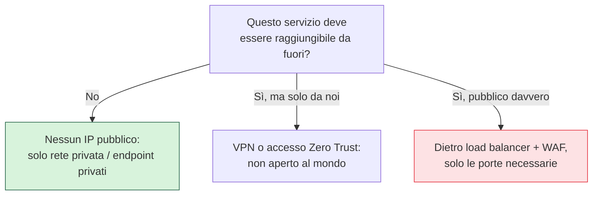

## Perché conta

Disegnata la [rete interna](), la domanda che determina il tuo
rischio è: *cosa è raggiungibile da Internet?* Ogni endpoint pubblico — un IP, un load balancer, una
API, una porta aperta — è un punto che chiunque, da ovunque, può provare ad attaccare. Nel cloud è
sorprendentemente facile esporre qualcosa senza volerlo: un IP pubblico assegnato di default, un
database aperto "per un test", una console di gestione raggiungibile. Ridurre la superficie d'attacco è
il modo più efficace di ridurre il rischio: ciò che non è esposto non può essere colpito dall'esterno.

## La gerarchia della riduzione



La prima domanda per ogni servizio è "deve davvero stare su Internet?". La maggior parte delle volte la
risposta è no: database, code, servizi interni, pannelli di gestione non hanno motivo di essere
pubblici. Ciò che resta pubblico per necessità (un sito, una API) va **dietro un load balancer e un
WAF**, esponendo solo le porte strettamente necessarie.

## Il WAF: filtrare il traffico applicativo

Per ciò che è legittimamente pubblico, un **Web Application Firewall** ispeziona le richieste HTTP e
blocca pattern malevoli — injection, cross-site scripting, scanner automatici — prima che raggiungano
l'applicazione. I WAF cloud (AWS WAF, Azure/GCP equivalenti) offrono regole gestite contro le minacce
note (OWASP Top 10), rate limiting contro gli abusi, e blocco geografico o per reputazione dell'IP. Non
sostituisce il codice sicuro, ma ferma il rumore di fondo e dà tempo per reagire.

## Endpoint privati: parlare senza Internet

Spesso servizi del provider (storage, database gestiti, code) sono raggiungibili tramite endpoint
pubblici anche quando li usi solo internamente — e il traffico esce e rientra da Internet senza
bisogno. Gli **endpoint privati (PrivateLink, Private Endpoint, Private Service Connect)** creano un
punto d'accesso al servizio *dentro* la tua rete privata: il traffico non tocca mai Internet, riduci la
superficie e spesso anche i costi di trasferimento.

```text {hl_lines=[2,3]}
Porte di gestione MAI su Internet:
  SSH (22), RDP (3389), console DB → via bastion, VPN o accesso Zero Trust
  mai "0.0.0.0/0 porta 22" — è l'invito aperto numero uno ai bruteforce
```

## Conclusione

La superficie d'attacco è ciò che esponi: la regola è esporre il meno possibile, mettere un WAF davanti
a ciò che resta pubblico, e usare endpoint privati per far parlare i servizi senza passare da Internet —
e mai, mai lasciare le porte di gestione aperte al mondo.


<details>
<summary><strong>Domanda:</strong> ridurre l'esposizione a zero e mettere tutto dietro VPN non rende il lavoro quotidiano scomodissimo? A volte aprire una porta "al volo" fa risparmiare ore.</summary>
<p>La porta aperta "al volo" è precisamente il meccanismo con cui avviene una quota enorme di
compromissioni, e la scomodità che eviti è minuscola rispetto a ciò che rischi — ma il punto vero è che
la scelta non è tra "sicuro e scomodo" o "insicuro e comodo": gli strumenti moderni rendono l'accesso
sicuro anche comodo. Una porta SSH o RDP aperta a <code>0.0.0.0/0</code> viene trovata da scanner
automatici nel giro di minuti, non giorni: Internet è scandito in continuazione, e un database o una
console di gestione esposti ricevono tentativi di bruteforce e di exploit quasi immediatamente. Il
risparmio di "qualche ora" di configurazione si paga con un incidente che costa settimane. Ma la
dicotomia è falsa: l'accesso Zero Trust moderno (identity-aware proxy, bastion gestiti, soluzioni di
accesso effimero) ti fa raggiungere una macchina privata con un comando, autenticandoti con la tua
identità e MFA, <em>senza</em> aprire alcuna porta a Internet e <em>senza</em> gestire una VPN pesante —
spesso è più comodo che ricordare IP e chiavi. Per gli accessi occasionali esistono i permessi
just-in-time: apri l'accesso per te, per dieci minuti, tracciato, e si richiude da solo. La "porta al
volo" è una scorciatoia che sembra gratis solo perché il conto arriva dopo, a nome di qualcun altro. La
comodità sostenibile si costruisce con gli strumenti giusti, non lasciando buchi.</p>
</details>


Ridotta l'esposizione esterna, il passo successivo è ripensare la fiducia *interna*: non basta essere
"dentro la rete" per essere fidati. È il [Zero Trust nel
cloud](), prossimo capitolo.
