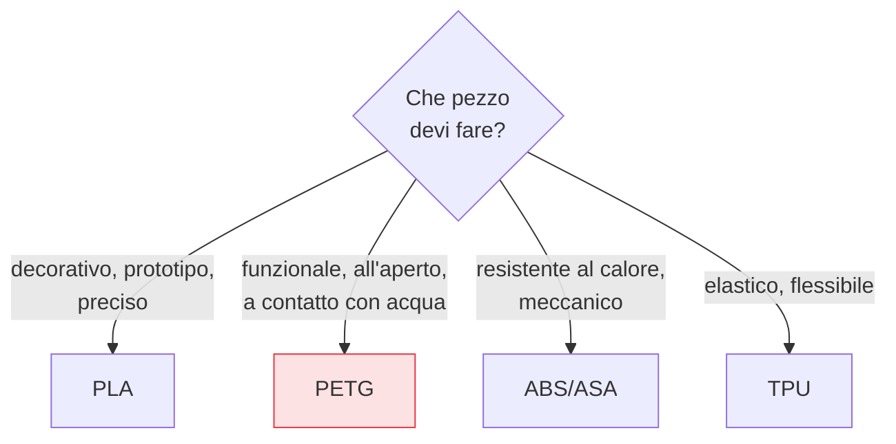

## Perché conta

La [macchina]() fonde ciò che le dai, ma ogni plastica
fonde, si contrae e aderisce in modo diverso. Scegliere il materiale sbagliato per un pezzo condanna
la stampa prima di premere "start": un ABS stampato senza camera chiusa si deformerà, un PLA in auto
d'estate si affloscerà. Capire i filamenti significa scegliere quello giusto per lo scopo, e
impostarlo bene.

## I quattro materiali che userai

```text {hl_lines=[2,3]}
            Facilità   Resistenza   Temp. d'uso   Note
PLA         altissima  media        bassa (~60°C) il default: facile, preciso, ecologico, ma fragile al calore
PETG        media      buona        media (~80°C) robusto e tenace, resiste all'acqua; tende a fare fili
ABS/ASA     bassa      alta         alta (~100°C) tecnico, resiste al calore; WARPA molto, serve camera chiusa, fumi
TPU         media      flessibile   -             gomma: per pezzi elastici; va stampato LENTO, meglio direct drive
```

- **PLA**: il punto di partenza di tutti. Facilissimo, preciso, poco warping. Il limite è termico:
  perde rigidità già a ~60 °C, quindi niente pezzi esposti al sole o al calore.
- **PETG**: il "tuttofare" robusto. Più tenace del PLA, resiste all'acqua e a più calore. In cambio
  tende a fare [fili (stringing)]() e attacca
  troppo bene al piano (rischio di danneggiarlo).
- **ABS/ASA**: tecnico, resistente al calore e agli urti, ma difficile: si contrae molto
  ([warping]()) e richiede una camera chiusa e ventilazione per
  i fumi.
- **TPU**: flessibile, gommoso. Per guarnizioni, cover, pezzi elastici. Va stampato lento e si trova
  meglio con un estrusore diretto.

## La regola di scelta



Nel dubbio, per imparare: **PLA**. Per un pezzo che deve *servire* davvero: **PETG**. Gli altri due
sono scelte mirate quando servono proprietà specifiche che giustificano la maggiore difficoltà.

## Il nemico silenzioso: l'umidità

Il problema di cui quasi nessuno parla finché non lo subisce. I filamenti sono **igroscopici**:
assorbono umidità dall'aria. Un filo bagnato stampa male in modi che sembrano guasti della macchina:

```text {hl_lines=[2]}
Sintomi di filamento umido:
  crepitii/vapore dal nozzle, superficie opaca e rugosa, bolle, stringing improvviso, fragilità
→ non è la stampante: è il filamento che ha assorbito acqua (specie PETG, TPU, nylon)
```

L'acqua intrappolata evapora nell'hotend e disturba l'estrusione. La cura: conservare i filamenti in
contenitori sigillati con **essiccante**, e *asciugarli* (essiccatore o forno a bassa temperatura)
quando mostrano i sintomi. PLA regge meglio; PETG, TPU e soprattutto nylon vanno tenuti all'asciutto
con cura.


<details>
<summary><strong>Domanda:</strong> se il PETG è più robusto del PLA e resiste di più al calore e all'acqua, perché non usarlo sempre al posto del PLA ed evitare di gestire due materiali?</summary>
<p>Perché "più robusto" non significa "migliore per ogni scopo", e il PLA vince proprio nei casi — tanti —
dove la robustezza termica non serve ma contano precisione, facilità e aspetto. Vediamo i compromessi
concreti che pagheresti usando sempre PETG. Primo, la <em>precisione dei dettagli</em>: il PLA ha un
ritiro bassissimo e una viscosità che gli permette dettagli nitidi, spigoli netti, ponti puliti; il PETG
è più "colloso", tende a fare fili (stringing) tra le parti, sbava sui dettagli fini e richiede una
calibrazione del ritiro più attenta per ottenere lo stesso risultato. Per un modello decorativo, una
miniatura, un prototipo visivo, il PLA esce più bello con meno sforzo. Secondo, la <em>facilità e la
ripetibilità</em>: il PLA perdona quasi tutto — aderisce bene, warpa pochissimo, non ti serve una camera
chiusa, va a temperature basse; il PETG attacca al piano anche troppo (rischi di scheggiare la superficie
di stampa staccando il pezzo), è più sensibile all'umidità, e ha una finestra di stampa più stretta. Per
chi impara, ogni stampa in PETG ha più modi di andare storta. Terzo, il <em>costo e la sostenibilità</em>:
il PLA è economico, deriva da fonti rinnovabili ed è più gradevole da maneggiare. Quarto, e qui sta il
punto che ribalta la tua premessa: la "fragilità" del PLA è in realtà <em>rigidità</em>. Il PLA è più
rigido del PETG, quindi per un pezzo che deve mantenere la forma sotto un carico statico e non prendere
urti, il PLA può essere perfino preferibile; il PETG è più <em>tenace</em> (assorbe gli urti senza
rompersi di netto) e flessibile, il che è un vantaggio per pezzi che subiscono colpi o flessioni ma uno
svantaggio dove vuoi rigidità. Quindi la scelta non è "il forte contro il debole", è "lo strumento giusto
per il carico giusto": PLA per precisione, rigidità, facilità e pezzi che non scaldano; PETG per
resistenza agli urti, all'acqua, al calore moderato e all'uso esterno. Gestire due materiali non è una
complicazione gratuita, è avere due strumenti con punti di forza complementari — e proprio perché il PLA è
così facile e il PETG così versatile, questa coppia copre da sola la maggior parte dei bisogni reali.</p>
</details>


## Conclusione

Ogni filamento è un compromesso: PLA facile e preciso ma poco resistente al calore, PETG robusto e
versatile ma incline ai fili, ABS tecnico ma difficile, TPU flessibile; e tutti temono l'umidità, il
nemico silenzioso. Scelto il materiale, bisogna trasformare il modello 3D in istruzioni che la macchina
possa eseguire con quel filamento: è il lavoro dello slicer, che produce il G-code. Prossimo capitolo.
