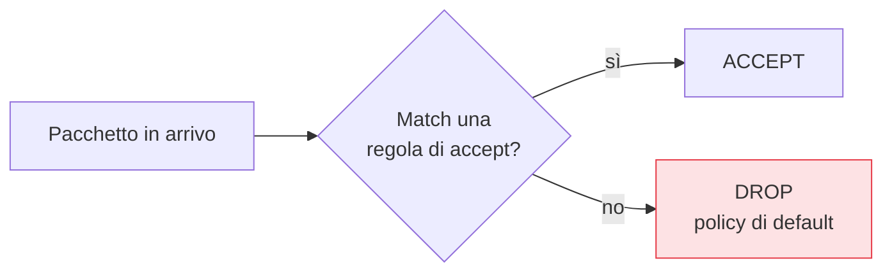

## Perché conta

Il [capitolo sui servizi]() ha ridotto cosa gira; il
firewall decide cosa, di ciò che gira, è *raggiungibile dalla rete*. È la seconda rete di sicurezza: se
per errore un servizio resta in ascolto su tutte le interfacce, un firewall in **default drop** lo
protegge comunque. **nftables** è il framework moderno (sostituisce iptables): una sintassi unica per
IPv4 e IPv6, più leggibile, con tabelle, catene e set.

## Il principio: default drop

La policy di default di una catena di input deve essere **drop**: tutto bloccato, si aprono solo le
eccezioni necessarie. L'opposto (default accept + blocca alcune cose) lascia sempre buchi per ciò che
hai dimenticato.



## Un ruleset completo

Il file vive in `/etc/nftables.conf`. Questo è un punto di partenza solido per un server:

```text {hl_lines=[7,12,13,18]}
#!/usr/sbin/nft -f
flush ruleset

table inet filter {
    chain input {
        type filter hook input priority 0;
        policy drop;                          # DEFAULT DROP: tutto negato salvo eccezioni

        iif "lo" accept                       # traffico di loopback sempre ok
        ct state established,related accept   # risposte alle connessioni che abbiamo iniziato
        ct state invalid drop                 # pacchetti malformati/fuori stato

        ip protocol icmp accept               # ping (opzionale)
        ip6 nexthdr ipv6-icmp accept          # ICMPv6 è necessario per IPv6

        # SSH con rate limiting: max 4 nuove connessioni/minuto per IP
        tcp dport 22 ct state new limit rate 4/minute accept

        # servizi pubblici
        tcp dport { 80, 443 } accept
    }
    chain forward { type filter hook forward priority 0; policy drop; }
    chain output  { type filter hook output  priority 0; policy accept; }
}
```

Punti chiave: `ct state established,related accept` è ciò che rende il firewall **stateful** — non devi
aprire porte per le *risposte* al traffico che inizi tu. Il `limit rate` su SSH taglia i bruteforce
alla fonte. `policy drop` sulla catena forward impedisce che la macchina inoltri traffico se non glielo
chiedi esplicitamente.

## Applicare e rendere persistente

```bash
nft -c -f /etc/nftables.conf      # -c = check: valida SENZA applicare
systemctl enable --now nftables   # applica al boot e ora
nft list ruleset                  # mostra il ruleset attivo
```

Come per SSH, **non chiuderti fuori**: se amministri da remoto, assicurati che la regola SSH sia
presente *prima* di applicare un default drop, e tieni una sessione aperta.

## Set e restrizioni per sorgente

I **set** rendono le regole compatte e manutenibili — per esempio aprire SSH solo dalle reti fidate:

```text {hl_lines=[2,3,6]}
table inet filter {
    set admin_nets { type ipv4_addr; flags interval;
                     elements = { 10.0.0.0/8, 192.168.1.0/24 } }
    chain input {
        # ... (loopback, established come sopra) ...
        ip saddr @admin_nets tcp dport 22 accept   # SSH SOLO dalle reti admin
    }
}
```

Limitare SSH alle sole reti di amministrazione è più forte di qualunque rate limit: l'Internet pubblico
non raggiunge nemmeno la porta.


<details>
<summary><strong>Domanda:</strong> se ho già ridotto i servizi in ascolto e indurito SSH, il firewall non è ridondante? Perché bloccare ciò che tanto non è raggiungibile perché il servizio non c'è?</summary>
<p>È ridondante nel senso buono del termine — è <em>difesa in profondità</em>, cioè protezione che vale
proprio quando gli altri strati falliscono, ed è per questo che non va saltata. Ridurre i servizi e
indurire SSH riduce la superficie, ma dipende dal fatto che tu l'abbia fatto <em>correttamente e per
sempre</em>, su un sistema che cambia. Pensa a cosa copre il firewall che gli altri strati no. Primo, gli
errori e le derive: domani installi un pacchetto che avvia un servizio in ascolto su
<code>0.0.0.0</code> senza che tu te ne accorga, o un collega lo fa, o un aggiornamento riabilita
qualcosa. Con default drop, quel servizio resta irraggiungibile da fuori finché non apri la porta
esplicitamente — il firewall trasforma "esposto per sbaglio" in "comunque bloccato". Secondo, il binding
sbagliato: un servizio che credevi legato a localhost potrebbe ascoltare su tutte le interfacce per un
default o un errore di configurazione; il firewall è l'ultima barriera. Terzo, la restrizione per
sorgente, che i servizi da soli non sanno fare: con i set puoi dire "SSH solo dalle reti admin", cosa che
SSH stesso non filtra a livello di rete — e questo rende l'Internet pubblico incapace persino di
raggiungere la porta, altro che bruteforce. Quarto, lo stateful tracking e il drop dei pacchetti invalid
proteggono da traffico malformato a prescindere dai servizi. Il principio è che ogni strato presume che
gli altri possano fallire: se ti affidi solo alla riduzione dei servizi, basta un errore una volta per
restare esposto; con il firewall in default drop, quell'errore è coperto. Costa un file di
configurazione e vale ogni volta che qualcos'altro va storto — che, su un sistema vivo, è una
questione di quando, non di se.</p>
</details>


## Conclusione

nftables in default drop, stateful, con rate limit su SSH e restrizioni per sorgente via set, è la
barriera di rete che protegge anche dagli errori degli altri strati. Il firewall e la riduzione dei
servizi lavorano insieme sullo stesso obiettivo: la superficie di rete. Vediamola in modo sistematico —
cosa ascolta, dove, e come restringerlo — nel [prossimo capitolo]().
