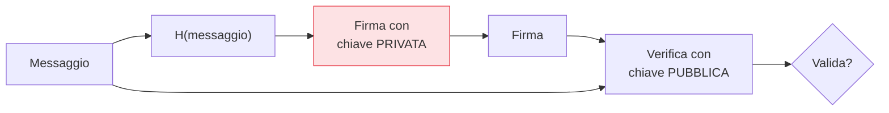

## Perché conta

Lo [scambio di chiavi]() concorda un segreto ma
non autentica. L'[HMAC]() autentica, ma è
simmetrico: chi verifica può anche forgiare. La **firma digitale** è l'autenticazione *asimmetrica*:
si firma con la chiave privata, chiunque verifica con quella pubblica, e chi verifica **non** può
creare firme. È il meccanismo dietro i certificati TLS, la [firma del software](),
i commit firmati, gli aggiornamenti verificati.

## Tre garanzie in una



Una firma valida garantisce contemporaneamente:

- **Autenticità**: viene da chi possiede la chiave privata corrispondente a quella pubblica.
- **Integrità**: il messaggio non è stato alterato (la firma non combacerebbe più).
- **Non ripudio**: il firmatario non può negare di aver firmato — proprietà che l'HMAC *non* ha,
  perché lì anche il verificatore conosce la chiave e avrebbe potuto produrre il tag.

Il non ripudio è ciò che distingue la firma dal MAC: con una firma, solo *una* persona al mondo poteva
produrla.

## Perché si firma l'hash

Non si firma mai il messaggio intero, ma il suo **hash**:

```text {hl_lines=[2]}
firma = Sign(chiave_privata, H(messaggio))
# 1. efficienza: l'asimmetrica è lenta → firmi 32 byte di hash, non 2 GB di file
# 2. la sicurezza della firma eredita dalla resistenza alle collisioni dell'hash
```

È anche il motivo per cui un hash rotto rovina la firma: se un attaccante trova due messaggi con lo
stesso hash ([collisione]()), una firma valida per uno vale
anche per l'altro. Per questo le firme usano SHA-256 o più, mai SHA-1.

## ECDSA, EdDSA e il pericolo del nonce

Gli algoritmi di firma su curve ellittiche:

- **ECDSA**: lo standard diffuso. Ha un punto delicato: richiede un valore casuale ($k$, un nonce) per
  *ogni* firma, e quel valore deve essere unico e imprevedibile.
- **EdDSA (Ed25519)**: progettato per eliminare proprio quel rischio. È deterministico (il nonce deriva
  da chiave e messaggio), veloce, con chiavi corte. **È la scelta preferibile oggi.**

Il pericolo del nonce in ECDSA non è teorico:

```text {hl_lines=[2]}
Nonce k riusato o prevedibile in ECDSA → la chiave PRIVATA si ricava dalle firme
  (è successo davvero: console di gioco, wallet — chiavi estratte da firme con k debole)
→ un motivo in più per preferire Ed25519, che rende il nonce deterministico e sicuro by design.
```

Riusare — o anche solo generare male — il nonce $k$ permette di calcolare la chiave privata partendo
dalle firme pubbliche. È accaduto a sistemi reali. EdDSA toglie l'arma dalle mani di chi implementa.

## Firma non è cifratura

Un equivoco comune ("firmare = cifrare con la privata"). Concettualmente sono operazioni distinte, con
scopi opposti: la cifratura protegge la *riservatezza* (nasconde), la firma protegge
*autenticità e integrità* (non nasconde nulla, un messaggio firmato è in chiaro). Gli standard moderni
le trattano come primitive separate. Usa una libreria che offre "firma" e "verifica" esplicite, non
costruzioni fatte a mano.


<details>
<summary><strong>Domanda:</strong> il "non ripudio" vale davvero in pratica? Se qualcuno mi ruba la chiave privata, può firmare a mio nome — quindi come fa una firma a provare che sono stato io?</summary>
<p>Hai colto la tensione esatta tra la proprietà <em>crittografica</em> e la proprietà <em>legale/pratica</em>
del non ripudio, e vale la pena separarle perché è lì che nascono i fraintendimenti. Dal punto di vista
crittografico, il non ripudio afferma una cosa precisa e vera: una firma valida poteva essere prodotta
<em>solo</em> da chi possedeva la chiave privata, perché nessun altro — nemmeno chi verifica, a differenza
dell'HMAC — è matematicamente in grado di generarla. Questo è forte e reale: la firma lega in modo
infalsificabile un messaggio a una specifica chiave privata. Ma, e qui sta il tuo punto, lega il messaggio
alla <em>chiave</em>, non direttamente alla <em>persona</em>; il ponte tra "questa chiave" e "questa
persona" non è crittografico, è organizzativo e dipende interamente dalla premessa che la chiave privata
sia rimasta sotto il controllo esclusivo del suo titolare. Se quella premessa cade — chiave rubata,
copiata, usata da un malware, custodita male — allora la firma prova ancora che "la chiave ha firmato", ma
non più che "la persona ha voluto firmare". Ecco perché il non ripudio nella pratica non è una proprietà
che la matematica ti regala da sola, è il risultato di un sistema attorno alla chiave: custodia in
hardware non esportabile (smartcard, HSM, Secure Enclave) così la chiave non lascia mai il dispositivo;
protezione d'uso (PIN, biometria) così il possesso del dispositivo non basta; e soprattutto meccanismi di
<em>revoca</em> e <em>timestamp</em>. La revoca è decisiva: quando sospetti una compromissione, dichiari
la chiave revocata a una certa data, e da quel momento le firme non sono più accettate; i timestamp fidati
permettono di stabilire se una firma è stata prodotta <em>prima</em> della revoca (valida) o dopo (da
rigettare). È la stessa logica della PKI che vedremo nel prossimo capitolo. Quindi la risposta onesta: la
firma fornisce un non ripudio crittografico robusto <em>condizionato</em> alla sicurezza della chiave
privata, e trasformarlo in non ripudio affidabile nel mondo reale richiede di proteggere la chiave in modo
che "possedere la chiave" coincida davvero con "essere la persona", più l'infrastruttura di revoca per
gestire i casi in cui quella coincidenza si rompe. Non è un difetto della firma: è il confine tra ciò che
la crittografia può garantire (chi ha la chiave) e ciò che deve garantire il sistema (chi è la persona).</p>
</details>


## Conclusione

Le firme digitali danno autenticità, integrità e non ripudio: si firma l'hash con la chiave privata, si
verifica con la pubblica, e Ed25519 è preferibile a ECDSA perché elimina il rischio del nonce che ha
già svuotato chiavi reali. Ma resta il nodo sollevato dal capitolo sull'asimmetrica e qui sul non
ripudio: *di quale chiave pubblica mi fido, e perché?* Legare una chiave a un'identità è il compito
della PKI, prossimo capitolo.
