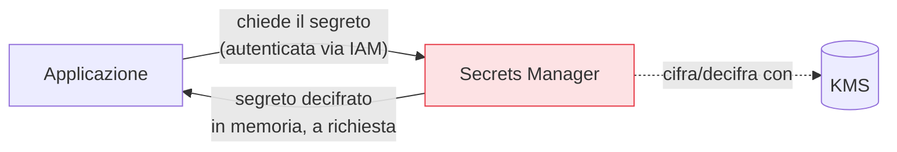

## Perché conta

L'[identità dei workload]() elimina le chiavi del cloud, ma
restano i segreti che il cloud non gestisce per te: la password del database, il token dell'API di
pagamento, la chiave di un partner, un certificato privato. Metterli in chiaro nel codice, in un file
`.env` committato, o in una variabile d'ambiente leggibile da chiunque ispezioni il processo, è un
errore classico e devastante. Servono due strumenti distinti ma collegati: un **secrets manager** per
custodire i segreti, e un **KMS** per gestire le chiavi che li cifrano.

## Secrets manager: la cassaforte

Un secrets manager (AWS Secrets Manager, Azure Key Vault, GCP Secret Manager, HashiCorp Vault)
conserva i segreti **cifrati a riposo**, li espone solo a identità autorizzate via IAM, ne tiene le
**versioni** e può **ruotarli** automaticamente.



Il valore non sta più nel codice: l'applicazione lo chiede a runtime, autenticandosi con la sua
identità di workload. Così il segreto si cambia senza ridistribuire l'app, e ogni accesso è tracciato.

## KMS e la crittografia a busta

Il KMS (Key Management Service) non conserva i tuoi dati: gestisce le **chiavi**. Il meccanismo
centrale è la **crittografia a busta (envelope encryption)**: invece di cifrare gigabyte di dati con la
chiave master (che non lascia mai il KMS), si genera una **chiave dati** usa-e-getta, con questa si
cifrano i dati, e si conserva solo la chiave dati a sua volta cifrata dalla master.

```text {hl_lines=[2,4]}
1. KMS genera una Data Key  → in chiaro (DK) + cifrata dalla master (DK_enc)
2. Cifri i dati con DK      → poi CANCELLI DK dalla memoria
3. Salvi insieme ai dati:   DK_enc  (la chiave dati cifrata)
4. Per decifrare: mandi DK_enc al KMS → ti ridà DK → decifri → scarti DK
```

Formalmente, con dati $D$, chiave dati $K$ e chiave master $M$:

$$ C = \text{Enc}_K(D), \qquad K_{enc} = \text{Enc}_M(K) $$

si archivia la coppia $(C, K_{enc})$ e la master $M$ resta sempre dentro il KMS. Il vantaggio: la
chiave master, la più preziosa, non esce mai e non tocca mai i dati; ruotarla o revocarla ha effetto
immediato; e i permessi d'uso delle chiavi passano per l'IAM, quindi puoi dire *chi* può decifrare
*cosa* senza dare a nessuno la chiave in mano.

## Rotazione: il segreto che cambia

Un segreto che non cambia mai è un segreto che, se trapela, resta valido per sempre. La **rotazione**
periodica — automatica dove possibile — limita la finestra d'esposizione. I secrets manager moderni
ruotano le credenziali di database generando la nuova, aggiornandola sul database e nel segreto in modo
coordinato, senza downtime.


<details>
<summary><strong>Domanda:</strong> se l'applicazione deve comunque leggere il segreto in chiaro per usarlo, e un attaccante che compromette l'app può leggerlo dalla memoria, a cosa serve tutta l'infrastruttura di secrets manager e KMS?</summary>
<p>Serve a moltissimo, perché cambia completamente la <em>superficie</em> e la <em>durata</em>
dell'esposizione, anche se è vero che nessun sistema può nascondere un segreto all'applicazione che lo
deve usare. Senza secrets manager, il segreto è esposto <em>ovunque e sempre</em>: nel codice sorgente
(quindi in Git, nella cronologia, in ogni clone, in ogni fork), nei file di configurazione, nelle
immagini dei container, nei backup, nei log di deploy. Un attaccante non ha bisogno di compromettere
l'app in esecuzione: gli basta trovare il repository, un backup o un'immagine. Con il secrets manager, il
segreto esiste in chiaro solo <em>in memoria, nel processo vivo, per il tempo d'uso</em>: per rubarlo
devi compromettere quel processo specifico in quel momento, che è enormemente più difficile che trovare
una stringa in un file. In più ottieni tre cose che il segreto in chiaro non dà: <em>tracciamento</em>
(sai chi e quando ha letto il segreto, quindi un accesso anomalo si vede), <em>rotazione</em> (se
sospetti una fuga, cambi il segreto in un punto solo e tutte le app lo prendono nuovo, senza
ridistribuire nulla), e <em>controllo d'accesso</em> (solo le identità autorizzate via IAM lo leggono,
non "chiunque abbia accesso al filesystem"). Sul KMS il discorso è ancora più netto: la chiave master
non entra <em>mai</em> nella memoria dell'applicazione — l'app manda al KMS la chiave dati cifrata e
riceve quella in chiaro, ma la master resta nel modulo hardware del provider, irraggiungibile anche se
l'app è completamente compromessa. La sicurezza perfetta non esiste; ridurre l'esposizione da "sempre, in
mille posti" a "solo in memoria, nel momento d'uso, tracciata e revocabile" è esattamente il lavoro che
conta.</p>
</details>


## Conclusione

I segreti inevitabili vanno in un secrets manager — cifrati, versionati, ruotabili, serviti a runtime
all'identità autorizzata — e il KMS gestisce le chiavi con la crittografia a busta, tenendo la master
sempre al sicuro. Questo meccanismo di cifratura non riguarda solo i segreti: è la base per proteggere
*tutti* i dati a riposo e in transito. È il tema della [crittografia dei dati nel
cloud](), prossimo capitolo.
