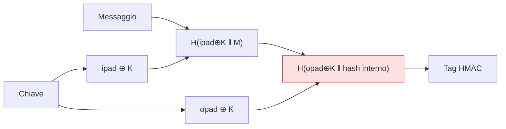

## Perché conta

L'[hash]() dimostra che i dati non sono cambiati, ma non
*chi* li ha prodotti: un attaccante che controlla il canale cambia dati e hash insieme. Il **MAC
(Message Authentication Code)** chiude il buco legando l'integrità a una **chiave segreta**: solo chi
la possiede può generare un tag valido, e solo chi la possiede può verificarlo. È la stessa garanzia
di autenticità del tag AEAD, ma come primitiva a sé — usata ovunque ci siano token, webhook, API
firmate, cookie di sessione.

## Hash con chiave: l'idea giusta, l'implementazione sbagliata

L'intuizione è naturale: per autenticare, mescola la chiave segreta con il messaggio e fai l'hash.

```text {hl_lines=[3]}
Intuizione:  tag = H(chiave || messaggio)
# sembra ragionevole: solo chi ha la chiave produce il tag giusto...
# ...ma con gli hash della famiglia SHA-2 è VULNERABILE: length extension attack
```

Il problema è un dettaglio della *costruzione* di molti hash (Merkle–Damgård, come SHA-256): lo stato
interno è il digest stesso. Un attaccante che vede `H(chiave || messaggio)` può **estendere** il
messaggio — aggiungere dati in coda e calcolare un tag valido per `chiave || messaggio || extra`
*senza conoscere la chiave*. L'intuizione era giusta, la costruzione ingenua no.

## HMAC: la costruzione corretta

**HMAC** risolve il length extension con una doppia applicazione dell'hash e due derivazioni della
chiave:



L'hash esterno "sigilla" quello interno, rendendo inefficace l'estensione. Il bello è che HMAC usa una
qualsiasi funzione di hash come componente: **HMAC-SHA256** è lo standard di fatto. Non si implementa a
mano — ogni libreria crittografica lo offre pronto.

## Il confronto deve essere a tempo costante

Un errore sottile e frequente: verificare il tag con un confronto normale di stringhe.

```python {hl_lines=[2,5]}
# SBAGLIATO: '==' si ferma al primo byte diverso → il tempo rivela quanti byte combaciano
if tag_ricevuto == tag_atteso: ...

# GIUSTO: confronto a tempo costante, indipendente da dove differiscono
if hmac.compare_digest(tag_ricevuto, tag_atteso): ...
```

Un confronto che termina prima quando trova un byte diverso perde pochi microsecondi in meno: misurando
quei tempi, un attaccante ricostruisce il tag byte per byte (**timing attack**). Le librerie offrono un
confronto *a tempo costante* apposta: va usato sempre per dati segreti.

## MAC o firma?

Il MAC è **simmetrico**: la stessa chiave genera e verifica. Chi verifica può anche *forgiare*. Va
benissimo quando le due parti si fidano e condividono il segreto (la tua app che firma i propri
token). Quando invece chi verifica *non* deve poter generare — software distribuito al pubblico,
messaggi tra parti che non si fidano — serve l'asimmetria delle firme digitali, più avanti nella
serie.


<details>
<summary><strong>Domanda:</strong> se uso già AES-GCM, che è AEAD e autentica, perché dovrei conoscere l'HMAC? Non è ridondante?</summary>
<p>Non è ridondante perché risolvono lo stesso bisogno — autenticità e integrità — in contesti diversi, e
spesso te ne serve uno dove l'altro non si applica. AES-GCM autentica <em>ciò che cifra</em>: è la scelta
giusta quando devi insieme nascondere e proteggere dei dati. Ma moltissimi casi reali richiedono di
autenticare qualcosa che <em>non vuoi affatto cifrare</em>, ed è lì che vive l'HMAC. Pensa a un token di
sessione o a un JWT firmato: il payload spesso è leggibile di proposito (il client deve sapere chi è,
quando scade), ti serve solo garantire che nessuno lo abbia alterato — HMAC sul contenuto, nessuna
cifratura. Pensa ai webhook: un servizio esterno ti invia un evento in chiaro e allega un tag
HMAC-SHA256 calcolato con un segreto condiviso, così tu verifichi che l'evento venga davvero da lui e non
sia stato manomesso in transito; cifrarlo non avrebbe senso, deve poterlo leggere chi lo riceve. Pensa
alla firma delle richieste API (lo stile AWS SigV4): firmi gli header e il corpo con HMAC per provare
l'autenticità della chiamata, ma il contenuto resta quello che è. In tutti questi casi vuoi
<em>autenticità senza riservatezza</em>, e tirare dentro una cifratura AEAD solo per ottenere il tag
sarebbe goffo e spesso controproducente. C'è poi la questione del livello di astrazione: AES-GCM è un
AEAD che ti dà il tag come sottoprodotto del cifrare, mentre HMAC è la primitiva di autenticazione pura,
quella che usi anche come mattone dentro costruzioni più grandi — la derivazione di chiavi (HKDF è
costruito su HMAC), i meccanismi di challenge-response, la verifica di integrità di dati già cifrati con
altro. In breve: se devi cifrare, usa un AEAD e hai l'autenticazione inclusa; se devi autenticare dati
che restano in chiaro — token, webhook, richieste, messaggi tra parti che condividono un segreto — HMAC è
lo strumento diretto e corretto. Conoscerli entrambi ti fa scegliere quello giusto invece di piegare
l'uno al compito dell'altro.</p>
</details>


## Conclusione

Il MAC lega integrità e autenticità a una chiave segreta; HMAC è la costruzione corretta che evita il
length extension, con HMAC-SHA256 come standard, e va verificato con un confronto a tempo costante. Ma
il MAC è simmetrico: chi verifica può forgiare. Un caso particolare di "hash con chiave" merita un
capitolo a sé, perché quasi tutti lo sbagliano — proteggere le password, prossimo capitolo.
