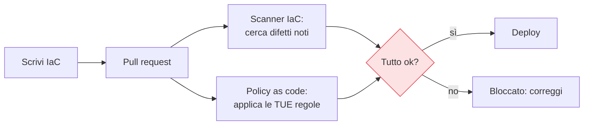

## Perché conta

Il [CSPM]() trova le misconfigurazioni *dopo* che sono state
create — nel migliore dei casi minuti dopo, quando il buco è già aperto. Se però l'infrastruttura è
**codice** (Terraform, CloudFormation, Bicep, Pulumi), c'è un'opportunità migliore: controllarla
*prima* che diventi reale. È lo **shift-left** applicato all'infrastruttura — spostare la verifica di
sicurezza il più a monte possibile, dove un difetto costa una riga da cambiare invece di un incidente
da gestire.

## Due controlli, un momento solo: la pipeline



Nella pipeline, prima di applicare l'infrastruttura, due controlli automatici:

- **Scanner IaC** (Checkov, tfsec, Trivy): cercano difetti *noti* nei template — un bucket senza
  cifratura, un security group aperto, il logging mancante — con un catalogo di regole pronte.
- **Policy as code** (OPA/Rego, Sentinel): impongono le *tue* regole, specifiche della tua
  organizzazione — "nessuna risorsa senza tag di owner", "solo queste region", "mai database pubblici",
  "sempre cifratura con chiave gestita da noi".

## Prevenire invece di inseguire

La differenza non è di strumento ma di *tempo*. Il CSPM è la guardia che trova la porta aperta durante
la ronda; la policy as code è la serratura che non lascia costruire una porta senza chiave. Una
misconfigurazione fermata in pull request non è mai esistita in produzione: zero finestra d'esposizione,
zero finding da smaltire, zero incidente possibile. È il modo più economico di fare sicurezza, perché il
costo di un difetto cresce enormemente man mano che avanza verso la produzione.

```text {hl_lines=[1,4]}
Costo di correggere un difetto, per stadio:
  in pull request   → una riga, zero rischio, secondi
  in produzione     → change gestito, test di regressione, finestra d'esposizione
  dopo un incidente → indagine, bonifica, notifica, danno reputazionale
```

## Il patto: guardrail, non cancelli chiusi

La policy as code funziona se non diventa un ostacolo che gli sviluppatori imparano ad aggirare. Il
modello giusto sono **guardrail chiari**: poche regole invalicabili e ben motivate (ciò che non deve
*mai* accadere), messaggi d'errore che spiegano *come* correggere, e un percorso di eccezione tracciato
per i casi legittimi. Regole oscure che bloccano tutto producono solo frustrazione e scorciatoie.


<details>
<summary><strong>Domanda:</strong> non tutta l'infrastruttura è gestita come codice — c'è sempre qualcuno che tocca la console a mano. Se la policy as code copre solo l'IaC, non è una difesa con un buco enorme che la rende quasi inutile?</summary>
<p>Il buco esiste ma non rende la difesa inutile — anzi, è proprio il motivo per cui policy as code e
CSPM sono complementari e vanno usati insieme, non in alternativa. La policy as code copre il percorso
<em>corretto</em>, quello in cui l'infrastruttura nasce da codice rivisto e controllato; il CSPM copre
tutto il resto, incluse le modifiche fatte a mano in console. Pensa a due reti di sicurezza a maglie
diverse: la policy as code impedisce che il difetto entri dalla porta principale (la pipeline), che è da
dove passa la maggior parte dei cambiamenti in un'organizzazione matura; il CSPM intercetta ciò che entra
dalle finestre (le modifiche manuali, gli esperimenti, i cambiamenti d'emergenza). Insieme coprono
entrambi i percorsi. In più, il modo giusto di chiudere il "buco" della console non è rinunciare alla
policy as code, ma <em>restringere la console</em>: limitare chi può modificare l'infrastruttura a mano
(il resto passa per la pipeline), e usare i guardrail d'organizzazione — quelli sì applicati a
<em>qualunque</em> modifica, da codice o da console — per le regole davvero invalicabili. L'obiettivo è
far convergere sempre più cambiamenti sul percorso controllato e sorvegliare con il CSPM quelli che
sfuggono. Rinunciare alla prevenzione perché "non copre il 100%" è la fallacia del tutto-o-niente:
prevenire l'80% dei difetti alla fonte e intercettare il restante 20% con la detection è
incomparabilmente meglio che inseguirli tutti dopo. La difesa in profondità non è un muro unico perfetto:
sono più strati imperfetti che insieme non lasciano passare.</p>
</details>


## Conclusione

Con l'infrastruttura come codice, scanner IaC e policy as code spostano la sicurezza a sinistra:
bloccano le misconfigurazioni in pull request, prevenendole invece di inseguirle, con guardrail chiari
invece di cancelli ciechi. Finora abbiamo trattato risorse "classiche"; i prossimi capitoli affrontano
piattaforme con esigenze proprie, a partire da quella più diffusa: [la sicurezza di Kubernetes
gestito]().
