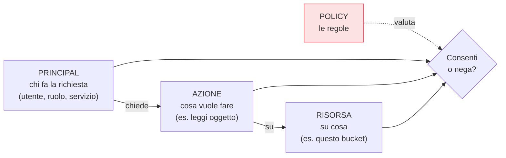

## Perché conta

Nella rete tradizionale, se eri "dentro" il perimetro eri in gran parte fidato. Nel cloud quel
perimetro non esiste: ogni risorsa è un endpoint API raggiungibile da Internet, e l'unica cosa che
separa un attaccante dai tuoi dati è **chi può chiamare quell'API**. Per questo si dice che nel cloud
**l'identità è il nuovo perimetro**. L'IAM (Identity and Access Management) è il sistema che decide, a
ogni singola richiesta, se concederla o negarla.

## I quattro concetti base



Ogni richiesta è la tripla **principal → azione → risorsa**, e le **policy** sono le regole che la
valutano. Una policy è, in sostanza, un elenco di "questo principal può (o non può) fare queste azioni
su queste risorse, a queste condizioni".

## Utenti, gruppi, ruoli

- **Utente**: un'identità a lungo termine per una persona (o, storicamente, per un'app — da evitare).
- **Gruppo**: un insieme di utenti a cui si assegnano permessi in blocco, per non ripeterli uno a uno.
- **Ruolo**: un'identità *assumibile* temporaneamente, senza credenziali permanenti. È lo strumento
  chiave del cloud: una VM, una funzione o un utente "assume" un ruolo e ottiene credenziali a
  scadenza. I ruoli evitano le chiavi statiche, il punto debole numero uno.

## Il modello di valutazione: nega per default

La regola d'oro di quasi tutti gli IAM cloud:

```text {hl_lines=[2,4]}
1. Si parte da: TUTTO NEGATO (deny implicito)
2. Un Allow esplicito concede il permesso
3. ...ma un Deny esplicito VINCE sempre su qualunque Allow
4. Risultato: accesso solo se c'è un Allow e NESSUN Deny applicabile
```

Il *deny implicito* significa che se nessuna policy concede un'azione, è negata. E un **deny esplicito
batte qualsiasi allow**: utile per mettere guardrail che nessun permesso successivo può aggirare. Su
AWS si aggiungono i confini (permission boundaries) e le SCP a livello di organizzazione; su GCP
l'ereditarietà lungo la gerarchia; su Azure i ruoli RBAC con scope. I nomi cambiano, la logica
"nega-salvo-consenso-esplicito" no.


<details>
<summary><strong>Domanda:</strong> l'IAM con policy, ruoli, condizioni sembra enormemente più complicato di "utente e password con dei permessi". Tutta questa complessità non è ingegneria eccessiva?</summary>
<p>Sembra eccessiva solo finché non vedi cosa deve governare: non "un utente che accede a un'app", ma
<em>qualunque principal — persona, server, funzione, pipeline, servizio di un altro account — che chiama
una qualunque delle migliaia di API del provider su una qualunque delle tue risorse, da ovunque nel
mondo</em>. "Utente e password con dei permessi" basta per un'applicazione singola; non basta per un
sistema dove il chiamante è spesso una macchina, le risorse sono centinaia, e concedere un permesso di
troppo a un'identità sbagliata espone dati a Internet. La complessità dell'IAM non è gratuita: ogni
pezzo risolve un problema reale. I <em>ruoli</em> esistono per eliminare le chiavi statiche, che sono la
causa principale di credenziali rubate. Le <em>condizioni</em> (da quale IP, con quale MFA, verso quale
rete) esistono per restringere un permesso al contesto legittimo. Il <em>deny esplicito</em> e i
guardrail d'organizzazione esistono per porre limiti invalicabili che nemmeno un amministratore distratto
può allargare. Il <em>privilegio minimo</em>, che vedremo nel prossimo capitolo, ha bisogno di questa
granularità per essere esprimibile. La vera scelta non è "IAM semplice o complesso", ma "controllo
granulare di chi-può-cosa, oppure permessi grossolani che per comodità finiscono sempre troppo larghi".
Nel cloud, dove un permesso troppo largo significa dati esposti, la granularità è il prezzo della
sicurezza — e, con buone pratiche (gruppi, ruoli, policy riusabili), si gestisce senza impazzire.</p>
</details>


## Conclusione

L'IAM è il perimetro del cloud: valuta ogni richiesta come principal-azione-risorsa contro le policy,
partendo da tutto negato, con il deny esplicito che vince sempre. Utenti, gruppi e soprattutto ruoli
assumibili ne sono i mattoni. Avere questo modello chiaro è la premessa per la regola che rende l'IAM
davvero sicuro — concedere il meno possibile: il [principio del privilegio
minimo](), prossimo capitolo.
