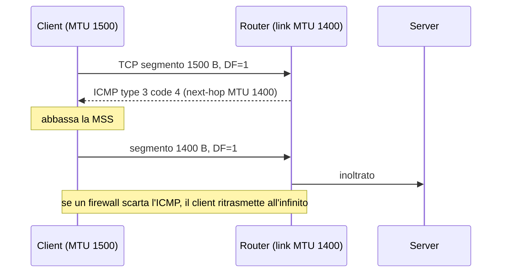

## Perché conta

`ping` è il comando di rete più usato, e **ICMP** è il protocollo che lo trasporta. Ma ICMP non serve solo
a verificare se un host risponde: è il canale con cui la rete segnala errori e condizioni anomale
(destinazione irraggiungibile, TTL scaduto, pacchetto troppo grande). Per questo i firewall "paranoici"
che scartano tutto l'ICMP producono sintomi bizzarri: connessioni che si bloccano solo con certi
pacchetti, siti che si caricano a metà, IPv6 che non funziona.

Al tempo stesso ICMP è un ottimo veicolo per l'attaccante: serve alla ricognizione (host discovery),
può nascondere un canale di comando e controllo e, in alcune configurazioni, può alterare il routing.
La risposta giusta non è né "blocca tutto" né "lascia passare tutto", ma un filtro per tipo.

## Come funziona

ICMP viaggia direttamente dentro IP (protocollo 1; ICMPv6 è il next header 58). Ogni messaggio ha un
`type` e un `code`. I più importanti:

| Tipo (IPv4) | Significato | Va lasciato passare? |
|---|---|---|
| 0 / 8 | Echo reply / request (`ping`) | Solo se serve, con rate limit |
| 3 | Destination unreachable (code 4 = *fragmentation needed*) | **Sì**, serve a PMTUD |
| 11 | Time exceeded (`traceroute`) | Di solito sì |
| 5 | Redirect | **No** sui host, cambia il routing |

Il caso che più spesso si rompe è **Path MTU Discovery** (RFC 1191): il mittente invia pacchetti con il bit
DF (*don't fragment*); un router che non riesce a inoltrarli risponde con ICMP tipo 3 code 4 indicando
la MTU del suo link. Se quel messaggio viene scartato da un firewall, il mittente non saprà mai che
i pacchetti grandi non passano: è il classico *PMTUD black hole*.



In IPv6 il problema è più serio: i router **non frammentano mai**, quindi `Packet Too Big` (tipo 2) è
indispensabile (RFC 8201), e ICMPv6 è usato anche per Neighbor Discovery (cfr.
[sicurezza IPv6 e RA Guard]()). Bloccarlo significa spegnere IPv6.

## L'attacco

**Ricognizione.** Un `ping sweep` individua gli host vivi prima di passare alla
[scansione delle porte]():

```bash
nmap -sn -PE 192.0.2.0/24        # echo request su tutta la subnet
hping3 --icmp -c 3 192.0.2.10    # singolo echo con controllo sui campi
```

**Tunnel ICMP.** L'echo request ha un campo dati arbitrario. Strumenti come `ptunnel` o `icmpsh`
incapsulano un flusso TCP (una shell, un SSH) nei payload dei ping: dove l'unico traffico in uscita
consentito è il ping, il tunnel passa. Come per il [DNS tunneling](),
il traffico si tradisce per le sue anomalie. Un `ping` normale invia 56 byte di payload e ne riceve altrettanti;
un tunnel invia payload grandi e variabili, con un rapporto richieste/risposte costante e una frequenza alta.

Un'euristica semplice per l'analisi dei flussi è il volume medio di dati per pacchetto ICMP: se $B$ sono i byte
di payload osservati e $n$ il numero di echo in una finestra,

$$\bar{p} = \frac{B}{n}, \qquad \bar{p} \gg 56 \;\Rightarrow\; \text{sospetto}$$

**Redirect.** Un messaggio ICMP *Redirect* (tipo 5) dice a un host "usa questo altro gateway": un attaccante
sulla stessa LAN può spedirlo falsificando il router per deviare il traffico verso di sé, un MITM simile
all'[ARP spoofing]().

## La difesa

Si parte spegnendo ciò che non serve sugli host Linux:

```bash
sysctl -w net.ipv4.conf.all.accept_redirects=0
sysctl -w net.ipv4.conf.all.send_redirects=0
sysctl -w net.ipv6.conf.all.accept_redirects=0
sysctl -w net.ipv4.icmp_echo_ignore_broadcasts=1
```

Poi il firewall filtra per tipo, lasciando passare ciò che serve alla rete e limitando il resto
(la logica di conntrack è in [stateful firewall con nftables]()):

```nft {hl_lines=[5,6,8,9]}
table inet filter {
    chain input {
        type filter hook input priority 0; policy drop;
        ct state established,related accept
        icmp type { destination-unreachable, time-exceeded, parameter-problem } accept
        icmpv6 type { destination-unreachable, packet-too-big, time-exceeded, parameter-problem, nd-neighbor-solicit, nd-neighbor-advert } accept
        icmp type redirect drop
        icmp type echo-request limit rate 5/second burst 10 packets accept
        icmpv6 type echo-request limit rate 5/second burst 10 packets accept
    }
}
```

Le righe evidenziate sono il cuore del filtro: PMTUD e Neighbor Discovery restano funzionanti (RFC 4890),
i redirect vengono scartati, e il `ping` è ammesso ma con un tetto che frena sweep e tunnel rumorosi.
Per bloccare i tunnel più discreti si aggiunge un controllo sulla dimensione, ad esempio
`meta length > 128 icmp type echo-request drop`, e si osservano i flussi con [Zeek](),
che registra ogni echo in `conn.log` e permette di calcolare $\bar{p}$ per host.

## Lab

Con due container sulla stessa bridge (vedi [roadmap]()):

1. Sul target carica la policy nftables sopra. Da un altro container lancia `ping -c 20 -i 0.05 <target>`: quanti pacchetti passano?
2. Prova `ping -s 1000 -c 3 <target>` con la regola `meta length > 128 ... drop` attiva: cosa succede?
3. Abbassa la MTU del link del target (`ip link set eth0 mtu 1400`) e invia `ping -M do -s 1472 <target>`: quale messaggio ICMP ricevi e perché non dovresti bloccarlo?


<details><summary>Soluzione</summary>
<ol>
<li>Con 20 pacchetti a intervalli di 50 ms (circa 20/s) il limite di 5/s con burst 10 scarta quelli in eccesso: passano circa 10-12 pacchetti, il resto va perso.</li>
<li>Un echo con 1000 byte di payload supera i 128 byte della regola e viene scartato: <code>ping</code> non riceve risposta. I ping standard da 56 byte (84 byte di pacchetto IP) continuano a passare.</li>
<li>Con DF impostato e un pacchetto da 1500 byte su un link da 1400, il router risponde con <code>Frag needed and DF set (mtu 1400)</code>, ICMP tipo 3 code 4. È proprio il messaggio che alimenta PMTUD: se lo scarti, le connessioni con pacchetti grandi si bloccano.</li>
</ol>
</details>


## Conclusione

ICMP è un protocollo di controllo, non un optional: scartarlo in blocco rompe PMTUD e IPv6, lasciarlo
aperto senza limiti regala ricognizione e canali coperti. Il compromesso corretto è un filtro per tipo: accetta
gli errori che la rete richiede, scarta i redirect, limita gli echo e monitora le dimensioni dei payload.

**Prossimo nella serie:** [Torna alla roadmap]()
