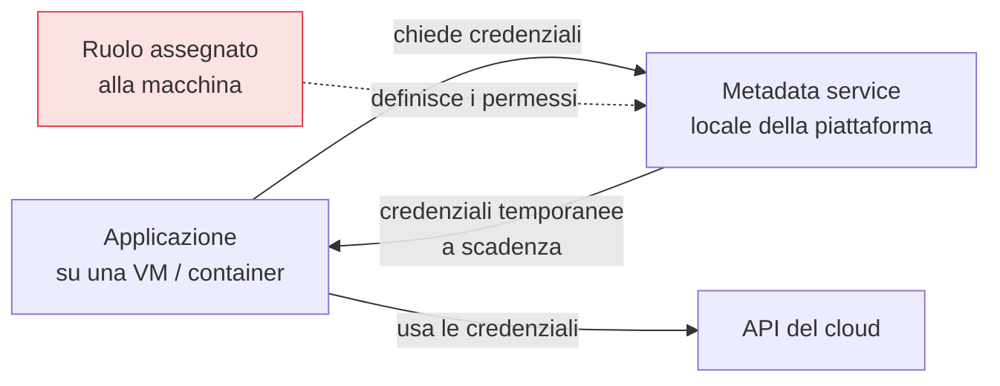

## Perché conta

Un'applicazione nel cloud deve spesso leggere un database, scrivere su uno storage, chiamare un'altra
API. Per farlo le serve un'identità. La via sbagliata — e purtroppo comunissima — è creare un utente
IAM, generare una **chiave statica** (access key / service account key) e incollarla in un file di
configurazione o in una variabile d'ambiente. Quella chiave non scade mai, finisce nei log, nei
repository Git, nei backup, nelle immagini dei container: è la causa numero uno di credenziali cloud
rubate. Le **identità di workload** esistono per non doverla mai creare.

## Il meccanismo: la macchina È l'identità



Invece di dare una chiave all'applicazione, si assegna un **ruolo alla macchina** che la ospita (una
istanza, un container, una funzione). La piattaforma espone un *metadata service* locale da cui
l'applicazione ottiene, a richiesta, credenziali **temporanee** che scadono dopo minuti o ore e vengono
rinnovate in automatico. Nessun segreto a lunga vita esiste mai: se la macchina viene spenta, le
credenziali muoiono con lei.

## I nomi nei tre provider

```text {hl_lines=[1,2,3]}
AWS   → IAM Role su EC2/ECS/Lambda (via Instance Metadata Service, usa IMDSv2!)
GCP   → service account allegato alla risorsa + metadata server
Azure → Managed Identity (system- o user-assigned)
```

Il concetto è identico: un'identità legata alla risorsa, credenziali effimere servite localmente. Su
AWS è importante forzare **IMDSv2** (la versione del metadata service che richiede un token), perché la
v1 è stata sfruttata in attacchi SSRF per rubare credenziali dalle istanze.

## Oltre il cloud: la federazione

E se il workload gira *fuori* dal cloud — in una pipeline CI/CD su GitHub, in un cluster on-premise?
Qui entra la **federazione (workload identity federation)**: il sistema esterno presenta un token
firmato OIDC che attesta la sua identità ("sono la pipeline X del repo Y"), e il cloud lo scambia con
credenziali temporanee, senza che nessuna chiave statica cambi mai di mano. È il modo moderno di far
parlare CI, Kubernetes esterni e altri cloud con il tuo ambiente, in sicurezza.


<details>
<summary><strong>Domanda:</strong> una chiave statica in un file è semplicissima e funziona ovunque. Ruoli, metadata service, federazione OIDC: non sto aggiungendo pezzi fragili per risolvere un problema che una buona gestione dei segreti già coprirebbe?</summary>
<p>No, e la distinzione è importante: la gestione dei segreti (che vedremo nel prossimo capitolo) riduce
il rischio di una chiave, ma l'identità di workload lo <em>elimina alla radice</em> — sono complementari,
non alternative. Una chiave statica, per quanto ben custodita in un vault, ha tre proprietà che nessuna
gestione può togliere: <em>esiste</em>, quindi può essere letta; <em>non scade</em>, quindi se trapela
resta valida finché qualcuno non se ne accorge e la revoca manualmente; e <em>deve viaggiare</em> dal
vault all'applicazione, moltiplicando i punti in cui può trapelare (log, dump di memoria, variabili
d'ambiente ispezionabili, immagini di container). L'identità di workload rende la chiave statica
<em>inesistente</em>: l'applicazione non possiede mai un segreto a lunga vita, ottiene credenziali che
scadono in minuti e si rinnovano da sole. Se un attaccante le ruba, ha una finestra brevissima, non un
accesso permanente; e la revoca è automatica allo spegnimento della macchina. Sui "pezzi fragili": il
metadata service e la federazione OIDC non li costruisci tu, li fornisce la piattaforma, già
irrobustiti — l'unica tua accortezza è usare la variante sicura (IMDSv2) e configurare bene le condizioni
della federazione. In cambio elimini l'intera categoria di incidenti "chiave statica trovata nel repo
Git", che è tra le più frequenti in assoluto. La chiave in un file è semplice come lasciare la porta
aperta è semplice: la complessità che eviti oggi la paghi come breach domani.</p>
</details>


## Conclusione

Le identità di workload eliminano le chiavi statiche: la macchina riceve un ruolo, ottiene credenziali
temporanee da un metadata service locale, e all'esterno la federazione OIDC scambia token firmati con
credenziali effimere. Nessun segreto a lunga vita da custodire. Ma qualche segreto — password di
database, chiavi di terze parti, certificati — resterà sempre inevitabile: come conservarlo è il tema
della [gestione dei segreti e KMS](), prossimo capitolo.
