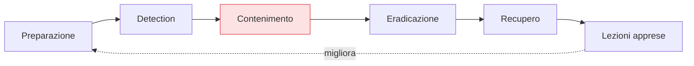

## Perché conta

Tutta la serie è stata prevenzione: ridurre la probabilità e il raggio d'esplosione. Ma la sicurezza
non è mai assoluta — una chiave trapelerà, un ruolo verrà abusato, una dipendenza nasconderà una falla.
La **incident response** è ciò che decide se quell'evento diventa un intoppo contenuto o una catastrofe.
E nel cloud ha regole proprie: strumenti nuovi a tuo favore (ogni azione è un'API, ogni risorsa è
clonabile) e insidie nuove da conoscere (le prove sono effimere, l'infrastruttura cambia sotto i piedi).

## Le fasi, in chiave cloud



- **Preparazione**: prima dell'incidente. Ruoli e responsabilità definiti, accessi break-glass pronti,
  runbook scritti, [log centralizzati e immutabili]() già
  attivi. Quasi tutto il successo si gioca qui.
- **Detection**: l'allarme dalla [threat detection]() o da
  una segnalazione. Si qualifica: è reale? quale perimetro tocca?
- **Contenimento**: fermare l'emorragia senza distruggere le prove (sotto).
- **Eradicazione e recupero**: rimuovere l'accesso dell'attaccante, ricostruire da uno stato pulito.
- **Lezioni apprese**: cosa ha permesso l'incidente, come evitarlo — che rialimenta la preparazione.

## Il contenimento cloud: veloce e chirurgico

Nel cloud il contenimento sfrutta IAM e API, ed è molto più rapido dell'on-premise:

```text {hl_lines=[2,3,4]}
Contenere una credenziale / risorsa compromessa:
  - revoca/disabilita l'identità o la chiave (taglia l'accesso all'istante)
  - isola la risorsa con un security group "quarantena" (nega ogni traffico)
  - NON spegnere subito la VM: perderesti la memoria volatile (prove)
  - revoca la chiave KMS se i dati cifrati sono a rischio
```

Il contenimento via identità è la mossa più potente: revocare un ruolo o una chiave taglia l'accesso
dappertutto, istantaneamente — il rovescio positivo del fatto che nel cloud [l'identità è il
perimetro]().

## Le prove sono effimere: catturare prima

Qui sta la trappola del cloud. Una VM compromessa, se la spegni o la termina, **svanisce** con la sua
memoria e spesso il suo disco. La forensics cloud sfrutta le API per *catturare prima di agire*:

- **Snapshot** del disco della risorsa compromessa, copiato in un account forense isolato.
- **Dump** della memoria volatile finché la macchina è viva.
- **Isolare, non distruggere**: metti la risorsa in quarantena di rete per fermarla, ma tienila viva
  per analizzarla.

Molto di questo si **automatizza**: un playbook che, allo scattare di un allarme, isola la risorsa,
ne cattura snapshot e memoria, revoca le credenziali coinvolte e apre un ticket — in secondi, senza
attendere un umano. È il vantaggio cloud portato alla risposta.


<details>
<summary><strong>Domanda:</strong> se ho fatto bene tutta la prevenzione dei capitoli precedenti — identità strette, rete segmentata, detection, postura curata — l'incident response non diventa un piano che non userò mai? Non è tempo investito in uno scenario che ho reso improbabile?</summary>
<p>È tempo investito in uno scenario che hai reso <em>improbabile ma non impossibile</em> — e questa è
esattamente la condizione in cui prepararsi conta di più, non di meno. La prevenzione riduce la frequenza
e la gravità degli incidenti, non li azzera: resta sempre la vulnerabilità non ancora nota, la dipendenza
compromessa a monte, l'errore umano, la credenziale di un fornitore, l'attacco che nessun controllo
prevede. Proprio perché hai reso l'incidente raro, quando arriverà il tuo team <em>non avrà pratica</em>:
nessuno ricorderà a freddo come si cattura uno snapshot forense, chi ha l'autorità di revocare un ruolo
di produzione, dove sono i log, chi chiamare. Il valore della preparazione non è "sapere che un giorno
servirà", è <em>trasformare il panico in procedura</em>: nel mezzo di un incidente reale, sotto pressione,
con dati che forse escono in tempo reale, la differenza tra un'ora e un giorno di contenimento è un
runbook già scritto e provato. E c'è un punto più sottile: la preparazione alla risposta <em>migliora la
prevenzione</em>. Scrivere i runbook ti costringe a chiederti "se X venisse compromesso, come lo conterrei,
avrei i log, potrei isolarlo?" — e quelle domande scoprono buchi nella prevenzione che altrimenti non
vedresti (un log mancante, un accesso break-glass inesistente, una risorsa che non puoi isolare). Le
esercitazioni (tabletop, simulazioni) valgono anche quando l'incidente non arriva, perché allenano il
team e validano l'architettura. Infine, l'incident response non è solo tecnica: è decidere <em>prima</em>
chi comunica, a chi, con quali obblighi di legge — cose che non si improvvisano mentre l'incidente è in
corso. La prevenzione ti compra tempo e tranquillità; la preparazione alla risposta è l'assicurazione che
paghi poco e che l'unico giorno in cui serve, vale tutto ciò che è costata.</p>
</details>


## Conclusione

L'incident response cloud contiene via IAM e rete (veloce, chirurgico), cattura le prove effimere
*prima* di agire, e automatizza i playbook sfruttando le API — ma quasi tutto si decide nella
preparazione fatta prima. Qui si chiude **Sicurezza Cloud in pratica**: dal modello di responsabilità
condivisa fino alla risposta agli incidenti, con un filo conduttore unico — nel cloud l'identità è il
perimetro e la configurazione è il campo di battaglia, e la sicurezza non è un prodotto che si compra,
ma una disciplina che si pratica a ogni livello. Per riprendere il percorso dall'inizio, torna alla
[roadmap della serie]().
