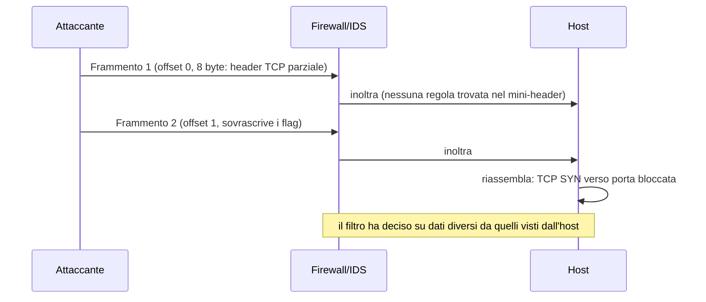

## Perché conta

Un datagramma IP più grande dell'MTU del percorso viene spezzato in **frammenti**. Solo il primo contiene l'header di livello 4 (porte TCP/UDP, flag); gli altri sono "pezzi di payload" senza contesto. Un firewall o un IDS che decide sul singolo pacchetto vede dunque una realtà diversa da quella dell'host di destinazione, che *riassembla* e interpreta. Quella differenza è un classico canale di **evasione**: [RFC 1858](https://www.rfc-editor.org/rfc/rfc1858) la descrive dal 1995 e [RFC 8900](https://www.rfc-editor.org/rfc/rfc8900) ribadisce che la frammentazione è "fragile". Si lega a [IDS/IPS con Suricata]() e ai filtri di [nftables]().

## Come funziona

Ogni frammento porta `Identification` (stesso valore per tutto il datagramma), `Fragment Offset` (in unità di 8 byte) e il flag `MF` (*More Fragments*). Il ricevitore raccoglie i pezzi con stessa terna (src, dst, ID, protocollo) e li ricompone. Con payload $P$ e MTU $M$, header da 20 byte, il numero di frammenti è

$$n = \left\lceil \frac{P}{8\,\lfloor (M-20)/8 \rfloor} \right\rceil, \qquad P = 4000,\ M = 1500 \Rightarrow n = 3$$



## L'attacco

Due tecniche storiche. Il **tiny fragment**: il primo frammento è così piccolo (8 byte) che i flag TCP finiscono nel secondo, e un filtro "stateless" che controlla solo il primo non li vede. L'**overlapping fragment**: due frammenti coprono gli stessi byte; il filtro vede un contenuto, l'host (a seconda del SO: *first wins* o *last wins*) ne ricostruisce un altro. In lab con `scapy`, **solo su reti che controlli**:

```python
from scapy.all import IP, TCP, Raw, send, fragment

DST = "10.0.0.1"   # host di lab

# Frammento 1: header TCP "innocuo" (flag ACK) verso porta 80
f1 = IP(dst=DST, id=4242, flags="MF", frag=0, proto=6) / bytes(
    TCP(sport=40000, dport=80, flags="A"))[:16]
# Frammento 2 (offset 1 = byte 8): sovrascrive la zona dei flag con SYN
f2 = IP(dst=DST, id=4242, flags=0, frag=1, proto=6) / b"\x00" * 16
send([f1, f2], verbose=False)

# Alternativa: frammentare un pacchetto vero a 8 byte per frammento
send(fragment(IP(dst=DST)/TCP(dport=22,flags="S")/Raw("A"*32), fragsize=8))
```

Con `nmap -f` (frammenti da 8 byte) o `-ff` (16 byte) si ottiene lo stesso effetto in scansione: vedi [Port scanning con Nmap](). Esiste anche l'uso opposto, il **fragment flood** contro la memoria di riassemblaggio: frammenti mai completati occupano buffer fino al timeout (famoso `teardrop`, e oggi i CVE sul reassembly dei kernel).

## La difesa

**1. Riassemblare prima di filtrare.** Con `conntrack` il kernel Linux **deframmenta** i pacchetti prima di nftables; quindi le regole vedono datagrammi completi. Ricorda di limitare le risorse:

```bash {hl_lines=[2,3,4]}
# /etc/sysctl.d/91-frag.conf
net.ipv4.ipfrag_high_thresh = 4194304
net.ipv4.ipfrag_low_thresh  = 3145728
net.ipv4.ipfrag_time        = 15
```

**2. Scartare ciò che non serve.** Su un perimetro moderno quasi nessun traffico legittimo ha bisogno di frammenti (PMTUD e TCP MSS evitano la frammentazione, vedi [ICMP]()):

```nft {hl_lines=[4,5,6]}
table inet filter {
  chain input {
    type filter hook input priority 0; policy drop;
    ip frag-off & 0x1fff != 0 ip protocol { tcp, udp } drop
    ip frag-off & 0x2000 != 0 ip frag-off & 0x1fff == 0 meta length < 120 drop
    ct state invalid drop
    ct state established,related accept
  }
}
```

La riga 4 scarta i frammenti non iniziali verso TCP/UDP, la 5 i primi frammenti troppo piccoli per contenere gli header L4, la 6 i segmenti fuori stato. In IPv6 la regola equivalente è sull'header `frag`; [RFC 5722](https://www.rfc-editor.org/rfc/rfc5722) impone di scartare l'intero datagramma se i frammenti si sovrappongono.

**3. IDS con reassembly coerente.** Suricata ha il motore `defrag` con politica per SO di destinazione; imposta quella corretta per ogni rete:

```yaml
defrag:
  memcap: 64mb
  hash-size: 65536
  max-frags: 65535
  timeout: 30
host-os-policy:
  linux: [10.0.0.0/24]
  windows: [10.0.1.0/24]
```

Se i frammenti sono anomali, la regola `decode-event` o `stream-event` genera un alert da inviare al [SIEM]().

## Lab

1. Su un nodo containerlab abilita `nft` con le regole sopra tranne le righe 4–5 e `tcp dport 22 drop`.
2. Dall'attaccante invia `nmap -f -sS -p 22 10.0.0.1`; osserva con `tcpdump -ni eth0 'ip[6:2] & 0x3fff != 0'`.
3. Abilita le righe 4–5 e ripeti. Cosa cambia? Calcola $n$ per un payload da 6000 byte con MTU 1500.


<details><summary>Soluzione</summary>
<p>Senza le regole, se il firewall è stateless e valuta solo il primo frammento, i frammenti successivi passano; con <code>conntrack</code> attivo il kernel riassembla e la porta 22 resta chiusa, quindi il test dipende dalla configurazione. Con le righe 4–5 i frammenti non iniziali e quelli troppo piccoli vengono scartati: <code>nmap -f</code> non riceve risposta. Per il calcolo: payload utile per frammento $8\lfloor 1480/8 \rfloor = 1480$ byte, quindi $n = \lceil 6000/1480 \rceil = 5$.</p>
</details>


## Conclusione

La frammentazione è un residuo del design degli anni '80 che oggi serve soprattutto agli attaccanti: la regola pratica è riassemblare dove si decide (conntrack, Suricata con policy per SO), scartare i frammenti anomali e progettare i protocolli per non frammentare mai (MSS clamping, PMTUD funzionante, DNS su TCP/EDNS corto).

**Prossimo nella serie:** un nuovo approfondimento sul perimetro di rete · [Torna alla roadmap]()
