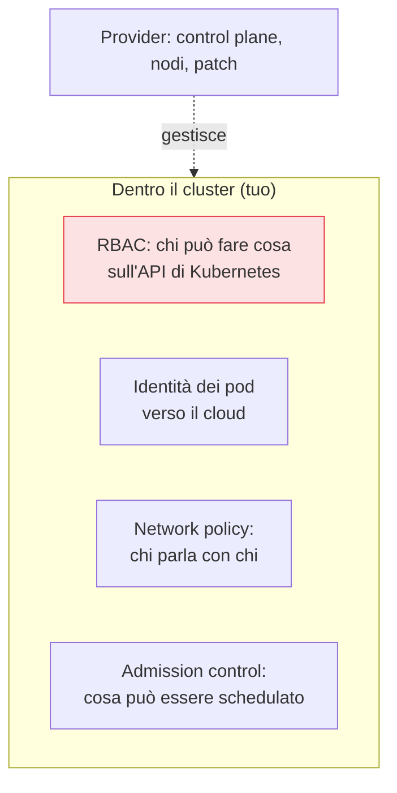

## Perché conta

Kubernetes gestito (EKS, AKS, GKE) applica il [modello di responsabilità
condivisa]() a un nuovo livello: il provider
gestisce e protegge il **control plane** (l'API server, etcd, gli aggiornamenti), togliendoti un peso
enorme. Ma tutto ciò che gira *dentro* il cluster — i workload, i permessi, la rete tra i pod, le
immagini che esegui — resta responsabilità tua. E Kubernetes ha una superficie di configurazione vasta,
dove i default sono spesso permissivi.

## I controlli che contano



- **RBAC**: Kubernetes ha il *suo* sistema di permessi, distinto dall'IAM del cloud. Applica anche qui
  il [privilegio minimo](): niente `cluster-admin`
  distribuito a pioggia, service account dedicati per namespace, nessun accesso di default.
- **Identità dei pod verso il cloud**: un pod che deve leggere uno storage non usa una chiave statica,
  ma federa la sua service account Kubernetes con un ruolo IAM (IRSA su EKS, Workload Identity su GKE) —
  le [identità di workload]() applicate ai container.
- **Network policy**: di default, in Kubernetes **tutti i pod si parlano**. Le network policy
  introducono la [microsegmentazione](): un
  namespace isolato, un pod che accetta traffico solo da chi deve.

## Immagini e admission control

I container eseguono immagini: se l'immagine è vulnerabile o manomessa, lo è il workload. Due difese:

```text {hl_lines=[2,4]}
1. SCANSIONE immagini → cerca vulnerabilità note PRIMA del deploy (nel registry e in pipeline)
2. ADMISSION CONTROL  → l'API server rifiuta pod che violano le regole:
      - immagini solo da registry fidati
      - no container privilegiati, no root, no hostPath
      - risorse e security context obbligatori
```

L'**admission control** (con OPA/Gatekeeper o Kyverno) è la [policy as
code]() applicata a Kubernetes: valuta ogni oggetto
*prima* che venga creato e blocca ciò che viola le regole. È il punto in cui impedisci, per esempio,
che un pod privilegiato o un'immagine non firmata entri nel cluster.


<details>
<summary><strong>Domanda:</strong> se uso Kubernetes gestito proprio per non pensare all'infrastruttura, tutto questo (RBAC, network policy, admission control) non vanifica il vantaggio, riportandomi la complessità che volevo evitare?</summary>
<p>No, perché il gestito ti toglie una complessità — quella <em>operativa</em> del control plane — che è
diversa da quella che questi controlli affrontano, che è la complessità <em>di sicurezza</em> dei tuoi
workload; e la seconda non puoi delegarla perché riguarda cosa fanno le <em>tue</em> applicazioni, che
solo tu conosci. Il gestito ti libera dal gestire etcd, aggiornare l'API server, sostituire i nodi,
applicare le patch del piano di controllo: lavoro pesante, continuo, che il provider fa meglio. Ma RBAC,
network policy e admission control non riguardano l'infrastruttura: riguardano <em>chi può fare cosa nel
tuo cluster</em> e <em>cosa possono fare i tuoi container</em> — domande a cui nessun provider può
rispondere al posto tuo, perché dipendono dalle tue applicazioni. Ignorarli non ti fa risparmiare
complessità, ti fa ereditare i default permissivi di Kubernetes: ogni pod che parla con ogni pod, service
account con più permessi del necessario, container che girano da root. Sono esattamente le condizioni che
trasformano la compromissione di un singolo container nella compromissione dell'intero cluster. E il
costo di questi controlli è calato molto: le network policy si scrivono una volta per namespace, l'identità
dei pod verso il cloud è ormai una configurazione standard, e l'admission control con Kyverno o Gatekeeper
usa policy riusabili che trovi già pronte. Non stai ricostruendo l'infrastruttura: stai applicando al
cluster gli stessi principi — privilegio minimo, microsegmentazione, policy as code — che valgono nel
resto del cloud. Il gestito ti dà una base solida; questi controlli impediscono che tu vi costruisca sopra
una casa con tutte le porte aperte.</p>
</details>


## Conclusione

Nel Kubernetes gestito il provider protegge il control plane, ma RBAC, identità dei pod, network policy
e admission control restano tuoi — e sono gli stessi principi della serie (privilegio minimo,
microsegmentazione, policy as code) applicati al cluster. Resta un modello di calcolo ancora più
astratto, dove non gestisci neppure i container: il serverless. È il prossimo capitolo, [serverless
security]().
