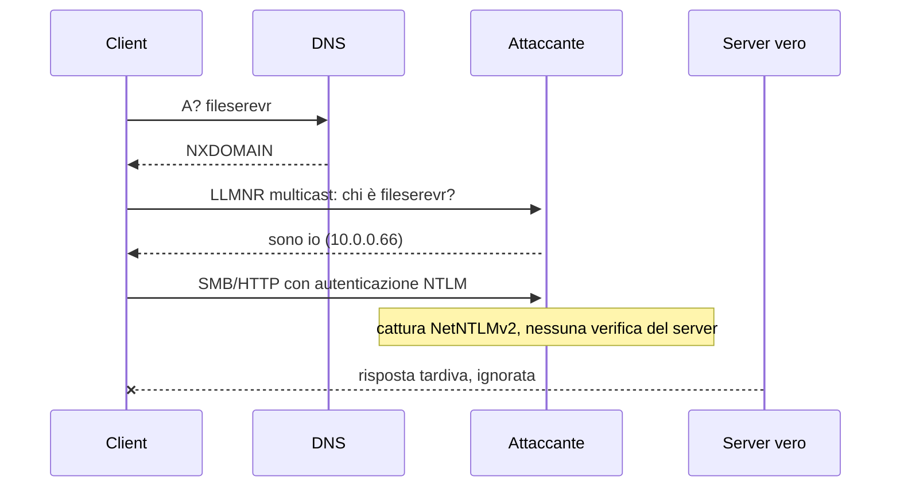

## Perché conta

Quando un host digita `\\fileserevr\share` (con un refuso) il DNS risponde `NXDOMAIN`. Molti sistemi non si arrendono: chiedono **a tutti** sul link locale "chi è `fileserevr`?". Qualunque macchina può rispondere, e quella del primo che risponde vince. Se a rispondere è un attaccante, il client gli consegna volentieri una **autenticazione** (NetNTLMv2) pensando di parlare col server.

Il problema non è un bug ma un progetto: LLMNR ([RFC 4795](https://www.rfc-editor.org/rfc/rfc4795)), mDNS ([RFC 6762](https://www.rfc-editor.org/rfc/rfc6762)) e NBT-NS ([RFC 1002](https://www.rfc-editor.org/rfc/rfc1002)) assumono che il link sia fidato e non hanno alcuna autenticazione delle risposte. È la stessa famiglia di fiducia implicita dei [layer 2 attacks](), spostata al livello dei nomi.

## Come funziona

| Protocollo | Trasporto | Destinazione | Tipico uso |
|---|---|---|---|
| LLMNR | UDP/5355 | `224.0.0.252`, `ff02::1:3` | Windows, fallback dopo il DNS |
| mDNS | UDP/5353 | `224.0.0.251`, `ff02::fb` | dominio `.local`, Bonjour/Avahi |
| NBT-NS | UDP/137 | broadcast di subnet | Windows legacy |



Le richieste restano nel **dominio di broadcast**: l'attaccante deve essere sullo stesso link (o VLAN), ma non serve alcuna posizione privilegiata.

## L'attacco

In laboratorio, con una macchina Linux sullo stesso segmento del client, [Responder](https://github.com/lgandx/Responder) risponde a LLMNR/NBT-NS/mDNS e avvia server SMB/HTTP finti. **Solo su reti che controlli.**

```bash
sudo ./Responder.py -I eth0 -A   # -A: solo analisi, nessun avvelenamento
sudo ./Responder.py -I eth0      # risponde alle query e cattura le auth
```

La modalità analisi (`-A`) è utile prima di tutto per **misurare** quanto traffico LLMNR/NBT-NS c'è nella rete. Senza `-A` i log mostrano righe del tipo `[SMB] NTLMv2-SSP Hash : utente::DOMINIO:...`. L'hash non è la password, ma si può attaccare offline (`hashcat -m 5600`) o rilanciare verso un altro server (*relay*) se il SMB signing non è obbligatorio.

Per osservare il fenomeno senza avvelenare nulla, basta catturare le query:

```bash
sudo tcpdump -ni eth0 'udp port 5355 or udp port 5353 or udp port 137'
```

## La difesa

**1. Spegnere i fallback.** Se il DNS interno funziona, LLMNR e NBT-NS non servono. Su Windows via GPO: *Computer Configuration → Administrative Templates → Network → DNS Client → Turn off multicast name resolution*, e disabilitare NetBIOS su TCP/IP sulle schede. Su Linux con systemd-resolved:

```ini {hl_lines=[3,4]}
# /etc/systemd/resolved.conf
[Resolve]
LLMNR=no
MulticastDNS=no
DNSSEC=allow-downgrade
```

**2. Rendere inutile l'hash catturato.** SMB signing obbligatorio e, dove possibile, disabilitare NTLM a favore di Kerberos; senza relay l'hash resta soltanto attaccabile offline, con password lunghe diventa impraticabile.

**3. Filtrare e segmentare.** I pacchetti multicast restano nel link, ma un host non deve parlarli se non li usa. Su un server Linux:

```nft {hl_lines=[4,5]}
table inet filter {
  chain input {
    type filter hook input priority 0; policy drop;
    udp dport { 5355, 137 } drop
    udp dport 5353 ip saddr != 10.0.0.0/24 drop
    ct state established,related accept
  }
}
```

Le [VLAN piccole]() riducono chi può ascoltare le richieste, e la [dynamic ARP inspection]() rende più difficile affiancare l'avvelenamento di nomi a quello degli indirizzi.

**4. Rilevare.** Un host che risponde a query LLMNR per nomi che *non esistono* è quasi certamente un attaccante. Si può creare un **honeytoken** (vedi [honeypot e deception]()): un host che ogni tanto cerca un nome inesistente e allarma se qualcuno risponde, da inviare al [SIEM]().

```bash
# canary: una query LLMNR per un nome che non esiste; una risposta = avvelenamento
resolvectl query --legend=no canary-$RANDOM.local || true
```

## Lab

In un lab containerlab con tre nodi (client, attaccante, server SMB) sulla stessa VLAN:

1. Sul client, con `LLMNR=yes`, prova `smbclient -L //fileserevr -N` e osserva con `tcpdump` le query multicast.
2. Avvia Responder sull'attaccante e ripeti: dove finisce l'autenticazione?
3. Imposta `LLMNR=no` e `MulticastDNS=no` sul client e ripeti. Cosa cambia nelle query?


<details><summary>Soluzione</summary>
<p>Al punto 1 il client prova prima il DNS (<code>NXDOMAIN</code>) e poi invia una query a <code>224.0.0.252:5355</code>; senza attaccante nessuno risponde e il comando fallisce. Al punto 2 Responder risponde per primo con il proprio IP, il client apre una connessione SMB verso l'attaccante e nel log compare un hash NetNTLMv2 con l'utente usato. Al punto 3 il client non emette più query multicast: dopo l'<code>NXDOMAIN</code> il comando fallisce subito e Responder non riceve nulla. Nota: lo stack Windows richiede la GPO equivalente e la disattivazione di NetBIOS, altrimenti ricade su NBT-NS.</p>
</details>


## Conclusione

LLMNR, mDNS e NBT-NS sono comodi in una rete domestica e pericolosi in una aziendale: la loro unica "sicurezza" è la fiducia nel link. Spegnerli costa una GPO, e quello che resta (DNS interno, Kerberos, SMB signing) è più verificabile.

**Prossimo nella serie:** un nuovo approfondimento sul perimetro di rete · [Torna alla roadmap]()
