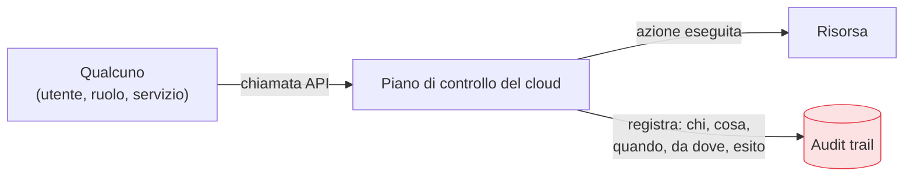

## Perché conta

La visibilità è la precondizione di tutto il resto: non puoi rilevare un attacco che non vedi, non puoi
indagare un incidente senza tracce, non puoi dimostrare la compliance senza registri. Il cloud ha un
vantaggio enorme qui: **ogni azione passa per un'API**, e ogni chiamata API può essere registrata. L'
**audit trail** (CloudTrail su AWS, Activity Log su Azure, Audit Logs su GCP) risponde alla domanda
fondamentale di ogni indagine: *chi ha fatto cosa, quando, da dove, con successo o no*.

## Cosa registra l'audit trail



Ogni voce dell'audit trail dice: l'**identità** che ha agito, l'**azione** (quale API), la **risorsa**
toccata, l'**istante**, l'**IP di origine** e l'**esito**. Da qui si ricostruisce una timeline: chi ha
creato quel ruolo admin, chi ha reso pubblico quel bucket, da quale IP è partita quella sequenza
sospetta. Senza questo, un incidente è un buco nero.

## Le tre regole dell'audit trail

```text {hl_lines=[1,2,3]}
1. ATTIVO OVUNQUE  → tutti gli account, tutte le region (gli attacchi scelgono gli angoli bui)
2. INALTERABILE    → i log in un account separato, write-once, fuori dalla portata degli admin
3. CENTRALIZZATO   → aggregati in un punto solo, per correlare e cercare
```

Il punto 2 è cruciale e spesso trascurato: un attaccante che ottiene privilegi cerca subito di
**cancellare le proprie tracce**. Se i log stanno nello stesso account che ha compromesso, può
eliminarli. Vanno quindi inviati a un **account separato di sola scrittura** (log archive account), con
l'immutabilità attiva (object lock), così nessuno — nemmeno un admin dell'account di produzione — possa
alterarli.

## Control plane e data plane

Due livelli di log, con costi e volumi diversi:

- **Control plane**: le azioni di *gestione* (crea una VM, modifica una policy, cancella un bucket).
  Volume gestibile, valore altissimo per la sicurezza. **Sempre attivo.**
- **Data plane**: le azioni *sui dati* (leggi questo oggetto, invoca questa funzione). Volume enorme e
  costoso, ma indispensabile per i dati sensibili. Attivalo **selettivamente** dove serve sapere chi
  accede a cosa.

## Conclusione

L'audit trail registra chi-ha-fatto-cosa su ogni API: va attivato ovunque, reso inalterabile in un
account separato, e centralizzato. È la materia prima della sicurezza cloud. Ma i log grezzi, da soli,
non avvisano di nulla: qualcuno o qualcosa deve leggerli e riconoscere le minacce. È il passaggio dalla
registrazione alla [threat detection nel cloud](), prossimo
capitolo.


<details>
<summary><strong>Domanda:</strong> registrare ogni chiamata API genera volumi enormi di log che nessuno leggerà mai e che costano in storage. Non è accumulare dati inutili "per scrupolo"?</summary>
<p>Sarebbe accumulo inutile se i log servissero a essere <em>letti a mano</em>, ma non è quello il loro
scopo: servono a essere <em>interrogati quando serve</em> e <em>analizzati automaticamente sempre</em>, e
in entrambi i casi il valore è reale e sproporzionato al costo. Pensa al momento dell'incidente: scopri
oggi che tre settimane fa un ruolo è stato compromesso. Senza audit trail, non hai modo di sapere cosa ha
fatto l'attaccante in quelle tre settimane — quali dati ha letto, quali risorse ha creato, se ha lasciato
backdoor. Con l'audit trail, ricostruisci l'intera timeline e sai esattamente l'entità del danno e cosa
bonificare. Quel singolo uso ripaga anni di storage. Ma i log non aspettano passivamente l'incidente: il
loro valore quotidiano è alimentare la <em>detection automatica</em> (il prossimo capitolo) — sistemi che
leggono il flusso in tempo reale e segnalano l'anomalia, il login da un paese nuovo, la cancellazione di
massa, l'escalation di privilegi. Nessun umano legge i log grezzi; le macchine sì, in continuazione. Sul
costo: i log del control plane, i più preziosi, hanno volume modesto e costano poco; quelli del data
plane, voluminosi, si attivano selettivamente solo dove i dati lo giustificano, e si archiviano su
storage freddo a basso costo con politiche di retention. Il vero "accumulo inutile" sarebbe tenere i log
senza mai interrogarli né analizzarli — ma la soluzione è analizzarli, non smettere di raccoglierli.
Spegnere i log per risparmiare è come togliere le telecamere di sicurezza perché "nessuno guarda i nastri":
il punto è averli quando serve guardare indietro.</p>
</details>

