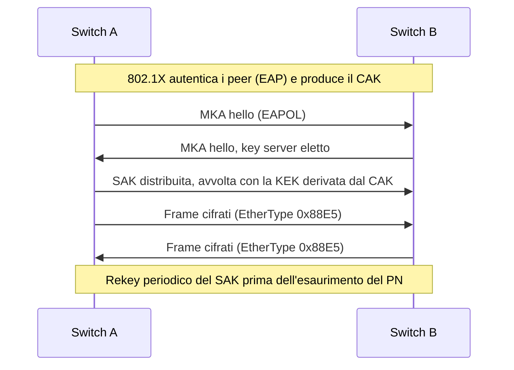

## Perché conta

La cifratura di cui parliamo di solito è end-to-end: [TLS]() tra browser e
server, [IPsec o WireGuard]() tra sedi. Ma dentro un campus o un
datacenter ci sono link in cui il traffico viaggia in chiaro: la dorsale tra due switch, il cavo che
attraversa un cunicolo, la fibra in un edificio condiviso. Chi ha accesso fisico può inserire un TAP
passivo o una porta SPAN sul percorso e leggere tutto ciò che non è già cifrato a livello applicativo,
compresi ARP, DHCP, LLDP, DNS e protocolli legacy.

**MACsec** (IEEE 802.1AE) cifra e autentica i frame Ethernet **hop-by-hop**, direttamente sul link. Non
sostituisce TLS o IPsec: li completa, proteggendo anche ciò che sta sotto il layer 3 e aggiungendo
cifratura a velocità di linea (è implementata in hardware nelle NIC e negli ASIC degli switch).

## Come funziona

MACsec aggiunge due elementi a ogni frame: un **SecTAG** dopo gli indirizzi MAC e un **ICV**
(Integrity Check Value) in coda. Il cifrario standard è GCM-AES-128 (o 256), un cifrario AEAD che
fornisce riservatezza e integrità insieme; gli indirizzi MAC restano in chiaro, il payload è cifrato.



Le chiavi si gestiscono con **MKA** (MACsec Key Agreement, definito in 802.1X): dalla chiave master
(**CAK**, ottenuta da EAP oppure preconfigurata) si ricavano le chiavi di sessione **SAK**, che MKA
distribuisce e ruota. Ogni direzione di traffico è una **Secure Association** (SA) con un contatore di
pacchetti, il *packet number* (PN), usato come nonce di GCM e quindi **mai riutilizzabile** con la stessa
chiave. Con un PN a 32 bit lo spazio finisce dopo $2^{32}$ frame; a 10 Gb/s con frame minimi
($\approx 14{,}88 \cdot 10^6$ pacchetti/s) il tempo prima del rekey obbligato è

$$t_{\max} = \frac{2^{32}}{14{,}88 \cdot 10^{6}\ \text{pkt/s}} \approx 289\ \text{s}$$

Per questo MKA rinnova il SAK ben prima della soglia, e per i link veloci esiste l'estensione **XPN**
(802.1AEbw) con PN a 64 bit. Il costo in banda è fisso: SecTAG da 8 byte (16 con SCI esplicito) più
ICV da 16 byte, cioè 24-32 byte per frame, da tenere in conto nell'MTU.

## L'attacco

Senza MACsec, intercettare un link è un'operazione quasi banale per chi ha accesso al cavo. Un TAP
passivo copia il traffico senza alterarlo; su un host in mezzo al percorso basta un bridge Linux
trasparente per osservare e perfino modificare i frame:

```bash
ip link add br0 type bridge
ip link set eth0 master br0 && ip link set eth1 master br0
ip link set br0 up
tcpdump -i br0 -nn -w capture.pcap   # tutto il traffico non cifrato dell'applicazione
```

Il bridge è invisibile agli endpoint (non ha un IP) e, a differenza di un attacco ARP, non genera traffico
anomalo che un IDS possa notare. Con un link non protetto un attaccante può anche **iniettare** frame
costruiti ad arte, per esempio risposte DHCP o BPDU, come negli attacchi su
[STP]() o [DHCP]().
Con MACsec il frame manipolato fallisce il controllo dell'ICV e viene scartato; un frame catturato e
rinviato (replay) fallisce il controllo del PN.

## La difesa

Su Linux MACsec è un'interfaccia virtuale costruita sopra una fisica. Esempio con chiavi statiche (utile
per il lab; in produzione le chiavi arrivano da MKA, ad esempio con `wpa_supplicant` o `mka`):

```bash {hl_lines=[2,3,5,7]}
# su host A (MAC 52:54:00:aa:00:01), peer B (MAC 52:54:00:bb:00:02)
ip link add link eth0 macsec0 type macsec encrypt on
ip macsec add macsec0 tx sa 0 pn 1 on key 01 0123456789abcdef0123456789abcdef
ip macsec add macsec0 rx port 1 address 52:54:00:bb:00:02
ip macsec add macsec0 rx port 1 address 52:54:00:bb:00:02 sa 0 pn 1 on key 02 fedcba9876543210fedcba9876543210
ip link set macsec0 up
ip addr add 10.10.0.1/24 dev macsec0
```

Le righe evidenziate sono il nucleo: l'interfaccia con `encrypt on` (senza, MACsec fa solo
autenticazione), la SA di trasmissione con la sua chiave e la SA di ricezione per il peer. Su B si
configurano le stesse chiavi con ruoli invertiti. Alcune note operative:

- **Chiavi statiche non scalano e non ruotano**: usale solo per prove; in produzione 802.1X + MKA.
- Imposta `replay protect on window 0` se vuoi rifiutare ogni frame fuori ordine, al costo di
  compatibilità con switch che riordinano.
- MACsec protegge il **singolo link**: dentro lo switch il traffico è in chiaro. Per proteggere un
  percorso con più hop serve MACsec su ogni tratta, oppure un overlay come IPsec/WireGuard.
- Verifica lo stato con `ip -s macsec show` e controlla i contatori `InPktsNotValid`: valori che crescono
  indicano frame manipolati o chiavi disallineate.

## Lab

Con due namespace o due nodi containerlab collegati da un `veth`:

1. Configura MACsec con `encrypt on` come sopra e fai un `ping` tra i due IP di `macsec0`.
2. Su un terzo nodo bridge-ato in mezzo al link, esegui `tcpdump -i eth0 -nn -X icmp`. Cosa vedi?
3. Cambia di un solo carattere la chiave RX su B e riprova il ping. Quale contatore di
   `ip -s macsec show` cresce?


<details><summary>Soluzione</summary>
<ol>
<li>Il ping funziona: l'interfaccia <code>macsec0</code> mostra traffico ICMP normale agli endpoint.</li>
<li>Il nodo in mezzo non vede nessun pacchetto ICMP: <code>tcpdump</code> mostra solo frame con EtherType
<code>0x88e5</code> e payload cifrato. Il filtro <code>icmp</code> non cattura nulla, perché il tipo reale
è nascosto. Solo gli indirizzi MAC restano leggibili.</li>
<li>Con chiavi diverse l'ICV non corrisponde e i frame vengono scartati: il ping fallisce e crescono i
contatori di pacchetti non validi (<code>InPktsNotValid</code> / <code>InPktsUnknownSCI</code> a seconda del
caso), lo stesso effetto di un frame manipolato in transito.</li>
</ol>
</details>


## Conclusione

MACsec colma un vuoto spesso ignorato: la protezione dei link che la cifratura end-to-end non vede.
Offre riservatezza, integrità e protezione dal replay a velocità di linea, con chiavi gestite da MKA e
legate all'identità 802.1X (vedi [802.1X e NAC]()). I limiti da ricordare
sono tre: protegge un hop alla volta, richiede supporto su entrambi i capi e va dimensionato nell'MTU.
Usalo dove l'accesso fisico al cablaggio non è sotto il tuo controllo.

**Prossimo nella serie:** [Torna alla roadmap]()
