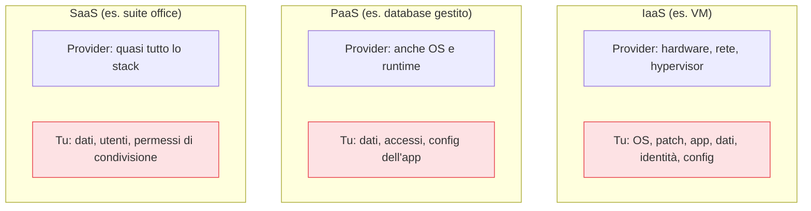

## Perché conta

La frase più pericolosa nel cloud è "tanto ci pensa il provider". È vera per metà — ed è esattamente la
metà sbagliata a farti sentire al sicuro. Il **modello di responsabilità condivisa** stabilisce che la
sicurezza è un lavoro a due: il provider protegge la *sicurezza del* cloud (data center, hardware,
hypervisor, rete fisica), tu proteggi la sicurezza *nel* cloud (i tuoi dati, le identità, le
configurazioni). Quasi ogni incidente cloud di cui leggi sui giornali cade sul **tuo** lato della linea.

## Dove passa la linea

Il punto cruciale: la linea non è fissa, si sposta col tipo di servizio.



Più sali verso il SaaS, meno gestisci — ma **i dati e le identità restano sempre tuoi**, in ogni
modello. Non esiste un servizio cloud in cui "chi può accedere ai tuoi dati" sia responsabilità del
provider.

## Le tre costanti che restano sempre tue

Qualunque sia il servizio, tre cose non delega mai nessuno al provider:

```text {hl_lines=[1,2,3]}
1. DATI        → classificazione, cifratura, chi vi accede
2. IDENTITÀ    → account, ruoli, permessi, MFA
3. CONFIG      → impostazioni di sicurezza dei servizi che usi
```

È qui che accadono i breach: un bucket di storage reso pubblico, un account senza MFA, un ruolo con
permessi amministrativi lasciato a un'applicazione. Il provider ha fatto il suo lavoro; la
configurazione era tua.

## Il trabocchetto delle impostazioni di default

I provider spediscono default che privilegiano la *facilità di avvio*, non la sicurezza massima. Un
nuovo bucket spesso è privato di default oggi (lo è diventato dopo anni di incidenti), ma mille altre
opzioni — logging disattivato, cifratura non forzata, regole di rete larghe — restano a tuo carico.
"Default sicuro" non è garantito: va verificato servizio per servizio.


<details>
<summary><strong>Domanda:</strong> se tanto la parte difficile (data center, hypervisor) la fa il provider con team enormi, la mia parte non è forse quella banale? Perché dovrei studiarla così tanto?</summary>
<p>Perché è esattamente al contrario: la parte del provider è difficile ma <em>risolta e automatizzata</em>
da migliaia di ingegneri e certificazioni, mentre la tua parte è apparentemente banale ma <em>ricade
interamente su di te, cambia a ogni servizio, e non perdona</em>. Il provider protegge l'hypervisor una
volta, per tutti i clienti, con processi maturi; tu invece devi configurare correttamente ogni bucket,
ogni ruolo, ogni regola di rete, ogni volta, su decine di servizi diversi, ciascuno con le sue
impostazioni e i suoi default. Un singolo bucket reso pubblico per errore, un solo ruolo con permessi
eccessivi assegnato a un'applicazione compromessa, un unico account admin senza MFA: nessuna di queste
cose richiede un attaccante geniale, e tutte e tre sono dalla tua parte della linea. Le statistiche sui
breach cloud lo confermano da anni: la stragrande maggioranza non sfrutta una falla del provider, ma una
<em>misconfigurazione del cliente</em>. La parte del provider è difficile e la fanno loro proprio perché
è standardizzabile; la tua parte sembra facile proprio perché ogni singola decisione è semplice — ed è
quella semplicità ripetuta migliaia di volte, su servizi che non conosci a fondo, a produrre il buco.
Studiarla non è pedanteria: è concentrare l'attenzione dove cadono davvero gli incidenti.</p>
</details>


## Conclusione

Il modello di responsabilità condivisa dice chi protegge cosa — e la risposta cambia tra IaaS, PaaS e
SaaS, tranne per dati, identità e configurazione, che restano sempre tuoi. È lì che cadono quasi tutti
gli incidenti. Avendo chiaro cosa è a tuo carico, il primo controllo da padroneggiare è il vero
perimetro del cloud: l'identità. È il prossimo capitolo, [IAM: identità e
accessi]().
