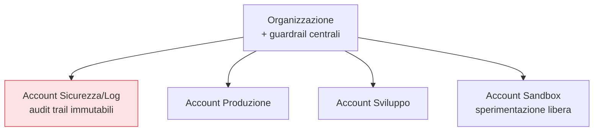

## Perché conta

All'inizio un account cloud solo è comodo: tutto in un posto. Poi crescono i team, i progetti, gli
ambienti, e quell'account diventa un unico grande spazio dove produzione e sperimentazione convivono,
dove un errore o una compromissione in un angolo tocca potenzialmente tutto, e dove i permessi
diventano un groviglio ingestibile. Separare per **account** (o progetti/subscription) crea i confini
più forti che il cloud offra: un'identità o una misconfigurazione in un account **non** attraversa il
confine verso un altro.

## L'account come unità di isolamento



Il confine d'account è la forma più netta di [raggio d'esplosione
contenuto](): produzione separata da sviluppo (un
errore in dev non tocca i clienti), un account dedicato a **log e sicurezza** dove confluiscono gli
[audit trail immutabili]() fuori dalla portata di chi
amministra la produzione, una sandbox dove si può sperimentare senza mettere a rischio il resto.

## I guardrail d'organizzazione

Separare gli account non basta: servono regole che valgano *su tutti*, che nessun amministratore di
singolo account possa aggirare. Sono i **guardrail** a livello d'organizzazione:

```text {hl_lines=[2,3]}
Esempi di guardrail invalicabili (SCP / organization policy):
  - vietare la disattivazione dell'audit trail in qualunque account
  - consentire solo determinate region (riduce superficie e deriva)
  - impedire di rendere pubblici gli storage a livello di organizzazione
  - vietare la creazione di utenti con chiavi statiche (solo ruoli/federazione)
```

Su AWS sono le **SCP (Service Control Policy)**, su GCP le **organization policy**, su Azure
**Azure Policy** con i management group. Sono [deny
esplicito]() a livello più alto: definiscono il *massimo*
dei permessi possibili in un account, un tetto che nemmeno un admin locale può sfondare.

## La landing zone

Costruire tutto questo a mano, ripetutamente, è lento e incoerente. La **landing zone** è lo schema
(spesso automatizzato con strumenti come Control Tower, o con IaC) che crea nuovi account **già
conformi**: con i guardrail applicati, l'audit trail attivo e centralizzato, le reti di base, l'accesso
federato configurato. Ogni nuovo team o progetto parte da una base sicura invece che da un account
vuoto da mettere in sicurezza a posteriori — la [prevenzione invece
dell'inseguimento]() applicata alla struttura stessa.


<details>
<summary><strong>Domanda:</strong> decine di account separati non moltiplicano il lavoro di gestione — permessi, rete, accessi replicati ovunque — rendendo tutto più complicato di un unico account ben organizzato con dei tag?</summary>
<p>Sembra così, ma è l'opposto: oltre una certa scala, i molti account <em>riducono</em> la complessità
reale, mentre l'account unico "ben organizzato con i tag" diventa ingestibile proprio perché i tag non
sono un confine, sono un'etichetta. La differenza chiave è che l'account è un <em>confine forte</em> e il
tag è una <em>convenzione debole</em>. In un account unico, la separazione tra produzione e sviluppo
esiste solo finché ogni singola policy IAM la rispetta scrupolosamente: un wildcard scritto male, un
ruolo troppo largo, una risorsa senza il tag giusto, e il confine evapora — e devi fidarti che migliaia di
permessi siano tutti corretti, per sempre. Con account separati, produzione e sviluppo non si toccano
perché <em>non possono</em>: non c'è policy sbagliata che faccia attraversare il confine, l'isolamento è
strutturale, non convenzionale. Questo semplifica il ragionamento di sicurezza enormemente: "cosa può
toccare questa compromissione?" ha una risposta certa (questo account), non "dipende da come sono scritti
tutti i tag e tutte le policy". Sul lavoro replicato: è proprio ciò che la landing zone automatizza — non
configuri ogni account a mano, lo generi già conforme da uno schema, e i guardrail centrali valgono per
tutti in un colpo solo. Gestisci le regole <em>una volta</em> a livello d'organizzazione, non account per
account. Paradossalmente l'account unico richiede <em>più</em> vigilanza continua (ogni permesso è un
potenziale buco nel confine), mentre i molti account richiedono buona automazione iniziale e poi reggono
da soli. La complessità non sparisce: si sposta da una sorveglianza infinita e fragile a una struttura
iniziale solida e duratura.</p>
</details>


## Conclusione

Separare per account crea confini d'isolamento forti — produzione, sviluppo, log/sicurezza, sandbox — e
i guardrail d'organizzazione impongono regole invalicabili su tutti, mentre la landing zone genera
account già conformi. È l'impalcatura che tiene insieme tutta la serie. Su questa struttura si
innestano i requisiti formali di legge e contratto: la [compliance e governance nel
cloud](), prossimo capitolo.
