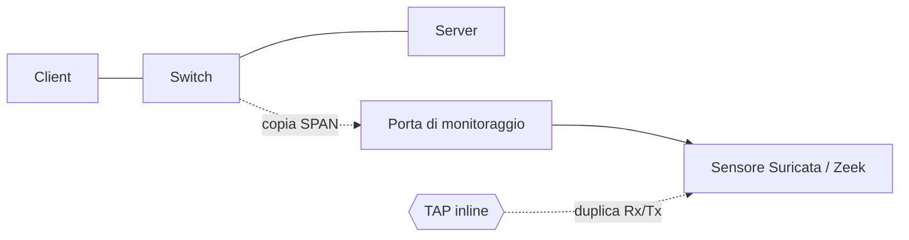

## Perché conta

Un IDS, un sistema NSM come [Zeek]() o [Suricata]() vedono solo ciò che gli arriva. Se il sensore è collegato male, la detection è un'illusione: nessun alert non significa nessun attacco, significa magari nessun pacchetto. Il problema della **visibilità** viene prima delle regole.

Ci sono due facce. La prima è difensiva: portare una copia fedele del traffico al sensore senza disturbare la produzione. La seconda è offensiva: la porta di mirror è un punto in cui *tutto* il traffico viene duplicato, quindi chi la controlla o la satura ottiene intercettazione o cecità. Questo articolo si collega a [packet analysis con Wireshark]() e a [MACsec](), che mostra cosa cambia quando il link è cifrato.

## Come funziona

Esistono tre modi per ottenere una copia del traffico:

- **TAP** (Test Access Point): dispositivo passivo inline sul cavo, in rame o fibra, che duplica entrambe le direzioni su due porte di monitoraggio. Non perde pacchetti per scelta di design e non ha indirizzo.
- **SPAN** (o port mirroring): lo switch copia il traffico di una o più porte sorgente verso una porta di destinazione. Costa poco, ma la copia ha priorità bassa e può perdere frame.
- **Mirroring software** (`tc mirred`, bridge, eBPF) su host o hypervisor Linux, utile nei lab e nel cloud.



Il limite fisico è l'**oversubscription**. Se $n$ porte sorgente a velocità $r_i$ in full duplex sono copiate su una porta di destinazione di capacità $C$, il traffico mirrorato è $2\sum_i r_i u_i$ (con $u_i$ utilizzo medio) e la frazione persa a regime è

$$L = \max\!\left(0,\; 1-\frac{C}{2\sum_{i=1}^{n} r_i\,u_i}\right)$$

Con quattro porte da 1 Gbit/s al 40% di utilizzo il mirror vale $2\cdot 4\cdot 0{,}4 = 3{,}2$ Gbit/s su una destinazione da 1 Gbit/s: $L \approx 69\%$. Il sensore vede meno di un terzo del traffico, e lo perde proprio nei picchi, cioè quando serve di più.

## L'attacco

Due scenari. Il primo è l'**evasione per saturazione**: l'attaccante genera traffico inutile (anche fra due host che controlla) per riempire il mirror e far cadere i frame dell'attacco vero, che lo switch scarta senza avvisare.

```bash
# due host dell'attaccante sulla stessa VLAN mirrorata: flood UDP che consuma banda di SPAN
iperf3 -c 10.0.1.50 -u -b 900M -t 120 -P 2
```

Il secondo è lo **sniffing sulla porta di monitoraggio**: se l'interfaccia del sensore ha un IP, risponde a ARP e ha servizi aperti, un host compromesso sul segmento di gestione può raggiungere una macchina che *vede tutto il traffico in chiaro*, comprese credenziali di protocolli non cifrati.

```bash
# lato sensore compromesso o mal configurato: tutto passa di qui
tcpdump -ni mon0 -A 'tcp port 21 or tcp port 110 or tcp port 23' | grep -i -E 'user|pass'
```

Infine, errori classici di configurazione: SPAN dimenticato su una porta di produzione, VLAN mirrorata che include dati sensibili senza basi giuridiche, `tcp-segmentation-offload` attivo che fa vedere al sensore super-pacchetti inesistenti sul filo.

## La difesa

Sullo switch si limita il mirror a ciò che serve e si mette la destinazione in una VLAN morta:

```text {hl_lines=[1,2,3]}
monitor session 1 source interface Gi0/1 - 2 both
monitor session 1 destination interface Gi0/24
!
interface Gi0/24
 description SENSORE-IDS no-ip
 switchport mode access
 switchport access vlan 999
 spanning-tree bpdufilter enable
 shutdown
```

Su Linux (hypervisor, lab, sensore software) il mirroring con `tc` e l'hardening dell'interfaccia di cattura:

```bash {hl_lines=[2,3,9,10,11]}
# copia ingress ed egress di eth1 su mon0
tc qdisc add dev eth1 handle ffff: ingress
tc filter add dev eth1 parent ffff: matchall action mirred egress mirror dev mon0
tc qdisc add dev eth1 handle 1: root prio
tc filter add dev eth1 parent 1: matchall action mirred egress mirror dev mon0

# la porta di cattura: nessun IP, nessun ARP, nessun offload che altera i frame
ip addr flush dev mon0
ip link set mon0 arp off promisc on up
ethtool -K mon0 gro off lro off tso off gso off rx off
sysctl -w net.ipv6.conf.mon0.disable_ipv6=1
```

Nel sensore, Suricata cattura in `af-packet` e dichiara le metriche di perdita, che vanno monitorate come un servizio:

```yaml {hl_lines=[3,4]}
af-packet:
  - interface: mon0
    cluster-id: 99
    cluster-type: cluster_flow
    defrag: yes
```

Dopo l'avvio, `suricatasc -c "dump-counters"` e i contatori `capture.kernel_drops` dicono quanti pacchetti il kernel ha perso: oltre l'1% la detection è già degradata. Quando la banda non basta si passa a un **packet broker** che filtra e bilancia, o si rinuncia alla cattura completa a favore di flow record IPFIX (RFC 7011), molto più leggeri. Se il link è cifrato con MACsec, il TAP vede solo ciphertext: il punto di cattura va spostato a valle del decifrare, o sull'endpoint.

## Lab

Con due namespace e un bridge Linux (`br0`), collega `h1` e `h2`, aggiungi `mon0` come terza porta senza IP e mirrorare `br0`-`h1`.

1. Genera traffico `h1 → h2` e verifica con `tcpdump -ni mon0` che la copia sia completa.
2. Limita `mon0` a 100 Mbit/s (`tc qdisc add dev mon0 root tbf rate 100mbit burst 32k latency 50ms`) e lancia `iperf3 -b 300M`: quanta parte arriva al sensore?
3. Qual è la frazione teorica persa e come si confronta con il misurato?


<details><summary>Soluzione</summary>
<p>1. Con il filtro <code>matchall action mirred egress mirror dev mon0</code> sia ingress sia egress compaiono su <code>mon0</code>; se vedi solo una direzione controlla di aver installato entrambe le qdisc.</p>
<p>2. Il flusso da 300 Mbit/s ha mirror a 300 Mbit/s (una sola direzione utile) su 100 Mbit/s: arriva circa un terzo, il resto è scartato dal <code>tbf</code>, come farebbe lo switch.</p>
<p>3. $L = 1 - 100/300 \approx 0{,}67$; la misura (<code>tc -s qdisc show dev mon0</code>, contatore <em>dropped</em>) deve darti un valore vicino, con scarto dovuto a burst e overhead di header.</p>
</details>


## Conclusione

Un sensore vale quanto la copia di traffico che riceve. Scegli TAP quando la fedeltà è critica, SPAN quando il costo conta e misuri le perdite, e tratta sempre la porta di monitoraggio come un asset sensibile: niente IP, VLAN isolata, offload spenti, contatori di drop sotto allarme. Senza questo, le regole di Suricata servono a poco.

**Prossimo nella serie:** altri approfondimenti su detection e visibilità · [Torna alla roadmap]()
