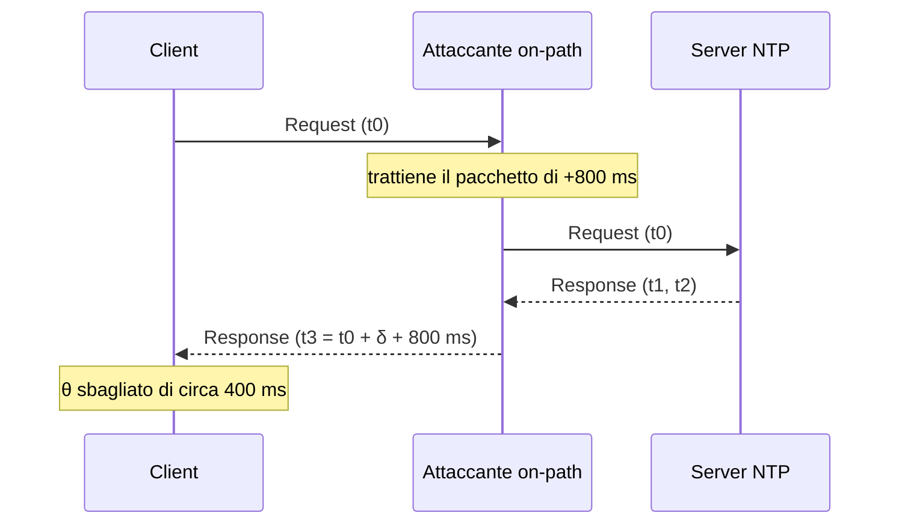

## Perché conta

Nessuno mette l'orologio nel threat model, eppure molta sicurezza dipende da lui. La validità dei certificati
[TLS]() è un intervallo di date; Kerberos rifiuta ticket se lo scarto supera
in genere 5 minuti; i codici TOTP sono funzioni del tempo; la correlazione dei log nel
[SIEM]() è inutile se ogni host ha un'ora diversa; DNSSEC ha finestre di
validità per le firme. Chi controlla l'orologio di un host può riesumare certificati scaduti o revocati,
far scadere ticket e spostare le tracce di un attacco fuori dalla finestra d'analisi.

NTP, nato nel 1985, di default usa UDP/123 in chiaro e senza autenticazione: un bersaglio comodo.

## Come funziona

Il client invia una richiesta con il proprio timestamp, il server risponde aggiungendo i suoi.
Con i quattro timestamp $t_0$ (invio client), $t_1$ (ricezione server), $t_2$ (invio server) e $t_3$
(ricezione client) si calcolano scarto e ritardo:

$$\theta = \frac{(t_1 - t_0) + (t_2 - t_3)}{2} \qquad \delta = (t_3 - t_0) - (t_2 - t_1)$$

La formula assume percorsi simmetrici: se l'andata dura $d_a$ e il ritorno $d_r$, l'errore su $\theta$ vale
$(d_a - d_r)/2$. È la leva del delay attack.



NTP non è autenticato per default: la Source Address e i timestamp non sono verificati. Esiste l'autenticazione
simmetrica con MAC (chiavi condivise), poco usata perché richiede di distribuire segreti.

## L'attacco

Due scenari classici.

**1. Amplificazione (DDoS reflection).** Fino al 2013 `ntpd` rispondeva al comando di controllo `monlist`
(CVE-2013-5211) con l'elenco degli ultimi 600 client: una richiesta piccola, una risposta enorme, indirizzo
sorgente falsificabile. Il fattore è $A = \frac{B_{\text{risposta}}}{B_{\text{richiesta}}}$ e con `monlist` superava varie centinaia
(il tema è trattato in [anatomia dei DDoS]()). Sui server esposti si
verifica ancora oggi se il servizio risponde a query di controllo:

```bash
# il server risponde a query di controllo (mode 6/7)? Se sì, è un amplificatore potenziale
ntpq -c rv 203.0.113.10
nmap -sU -p 123 --script ntp-info 203.0.113.10
```

**2. Time spoofing e delay attack.** Con una posizione on-path (ARP spoofing, vedi
[layer 2]()) basta modificare o ritardare i pacchetti. Senza
autenticazione il client accetta anche risposte forgiate. Un esempio con `scapy` che risponde con un'ora spostata di un'ora:

```python
from scapy.all import *
from scapy.layers.ntp import NTP

def spoof(pkt):
    if pkt.haslayer(NTP) and pkt[UDP].dport == 123:
        resp = IP(src=pkt[IP].dst, dst=pkt[IP].src) / UDP(sport=123, dport=pkt[UDP].sport) \
               / NTP(mode=4, stratum=2, recv=pkt[NTP].sent + 3600, sent=pkt[NTP].sent + 3600)
        send(resp, verbose=0)

sniff(filter="udp port 123", prn=spoof)
```

I client moderni scartano salti enormi (chrony con `makestep` limitato, ntpd con il panic threshold di 1000 s),
ma spostamenti piccoli e graduali passano, e un host appena avviato accetta quasi tutto.

## La difesa

**NTS** (RFC 8915) aggiunge due fasi. In *NTP-KE* (TCP/4460, TLS 1.3) client e server autenticano il server
con il suo certificato e derivano chiavi AEAD, più un set di *cookie* opachi. Poi i pacchetti NTP normali (UDP/123) portano
un *unique identifier*, un cookie (mai riusato: niente tracciamento) e un autenticatore AEAD. Un on-path non può
forgiare risposte né modificare i timestamp; può ancora ritardarle, ma l'autenticazione rende rilevabile il resto.
Il ritardo si contiene con più fonti indipendenti. Configurazione client con `chrony`:

```ini {hl_lines=[2,3,5,6]}
# /etc/chrony/chrony.conf
server time.cloudflare.com iburst nts
server nts.netnod.se iburst nts
pool 2.debian.pool.ntp.org iburst
minsources 3
makestep 1.0 3
ntsdumpdir /var/lib/chrony
cmdport 0
```

Le righe evidenziate: due server con `nts` autenticati, `minsources 3` che impone un quorum prima di
sincronizzare, `makestep 1.0 3` che permette salti solo nei primi 3 aggiornamenti, e `cmdport 0` che disattiva
l'interfaccia di controllo remota. Si verifica con `chronyc -N authdata` (colonna `Mode` = NTS) e `chronyc sources -v`.

Lato rete, il server NTP interno è l'unico che parla con l'esterno; gli altri host lo usano come unica fonte:

```nft
table inet filter {
    chain forward {
        type filter hook forward priority 0; policy drop;
        ip saddr 10.0.0.0/24 ip daddr 10.0.10.5 udp dport 123 accept
        ip saddr 10.0.10.5 tcp dport 4460 accept
        ip saddr 10.0.10.5 udp dport 123 accept
        ct state established,related accept
    }
}
```

Se si gestisce un `ntpd` classico, applicare `restrict default kod nomodify notrap nopeer noquery` e la versione ≥ 4.2.7p26 chiude `monlist`.
Il monitoraggio completa il quadro: `chronyc tracking` esporta lo scarto (un salto improvviso è un indicatore da inviare al SIEM).

## Lab

Con tre container (client, server `chrony`, attaccante) sulla stessa bridge:

1. Sul server esegui `chronyd` con `allow 10.0.0.0/24`; sul client sincronizza in chiaro e osserva `chronyc tracking`.
2. Dall'attaccante fai ARP spoofing e usa lo script scapy sopra: di quanto si sposta il client? Perché non di un'ora intera?
3. Passa il client a NTS (server con `ntsservercert`/`ntsserverkey`): cosa cambia nella cattura con `tcpdump -n port 123 or port 4460`?


<details><summary>Soluzione</summary>
<ol>
<li>Con NTP in chiaro <code>chronyc tracking</code> mostra <code>Reference ID</code> del server e uno scarto di pochi millisecondi.</li>
<li>Il client rifiuta o non converge su un salto di 3600 s: chrony scarta le risposte come <em>falseticker</em> se manca il quorum (<code>minsources</code>) o se il salto supera la soglia di <code>makestep</code>. Per spostarlo bisogna procedere a piccoli passi graduali, oppure agire su un host appena avviato.</li>
<li>Compare un handshake TLS su TCP/4460, poi i pacchetti UDP/123 più lunghi (extension field con cookie e autenticatore). Le risposte forgiate non hanno un autenticatore valido e vengono scartate: <code>chronyc -N authdata</code> mostra i contatori di cookie e la modalità NTS.</li>
</ol>
</details>


## Conclusione

Il tempo è una dipendenza silenziosa di quasi ogni controllo di sicurezza. NTP in chiaro è spoofabile e abusabile come
amplificatore; la difesa è pragmatica: NTS dove possibile, almeno tre fonti indipendenti, salti limitati, comandi di
controllo chiusi, una sola uscita verso Internet e monitoraggio dello scarto.

**Prossimo nella serie:** [Torna alla roadmap]()
