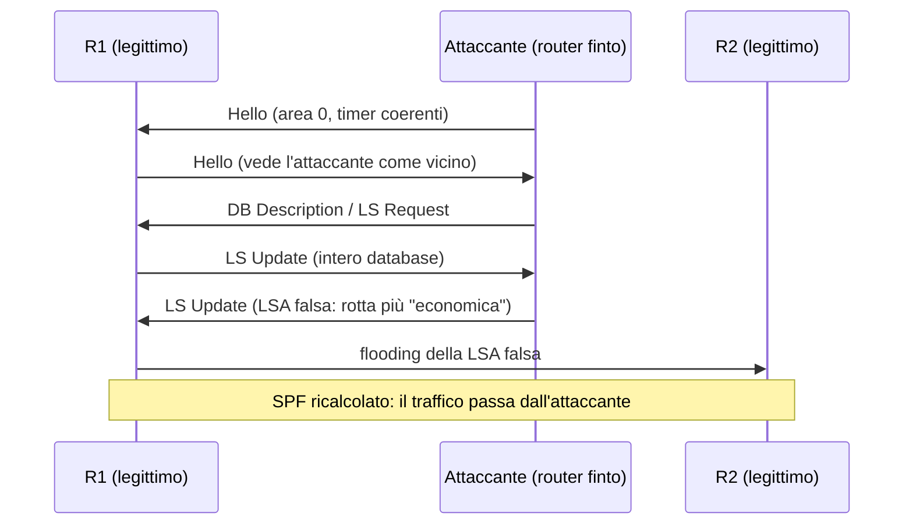

## Perché conta

Nelle ultime puntate abbiamo blindato BGP, il protocollo *tra* organizzazioni. Dentro la propria rete però il
lavoro lo fa un IGP, e nella maggior parte dei campus e dei data center è **OSPF**. Il suo modello di fiducia è
semplice e fragile: ogni router che parla OSPF su un segmento viene creduto. Se un attaccante ottiene un
host su una VLAN dove girano gli Hello, può diventare un router a tutti gli effetti, imparare l'intera topologia
e annunciare rotte false. Il risultato è la deviazione del traffico (man-in-the-middle), un blackhole o un
denial of service sul control plane, senza toccare nessun cavo.

Il problema è aggravato da un'abitudine: l'autenticazione OSPF è spesso spenta perché "tanto la rete è interna".
Con il [threat modeling]() di una rete reale si vede subito che
quella ipotesi regge solo finché nessuna porta d'accesso è compromessa.

## Come funziona

OSPF è un protocollo **link-state** che viaggia direttamente su IP (protocollo 89, multicast `224.0.0.5` e
`224.0.0.6`). Tre fasi contano per la sicurezza:

1. **Hello**: i vicini si scoprono e formano un'adiacenza se coincidono area, timer e parametri di autenticazione.
2. **Scambio del database**: i router si sincronizzano sulle **LSA** (Link State Advertisement), identificate da
   tipo, ID e router annunciante, con un *sequence number* e un *age*.
3. **SPF**: ogni router esegue Dijkstra sul database e costruisce la tabella di routing.



Il costo di un link è, per RFC 2328, derivato dalla banda con una banda di riferimento configurabile:

$$\text{cost} = \max\!\left(1,\; \left\lceil \frac{BW_{\text{ref}}}{BW_{\text{link}}} \right\rceil\right)$$

Poiché il percorso scelto è quello a costo totale minimo, basta annunciare un link fittizio con costo 1 per
attirare il traffico: l'attaccante non deve "battere" le LSA vere, deve solo offrire un percorso più corto.

## L'attacco

Il prerequisito è un host sul segmento e la possibilità di inviare pacchetti raw. In un lab (containerlab con due
router FRR e un container attaccante) basta osservare gli Hello per sapere se c'è autenticazione:

```bash
# Gli Hello in chiaro rivelano area, timer e tipo di autenticazione
tcpdump -ni eth1 -vv 'ip proto 89'
# ... OSPFv2, Hello, length 44, Router-ID 1.1.1.1, Area 0.0.0.0, Authentication Type: none (0)
```

Se l'`Authentication Type` è `none (0)` o `simple (1)`, l'attaccante ha già tutto: nel secondo caso la password
viaggia in chiaro nell'header. Con scapy si costruisce un Hello compatibile:

```python
from scapy.all import *
load_contrib("ospf")

hello = (
    Ether() / IP(src="10.0.12.99", dst="224.0.0.5", ttl=1)
    / OSPF_Hdr(src="9.9.9.9", area="0.0.0.0", authtype=0)
    / OSPF_Hello(mask="255.255.255.0", hellointerval=10, deadinterval=40,
                 router="10.0.12.1", neighbors=["1.1.1.1"])
)
sendp(hello, iface="eth1", inter=10, loop=1)
```

Una volta stabilita l'adiacenza, l'attaccante invia una `OSPF_LSUpd` con una Router-LSA o una External-LSA che
annuncia un prefisso della vittima con metrica 1. C'è anche un trucco insidioso: se l'attaccante annuncia una
LSA con il *router ID* di un router vero e un sequence number più alto, quel router riceve una LSA "propria" che
non ha generato e la contrasta rigenerandola, ma l'attaccante può insistere e provocare instabilità persistente.
Anche senza arrivare lì, un flood di LSA o di Hello falsi satura la CPU, che deve rieseguire SPF a ogni cambiamento:
è lo stesso scenario di [control plane protection]().

## La difesa

La difesa ha quattro livelli, dal più importante al più accessorio.

**1. Autenticazione crittografica.** OSPFv2 supporta null, password semplice e MD5 (RFC 2328, Appendice D).
Il solo MD5 è debole come primitiva; RFC 5709 introduce HMAC-SHA, da preferire dove l'hardware lo supporta.
In FRR l'autenticazione si lega a un *key-chain* con un identificatore di chiave che permette la rotazione:

```text {hl_lines=[1,2,3,4,5,6,10,11,12]}
key chain OSPF-KEYS
 key 1
  key-string UnaChiaveLunghissimaEcasuale
  cryptographic-algorithm hmac-sha-256
 exit
exit
!
router ospf
 ospf router-id 1.1.1.1
 passive-interface default
 no passive-interface eth1
 network 10.0.12.0/24 area 0
!
interface eth1
 ip ospf authentication key-chain OSPF-KEYS
 ip ospf network point-to-point
```

Con l'HMAC il pacchetto porta un *cryptographic sequence number* crescente, che serve a scartare i replay: un
attaccante che registra gli Hello non può riproporli. Una rotazione senza interruzioni si fa aggiungendo la chiave 2
con una finestra `accept-lifetime`/`send-lifetime` sovrapposta.

**2. `passive-interface default`.** Le interfacce verso gli utenti non devono mai emettere né accettare Hello:
si dichiarano passive e si abilita OSPF esplicitamente solo sui link tra router (evidenziato sopra). Il tipo
`point-to-point` evita inoltre l'elezione di DR/BDR su link che non ne hanno bisogno, riducendo la superficie.

**3. Filtri sul control plane.** Su un router Linux si accetta il protocollo 89 solo dai vicini noti:

```bash
nft add table inet ospf
nft add chain inet ospf in '{ type filter hook input priority 0; policy accept; }'
nft add rule inet ospf in ip protocol 89 ip saddr != '{ 10.0.12.1, 10.0.12.2 }' drop
```

**4. Sicurezza fisica e L2.** L'attaccante deve stare sul segmento: [DHCP snooping e DAI](),
port security e [802.1X]() tolgono il prerequisito. Per OSPFv3 non c'è l'header
di autenticazione di v2: si usa IPsec (RFC 4552) oppure l'Authentication Trailer di RFC 7166.

## Lab

Costruisci con containerlab due router FRR (`r1`, `r2`) collegati da un bridge e un terzo container `attacker`
sullo stesso segmento. Prima senza autenticazione, poi con `hmac-sha-256`.

1. Verifica con `vtysh -c "show ip ospf neighbor"` che r1 e r2 siano `Full`.
2. Dall'attaccante invia l'Hello con scapy: compare un terzo vicino?
3. Abilita il key-chain su r1 e r2 e ripeti. Cosa vedi nei log di r1? Come si presenta il fallimento sul pacchetto?
4. Perché `passive-interface default` rende inutile l'attacco anche se l'autenticazione fosse spenta sulle porte utente?


<details><summary>Soluzione</summary>

<p><strong>2.</strong> Senza autenticazione r1 vede l'attaccante come vicino e lo porta fino a <code>Full</code>
(<code>show ip ospf neighbor</code>): riceve l'intero database.</p>

<p><strong>3.</strong> Con il key-chain il pacchetto dell'attaccante ha <code>Authentication Type: none</code> o un digest
non valido: r1 lo scarta e nei log compare un errore di tipo "authentication type mismatch" o "MD5/HMAC digest
failure". L'adiacenza non si forma e nessuna LSA viene accettata.</p>

<p><strong>4.</strong> Su un'interfaccia passiva il router non invia né elabora Hello: il pacchetto viene ignorato prima
di arrivare alla macchina a stati dei vicini. L'autenticazione è la difesa sul link tra router, la passive-interface
toglie del tutto il protocollo dove non serve. Sono complementari.</p>

</details>


## Conclusione

OSPF non è insicuro per natura, ma lo è per default: nessuna autenticazione e fiducia totale sul segmento. La
ricetta è breve: HMAC-SHA su ogni link tra router, `passive-interface default`, filtri sul protocollo 89 e L2
protetto. Con questo la rete interna smette di fidarsi di chiunque sappia parlare IP.

**Prossimo nella serie:** gli altri IGP e i loro punti deboli (IS-IS e EIGRP) · [Torna alla roadmap]()
