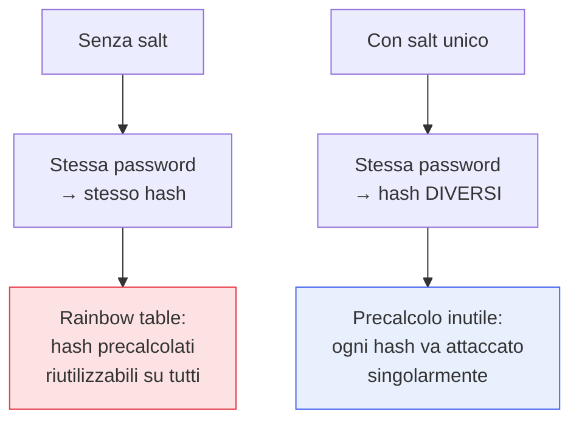

## Perché conta

Abbiamo visto che un [hash crittografico]() è progettato per
essere *veloce*. Per le password questa è la proprietà sbagliata: la velocità lavora per l'attaccante.
Salvare le password è il caso d'uso che quasi tutti sbagliano, e lo sbaglio non si vede finché un
database non trapela — allora si scopre in un pomeriggio se erano protette davvero o solo in
apparenza. Le password richiedono un approccio opposto a tutto il resto della crittografia: la
lentezza come virtù.

## Cosa NON fare

```text {hl_lines=[2,3,4]}
Password in chiaro          → ovvio disastro
Cifrate (reversibili)       → la chiave è lì vicino; un furto le espone tutte
SHA-256(password)           → miliardi di tentativi/secondo: dizionario esaurito in minuti
SHA-256(password) senza salt → due utenti con la stessa password hanno lo stesso hash
```

Il punto chiave: quando un database di hash trapela, l'attaccante non "decifra" — *indovina*. Prova
miliardi di candidati (password comuni, dizionari, brute force) e confronta gli hash. Il suo limite è
la *velocità*. Un hash veloce come SHA-256 gli regala miliardi di tentativi al secondo.

## Salt: contro il precalcolo

Un **salt** è un valore casuale, unico per ogni password, memorizzato accanto all'hash (non è
segreto). Si hasha `salt + password`. Due effetti:



Il salt rende inutili le **rainbow table** (tabelle di hash precalcolati) e impedisce di vedere quali
utenti condividono la stessa password. Ma non rallenta i tentativi: per quello serve altro.

## Il costo regolabile

Gli algoritmi di password hashing sono *deliberatamente lenti e costosi*, con un parametro di **costo**
che puoi alzare man mano che l'hardware migliora:

- **bcrypt**: lento, con un fattore di costo (work factor). Collaudato da decenni.
- **scrypt**: lento *e* avido di **memoria** (memory-hard), per neutralizzare le GPU.
- **Argon2**: vincitore della Password Hashing Competition, regolabile su tempo, memoria e
  parallelismo. La variante **Argon2id** è la raccomandazione di oggi.

L'idea della *memory-hardness* è cruciale: le GPU e gli ASIC hanno tantissimi core ma poca memoria per
core. Un algoritmo che richiede, diciamo, 64 MB per ogni tentativo annulla il vantaggio dell'hardware
parallelo, che è l'arma principale dell'attaccante.

## Tararlo bene

```text {hl_lines=[2]}
Obiettivo: un singolo hash impiega ~0,1–0,5s e usa decine di MB di RAM
  → per te (un login) è impercettibile
  → per l'attaccante (miliardi di tentativi) è proibitivo in tempo E in costo hardware
Rivaluta i parametri periodicamente: l'hardware migliora, il costo va alzato.
```

Il parametro va scelto in base alla *tua* infrastruttura: abbastanza alto da far male all'attaccante,
abbastanza basso da non rendere lento il login legittimo né esporti a un DoS. E va rivisto nel tempo.

## Il quadro completo

Password hashing robusto = **Argon2id** (o bcrypt se Argon2 non è disponibile) + **salt unico** per
utente (gestito automaticamente dalla libreria) + **costo tarato** e rivisto. E, a monte, ridurre il
valore del bersaglio: MFA, [segreti gestiti bene](), e dove
possibile passare a meccanismi senza password. Un database con password Argon2id ben tarate, se
trapela, costa all'attaccante molto più di quanto valgano la maggior parte degli account.


<details>
<summary><strong>Domanda:</strong> se il salt è memorizzato in chiaro accanto all'hash, a cosa serve? L'attaccante che ruba il database ha anche i salt.</summary>
<p>È vero che l'attaccante ottiene i salt insieme agli hash, e questo confonde molti — ma il salt non è
mai stato pensato per essere segreto, e capire a cosa serve davvero chiarisce perché funziona anche se è
pubblico. Il salt difende da un attacco specifico: il <em>precalcolo</em> e la <em>condivisione del lavoro
tra più password</em>. Senza salt, un attaccante può fare il lavoro una volta sola e riusarlo contro
tutti: costruisce in anticipo una gigantesca tabella (rainbow table) che mappa password comuni ai loro
hash, e poi, quando ruba un database, confronta semplicemente gli hash rubati con la tabella già pronta —
nessun calcolo nuovo, risposta immediata per milioni di account. Peggio, se due utenti hanno la stessa
password hanno lo stesso hash, quindi crackarne uno li crackа tutti insieme, e vedi subito chi condivide
la password. Il salt unico per utente distrugge entrambe le scorciatoie. Poiché ogni password è hashata
con un salt diverso, la tabella precalcolata diventa inutile: dovrebbe esistere una rainbow table separata
<em>per ogni salt possibile</em>, cioè miliardi di tabelle, il che è infattibile — il precalcolo
collassa. E due utenti con la stessa password ora hanno hash diversi, quindi l'attaccante deve attaccare
ogni account <em>singolarmente</em>, da zero, senza riusare nulla. Nota bene cosa il salt fa e cosa non
fa: non rallenta il tentativo del <em>singolo</em> hash — quello è compito del costo regolabile di
Argon2/bcrypt — ma impedisce all'attaccante di ammortizzare lo sforzo su molte password o di pre-pagarlo
prima del furto. Il fatto che sia pubblico non lo indebolisce, perché la sua forza non sta nella
segretezza ma nell'essere <em>unico e diverso per ciascuno</em>: costringe l'avversario a fare lavoro
fresco e separato per ogni password, invece di un lavoro solo riutilizzabile per tutte. Salt e costo
lavorano su assi ortogonali — il salt elimina le scorciatoie orizzontali (tra password), il costo rende
caro ogni singolo tentativo verticale — ed è la combinazione dei due a rendere un database rubato poco
redditizio da attaccare.</p>
</details>


## Conclusione

Le password si proteggono con algoritmi lenti e memory-hard — Argon2id oggi — con salt unico per
utente e costo tarato e rivisto nel tempo: mai in chiaro, mai cifrate, mai con un hash veloce.
Finora tutta la serie ha usato *chiavi condivise*: la stessa chiave per cifrare e decifrare, per
generare e verificare. Ma come fanno due parti che non si sono mai incontrate a condividere una chiave?
È il problema che la crittografia asimmetrica risolve, prossimo capitolo.
