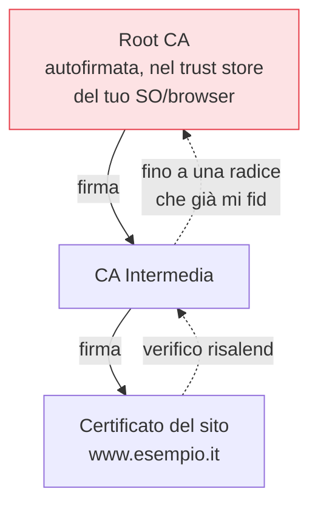

## Perché conta

Due capitoli hanno lasciato aperta la stessa domanda: la [crittografia asimmetrica]()
e le [firme]() funzionano solo se sai che una chiave pubblica
appartiene *davvero* a chi dice. Una chiave senza identità verificata è inutile: un man-in-the-middle
ti dà la sua e tu cifri felicemente per lui. La **PKI (Public Key Infrastructure)** risolve questo:
lega chiavi a identità tramite **certificati** firmati da autorità fidate.

## Il certificato: un'identità firmata

Un certificato **X.509** è, in sostanza, una dichiarazione firmata: "questa chiave pubblica appartiene
a questo soggetto", con una firma di chi lo attesta.

```text {hl_lines=[2,3,6]}
Certificato (semplificato):
  soggetto:       www.esempio.it         ← a chi appartiene
  chiave pubblica: 30 82 01 0a...         ← la chiave legata all'identità
  validità:       dal ... al ...
  emittente:      CA Intermedia X
  FIRMA dell'emittente                    ← la CA garantisce il legame
```

Il certificato non è segreto: è pubblico. La sua forza sta nella *firma* dell'emittente, che puoi
verificare — a patto di fidarti dell'emittente. E qui comincia la catena.

## La catena di fiducia

Nessuna singola autorità firma direttamente ogni certificato del mondo. La fiducia è gerarchica:



Il tuo sistema operativo e il browser contengono un **trust store**: un insieme di poche centinaia di
*root CA* di cui ti fidi a priori. Quando visiti un sito, il browser riceve il certificato foglia e la
catena di intermedie, e verifica ogni firma risalendo fino a una radice fidata. Se la catena regge e
tutto è valido (nome corretto, non scaduto, non revocato), la connessione è autenticata. È ciò che
avviene a ogni handshake [TLS]().

## Il punto debole: la revoca

Cosa succede se una chiave privata viene compromessa *prima* della scadenza del certificato? Va
**revocata**. Ma la revoca è storicamente il tallone d'Achille della PKI:

```text {hl_lines=[2,3]}
CRL (liste di revoca)  → grandi, scaricate di rado: lente ad aggiornarsi
OCSP (query online)    → una richiesta per certificato: lenta, e un problema di privacy
OCSP stapling          → il server allega la prova di non-revoca: meglio
tendenza moderna       → certificati a VITA BREVE (es. 90 giorni, Let's Encrypt) + automazione
```

La direzione vincente è ridurre il problema alla fonte: certificati a **vita breve**, rinnovati
automaticamente. Se un certificato dura 90 giorni, una compromissione ha una finestra corta anche
senza revoca tempestiva — lo stesso principio delle credenziali effimere visto per i
[segreti]() e la forward secrecy.

## Il rischio sistemico: una CA compromessa

Tutta la PKI poggia sulla fiducia nelle CA. Una CA compromessa o disonesta può emettere un certificato
valido per *qualsiasi* dominio, abilitando un man-in-the-middle che il browser accetterebbe. È un
rischio reale, già successo. La difesa è la [Certificate Transparency]():
ogni certificato emesso finisce in log pubblici append-only, così un'emissione fraudolenta per il tuo
dominio è *visibile* e rilevabile, anche se tecnicamente valida. La trasparenza non impedisce l'abuso,
ma lo rende impossibile da nascondere — e questo cambia gli incentivi.


<details>
<summary><strong>Domanda:</strong> l'intero sistema poggia sul fidarsi di qualche centinaio di CA che non conosco, inserite nel mio browser da qualcun altro. Non è un modello di fiducia fragile e centralizzato?</summary>
<p>Sì, è fragile e in parte centralizzato, e la comunità della sicurezza lo riconosce apertamente — ma è
anche il miglior compromesso pratico trovato finora per un problema che, su scala planetaria, non ha
soluzioni perfette, e nel tempo è stato rinforzato proprio nei punti che citi. Partiamo dal problema di
fondo: miliardi di persone devono poter verificare l'identità di milioni di siti che non hanno mai
contattato, senza un incontro preliminare. Qualunque soluzione richiede un <em>punto di partenza di
fiducia</em> comune, perché la fiducia non si crea dal nulla. Le alternative teoriche hanno tutte difetti
peggiori alla scala: la verifica manuale delle impronte (come SSH al primo accesso) non scala a un web che
visiti a centinaia di domini nuovi; la ragnatela di fiducia di PGP, dove ti fidi di chi è fidato dai tuoi
contatti, è elegante ma troppo complessa per l'utente medio e con una copertura disomogenea. La PKI
gerarchica ha vinto perché delega il lavoro di verifica a entità specializzate e lo ammortizza su tutti.
Ora, i difetti che sollevi sono reali e sono stati attaccati su più fronti. Primo, "non conosco quelle
CA": vero, ma non sei tu a doverle fidare alla cieca — i gestori dei trust store (i produttori di sistemi
operativi e browser) applicano programmi di root rigorosi, con audit, requisiti tecnici e il potere di
<em>espellere</em> una CA che si comporta male, cosa successa a CA importanti che hanno emesso certificati
impropri. La fiducia non è eterna, è condizionata e revocabile. Secondo, "una CA può emettere per
qualsiasi dominio": questo era il buco più grave, ed è proprio ciò che la Certificate Transparency ha
chiuso rendendo <em>pubblica e verificabile</em> ogni emissione — un certificato fraudolento per la tua
banca non può più essere emesso di nascosto, comparirebbe nei log monitorati. In aggiunta, meccanismi
come i record CAA permettono a un dominio di dichiarare <em>quali</em> CA possono emettere per lui,
restringendo la superficie. Terzo, la centralizzazione: è mitigata dal fatto che le root sono molte e
indipendenti, e che errori di una non compromettono le altre. Resta vero che un attaccante con risorse
statali, capace di piegare o compromettere una CA fidata, è una minaccia seria contro cui la PKI da sola
non basta — ed è per questo che per i casi ad altissima sensibilità si aggiungono strati come il
certificate pinning. Il quadro onesto: la PKI è un modello di fiducia imperfetto e centralizzato, ma
<em>sorvegliato, revocabile e reso trasparente</em>, che funziona a una scala dove i modelli più
"puri" falliscono. Non è fidarsi ciecamente: è fidarsi di un sistema con controllori, conseguenze e, ora,
testimoni pubblici.</p>
</details>


## Conclusione

La PKI lega chiavi a identità tramite certificati firmati in una catena che risale a poche root fidate;
la revoca è il punto debole, mitigato dai certificati a vita breve, e il rischio di una CA compromessa
è reso visibile dalla Certificate Transparency. Con questo i mattoni della crittografia applicata sono
completi — cifratura, integrità, autenticità, scambio di chiavi, firme e fiducia. Ma tutto questo
poggia su problemi matematici che un computer quantistico potrebbe un giorno risolvere. Cosa cambia, e
cosa fare già oggi, è l'ultimo capitolo.
