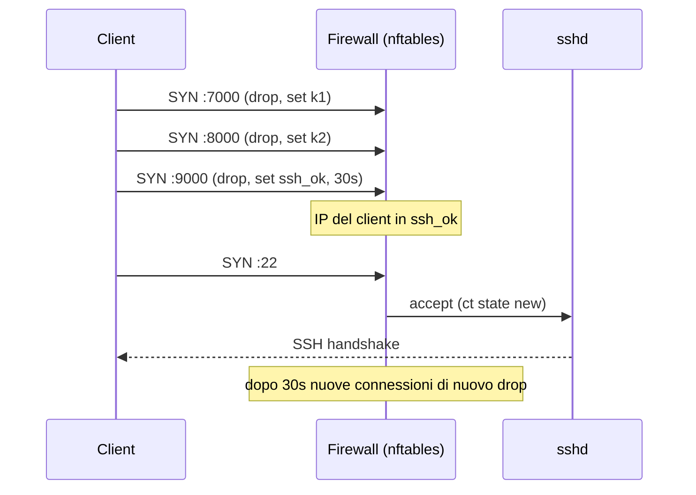

## Perché conta

Un servizio SSH esposto su Internet viene trovato in pochi minuti e subisce brute force continui. Anche con
[SSH hardening]() ben fatto resta una superficie d'attacco: se domani esce
una vulnerabilità pre-auth nel demone, sei esposto finché non patchi. L'idea del **port knocking** è
ribaltare il problema: la porta 22 è **chiusa per tutti**, e si apre solo per l'IP di chi dimostra di
conoscere un segreto.

È un controllo di *riduzione della superficie*, non un sostituto dell'autenticazione: lo scanner non vede
nulla, quindi non ha nulla da attaccare. Nel linguaggio dello
[Zero Trust]() è un piccolo esempio di "dark service": la risorsa non
risponde finché il client non è autenticato.

## Come funziona

Nel **port knocking** il client manda pacchetti (SYN) a una sequenza di porte chiuse, nell'ordine giusto. Il
firewall registra i tentativi (non c'è nessun demone in ascolto) e, a sequenza completa, apre la porta
per l'IP sorgente per un tempo limitato. La **Single Packet Authorization (SPA)** sostituisce la sequenza con
un solo pacchetto UDP cifrato e autenticato, verificato da un demone che sniffa l'interfaccia.



Quanto vale la sequenza come segreto? Con $k$ porte scelte tra $65535$ possibili l'entropia è

$$H = k \cdot \log_2(65535) \approx 16k \ \text{bit}$$

Con $k=3$ sono circa 48 bit: fuori portata per un brute force online (ogni tentativo richiede 3 pacchetti
e il firewall non dà nessun feedback). Il vero punto debole non è il guessing ma il **replay**: la sequenza viaggia
in chiaro, e chi la osserva sul percorso (Wi-Fi pubblico, ISP, un router compromesso) la ripete dal proprio IP.

## L'attacco

Il lato attaccante ha due strade. La prima è passiva: catturare il traffico verso il server e leggere
la sequenza delle porte contattate.

```bash
# sul percorso: quali porte colpisce il client prima di aprire SSH?
tcpdump -ni eth0 'tcp[tcpflags] == tcp-syn and dst host 203.0.113.10' -c 6
# ... > 203.0.113.10.7000: Flags [S]
# ... > 203.0.113.10.8000: Flags [S]
# ... > 203.0.113.10.9000: Flags [S]
```

Poi il replay dal proprio IP, che apre la porta 22 *per l'attaccante* (se condivide l'IP del client, ad esempio
dietro lo stesso NAT, non serve nemmeno falsificare nulla):

```bash
for p in 7000 8000 9000; do nc -z -w1 203.0.113.10 $p; done
ssh utente@203.0.113.10
```

Il knock classico ha altri limiti: la sequenza è fissa (nessun nonce), il tempo tra i colpi può essere
perturbato, e un pacchetto SYN casuale non può essere autenticato perché non porta payload. Per questo
la SPA mette il segreto *dentro* il pacchetto.

## La difesa

**Knock in nftables.** Tre insiemi dinamici con timeout fanno da macchina a stati: ogni porta è accettata
solo se l'IP è già nell'insieme dello stadio precedente.

```nft {hl_lines=[2,3,4,9,10,11,12]}
table inet filter {
    set k1     { type ipv4_addr; flags dynamic,timeout; timeout 10s; }
    set k2     { type ipv4_addr; flags dynamic,timeout; timeout 10s; }
    set ssh_ok { type ipv4_addr; flags dynamic,timeout; timeout 30s; }

    chain input {
        type filter hook input priority 0; policy drop;
        ct state established,related accept
        tcp dport 7000 add @k1 { ip saddr } drop
        tcp dport 8000 ip saddr @k1 add @k2 { ip saddr } drop
        tcp dport 9000 ip saddr @k2 add @ssh_ok { ip saddr } drop
        tcp dport 22 ip saddr @ssh_ok ct state new accept
    }
}
```

Il timeout di 30 secondi vale solo per aprire la *nuova* connessione: quella già stabilita resta in piedi grazie
alla regola `established,related`, quindi la finestra utile per un attaccante è breve. Per i dettagli su
conntrack e sui set vedi [stateful firewall con nftables]().

**SPA con fwknop.** Il pacchetto contiene IP, porta richiesta, timestamp e un valore casuale, cifrato con
AES e autenticato con HMAC (RFC 2104). Il server rifiuta pacchetti con firma sbagliata e ripetizioni dello
stesso pacchetto, e non ha nessuna porta in ascolto: `fwknopd` legge i pacchetti con libpcap.

```bash
# client: genera le chiavi e salvale nel file di configurazione
fwknop --key-gen --use-hmac --save-rc-stanza -n gateway -D 203.0.113.10

# client: richiede l'accesso a tcp/22 per il proprio IP pubblico
fwknop -n gateway -A tcp/22 -R
ssh utente@203.0.113.10
```

```ini {hl_lines=[3,4,5,6]}
# /etc/fwknop/access.conf (server)
SOURCE              ANY
KEY_BASE64          <chiave AES generata da --key-gen>
HMAC_KEY_BASE64     <chiave HMAC generata da --key-gen>
OPEN_PORTS          tcp/22
FW_ACCESS_TIMEOUT   30
```

Vale per entrambe le tecniche: non è una difesa unica. Tienilo sopra a un SSH già indurito (solo chiavi, niente
password), registra i tentativi sul [SIEM]() e ricorda che un servizio
nascosto non sparisce per chi ha già accesso alla rete interna: lì servono
[microsegmentazione]() e identità.

## Lab

Con due container (o due VM) e `nftables` sul server:

1. Carica il ruleset sopra e verifica che `nmap -p 22 <server>` dia `filtered`.
2. Colpisci le porte in ordine con `nc -z`, poi connettiti via SSH. Quanto dura la finestra?
3. Colpisci le porte nell'**ordine sbagliato** (9000, 8000, 7000): la porta 22 si apre? Perché?
4. Da un terzo host, registra con `tcpdump` il knock e ripetilo. Che cosa dimostra?


<details><summary>Soluzione</summary>
<ol>
<li><code>nmap</code> riporta <code>filtered</code>: la policy <code>drop</code> non risponde nemmeno con un RST, quindi lo scanner non distingue una porta chiusa da un host spento.</li>
<li>Per 30 secondi (<code>timeout</code> di <code>ssh_ok</code>) si possono aprire nuove connessioni; <code>nft list set inet filter ssh_ok</code> mostra l'IP e il tempo residuo. Le connessioni già stabilite non vengono chiuse.</li>
<li>No. La porta 9000 richiede l'IP in <code>k2</code>, e <code>k2</code> si popola solo dopo un colpo valido su 8000 con l'IP in <code>k1</code>. L'ordine sbagliato non fa avanzare la macchina a stati.</li>
<li>Il replay funziona dal terzo host solo se ha l'IP sorgente giusto o se il server non lega il knock a nulla di più che l'IP: dimostra che la sequenza è un segreto <em>riutilizzabile</em>. Con fwknop lo stesso test fallisce, perché il pacchetto contiene un nonce e il server scarta i duplicati.</li>
</ol>
</details>


## Conclusione

Port knocking e SPA riducono la superficie d'attacco, non la eliminano. Il knock con nftables è
perfetto per un laboratorio e per capire la macchina a stati; in produzione la SPA di fwknop evita replay
e forgery con costi operativi contenuti. In entrambi i casi il segreto che apre il firewall deve essere trattato
come una credenziale: ruotarlo, non scriverlo negli script condivisi e monitorare chi lo usa.

**Per approfondire:** [SSH hardening]() · [Torna alla roadmap]()
