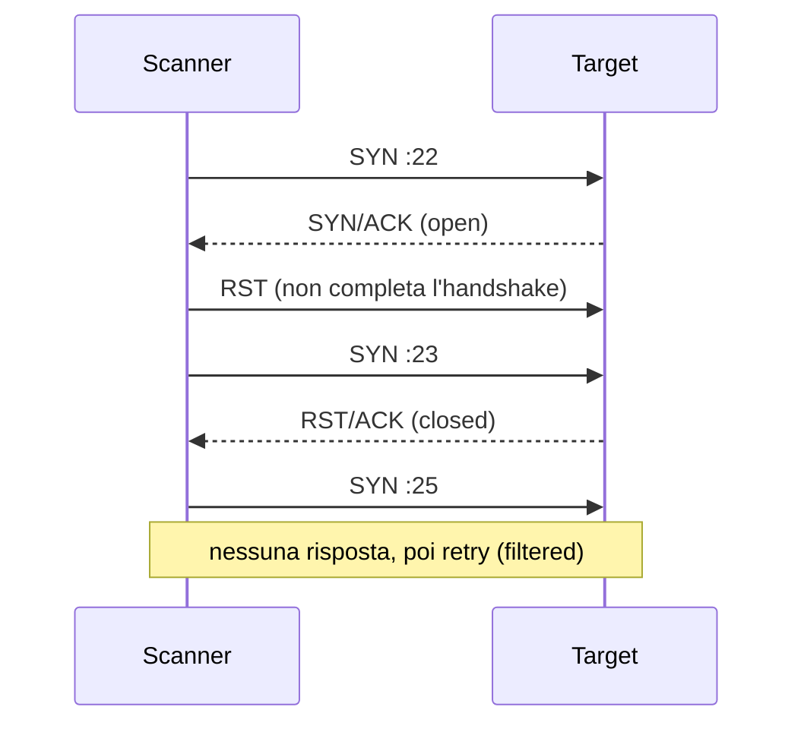

## Perché conta

Ogni intrusione parte dalla stessa domanda: *cosa c'è in ascolto, e dove?* Il **port scanning** risponde
a questa domanda ed è la prima fase della ricognizione (la tecnica T1046 di MITRE ATT&CK). Non è un
attacco in sé, ma è il segnale più precoce che qualcuno sta preparando il passo successivo. Chi lo
rileva ha un vantaggio: l'attaccante non ha ancora fatto nulla di irreversibile.

Capire la scansione serve a due cose: sapere cosa un attaccante vede *di te* (la tua superficie
d'attacco reale, cfr. [port knocking e SPA]() per nasconderla) e
sapere come riconoscerla nei log, ad esempio con [Zeek]()
o [Suricata]().

## Come funziona

Uno scanner sfrutta il comportamento di TCP definito in RFC 9293: un SYN verso una porta in ascolto riceve
SYN/ACK, verso una porta chiusa riceve RST, e se un firewall scarta il pacchetto non riceve nulla.
Ogni risposta classifica la porta.



I tipi di scansione principali:

- **SYN scan** (`-sS`): manda il SYN e non completa l'handshake. È veloce e, richiedendo raw socket, serve root.
- **Connect scan** (`-sT`): usa la `connect()` del sistema operativo, quindi completa l'handshake e finisce nei log delle applicazioni.
- **UDP scan** (`-sU`): una porta aperta spesso non risponde, una chiusa risponde con ICMP port unreachable; è lenta perché l'ICMP è limitato in rate.
- **Version detection** (`-sV`): dopo aver trovato la porta, legge il banner e prova probe applicativi.

Il tempo necessario dipende dal numero di porte $N$ e dalla velocità $r$ in pacchetti al secondo, più i retry $k$:

$$T \approx \frac{N \cdot (1 + k)}{r}$$

Su tutte le 65535 porte, con $r = 1000$ pkt/s e $k = 1$ per le porte filtrate, servono circa 130 secondi.
Rallentare lo scanner a pochi pacchetti al secondo non lo ferma, ma lo trasforma in un'operazione di ore,
molto più visibile.

## L'attacco

Una scansione tipica prima scopre gli host, poi le porte, poi identifica i servizi:

```bash
# 1. host vivi nella subnet, senza scansione di porte
nmap -sn 192.0.2.0/24

# 2. SYN scan di tutte le porte TCP sul target
sudo nmap -sS -p- --min-rate 1000 -oA scan_full 192.0.2.10

# 3. versioni e script di default solo sulle porte trovate
sudo nmap -sV -sC -p 22,80,443 192.0.2.10
```

Lo stesso lavoro, in modalità "lenta" per aggirare soglie semplici, riduce la frequenza e randomizza l'ordine:

```bash
sudo nmap -sS -p- -T2 --scan-delay 500ms --randomize-hosts 192.0.2.10
```

Sul filo, una scansione SYN ha una firma chiara: un solo IP sorgente, molte porte di destinazione
distinte, pacchetti di soli SYN e molti RST di ritorno. In Wireshark basta il filtro
`tcp.flags.syn==1 && tcp.flags.ack==0` e ordinare per porta.

## La difesa

Non si può impedire a qualcuno di mandare un SYN, ma si può **ridurre ciò che risponde** (solo i servizi
necessari, `policy drop` sul resto) e **penalizzare chi sonda troppo**. Con nftables un set dinamico
raccoglie gli IP che colpiscono troppe porte non servite e li blocca per un po':

```nft {hl_lines=[2,7,10]}
table inet filter {
    set scanners { type ipv4_addr; flags dynamic,timeout; timeout 10m; size 65535; }

    chain input {
        type filter hook input priority 0; policy drop;
        ct state established,related accept
        ip saddr @scanners drop
        tcp dport { 22, 443 } ct state new accept
        # arriva qui solo chi tocca porte non servite
        ct state new add @scanners { ip saddr limit rate over 5/second burst 10 packets } log prefix "scan: " drop
    }
}
```

Le porte legittime vengono accettate prima, quindi solo i pacchetti verso porte *non* servite alimentano il
contatore. Chi ne tocca più di 5 al secondo finisce in `@scanners` e viene scartato per dieci minuti
(i dettagli su set e conntrack in [stateful firewall con nftables]()).

Una soglia sul rate non vede però la scansione lenta. Per quella serve una finestra più lunga: in
Suricata una regola con `threshold` conta i SYN distinti verso lo stesso target e porta l'allarme al
[SIEM]().

```suricata
alert tcp $EXTERNAL_NET any -> $HOME_NET any (msg:"Possibile port scan SYN"; flags:S,12; \
    threshold: type both, track by_src, count 30, seconds 60; sid:1000046; rev:1;)
```

Altri accorgimenti: non restituire banner informativi, filtrare ICMP port unreachable in uscita dove ha
senso, e fare sulla propria rete la scansione prima degli altri, così da conoscere la superficie reale.

## Lab

Con [containerlab]() o due container sulla stessa bridge:
un target con la policy nftables sopra e un attaccante con Nmap.

1. Lancia `nmap -sS -p- --min-rate 1000` dall'attaccante verso il target senza regole: quante porte risultano `open` e `closed`?
2. Carica la configurazione nftables. Ripeti la scansione: cosa cambia nell'output e in `nft list set inet filter scanners`?
3. Rilancia con `-T2 --scan-delay 500ms`: viene bloccato? Perché sì o perché no?


<details><summary>Soluzione</summary>
<ol>
<li>Senza regole le porte non servite rispondono RST: Nmap le conta come <code>closed</code> e riporta solo quelle aperte (ad esempio 22 e 443).</li>
<li>Con la policy <code>drop</code> le porte non servite non rispondono: dopo i primi pacchetti l'IP entra in <code>@scanners</code> e il resto viene scartato. Nmap vede quasi tutto come <code>filtered</code> e può perfino perdere le porte aperte, perché anche i suoi SYN verso 22 e 443 vengono scartati dalla regola <code>ip saddr @scanners drop</code>.</li>
<li>Con 2 pacchetti al secondo il limite di 5/s non scatta: lo scanner passa. La scansione lenta richiede una finestra lunga (Suricata/Zeek con soglia su minuti o ore), non un semplice rate limit.</li>
</ol>
</details>


## Conclusione

Il port scanning è rumoroso per natura: un solo IP che sonda molte porte lascia tracce evidenti. La difesa
efficace combina superficie minima (solo ciò che serve risponde), penalizzazione automatica degli scanner
veloci e rilevazione su finestre lunghe per quelle lente. La ricognizione è il momento in cui costa meno
fermare un attacco.

**Prossimo nella serie:** [Torna alla roadmap]()
