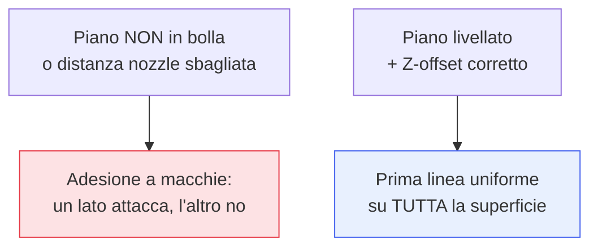

## Perché conta

Hai [filamento]() giusto e
[G-code]() corretto, eppure la stampa fallisce. Dove? Quasi
sempre nei primi millimetri. Il **primo layer** è il fondamento letterale dell'oggetto: se non
aderisce bene e in modo uniforme al piano, tutto ciò che sta sopra è compromesso. È, senza rivali, la
causa numero uno di stampe fallite — e la buona notizia è che dipende da poche cose, tutte
controllabili.

## Il primo layer "giusto"

Un buon primo strato è schiacciato quanto basta: il nozzle deve essere abbastanza vicino al piano da
*spalmare* la plastica, non da *appoggiarla*.

```text {hl_lines=[2,3]}
Nozzle TROPPO ALTO   → linee tonde e staccate, non si uniscono → il pezzo si stacca
Nozzle GIUSTO        → linee leggermente schiacciate, unite tra loro, superficie liscia
Nozzle TROPPO BASSO  → plastica raschiata, trasparente, "elephant foot", o nessuna estrusione
```

La differenza tra i tre è una frazione di millimetro. Trovare quel punto è lo scopo del livellamento.

## Livellare il piano



**Livellare** significa rendere la distanza nozzle-piano uguale ovunque, poi fissare quella distanza
(Z-offset) al valore giusto. Due modi:

- **Manuale**: a macchina fredda poi calda, si regolano le viti agli angoli con un foglio di carta
  come spessore, finché la resistenza è uniforme; poi si affina lo Z-offset stampando una prova.
- **Automatico (ABL)**: una sonda misura il piano in più punti e il firmware *compensa* le
  irregolarità. Comodo, ma lo Z-offset va comunque tarato bene a mano: l'ABL livella, non decide
  quanto schiacciare.

## La superficie: pulizia prima di tutto

Spesso il problema non è il livello ma il *grasso*. Le dita lasciano un velo oleoso che impedisce
l'adesione. Rimedi, in ordine:

```text {hl_lines=[1]}
1. PULIZIA: alcol isopropilico sul piano (il trucco più sottovalutato e più efficace)
2. Temperatura del piano giusta per il materiale (PLA ~60°C, PETG ~80°C, ABS ~100°C)
3. Superficie adatta: PEI testurizzato, vetro, ecc.
4. Aiuti nello slicer: brim (bordo), raft (zattera)
```

L'alcol isopropilico sul piano risolve una quota enorme di problemi di adesione, e quasi nessuno lo fa
abbastanza.

## Il warping: quando l'adesione cede dopo

Diverso dal primo layer che non attacca: il **warping** è il
[ritiro termico]() che, raffreddando, solleva gli angoli *dopo*
che sono stati stampati — tipico di ABS e PETG su pezzi grandi. Contromisure:

- **Piano caldo** alla temperatura giusta, e niente correnti d'aria fredda (per l'ABS, camera chiusa).
- **Brim**: un bordo di sacrificio attorno al pezzo che aumenta la superficie di adesione e tiene giù
  gli angoli.
- **Prima layer più lento e più caldo**, e geometrie che riducono le tensioni (angoli arrotondati).


<details>
<summary><strong>Domanda:</strong> ho una stampante con livellamento automatico del piano (ABL): perché il primo layer a volte è ancora sbagliato se la macchina "livella da sola"?</summary>
<p>Perché l'ABL risolve solo <em>metà</em> del problema del primo layer, e la metà che non tocca è proprio
quella che decide se la plastica si attacca — per questo "livella da sola" dà un falso senso di sicurezza.
Distinguiamo le due cose. L'ABL misura la <em>forma</em> del piano: sonda diversi punti e costruisce una
mappa delle sue irregolarità (un piano non è mai perfettamente planare, si incurva col calore, ha punti
alti e bassi), poi durante la stampa il firmware alza e abbassa leggermente l'asse Z per <em>seguire</em>
quella forma, così la distanza nozzle-piano resta costante su tutta la superficie. Questo elimina il
problema "un angolo attacca e l'altro no". Ma l'ABL <em>non</em> decide <em>quale</em> debba essere quella
distanza costante: quello è lo <em>Z-offset</em>, il parametro che dice "quando la sonda segna zero, il
nozzle deve stare a questa altezza dal piano", ed è una regolazione a parte, quasi sempre manuale. Se lo
Z-offset è sbagliato, l'ABL mantiene fedelmente una distanza <em>uniformemente</em> sbagliata su tutto il
piano: troppo alta (linee tonde che non si uniscono, pezzo che si stacca) o troppo bassa (plastica
raschiata, niente estrusione). È uniforme — merito dell'ABL — ma uniformemente inutilizzabile. Quindi la
prima cosa da controllare se il primo layer è brutto con ABL è proprio lo Z-offset: si affina stampando
una prova di primo layer (o un "baby-stepping" live durante la prima linea) finché le linee sono
leggermente schiacciate e ben saldate. Ci sono poi altre ragioni per cui l'ABL può deludere: la sonda può
avere un <em>offset di temperatura</em> (misura a freddo ma il nugget si dilata a caldo), quindi conviene
sondare a piano caldo; la sonda può essere imprecisa o sporca; e soprattutto l'ABL <em>non fa nulla</em>
contro le due altre cause principali di cattiva adesione, che sono indipendenti dal livello: la
<em>pulizia</em> del piano (il grasso delle dita sconfigge qualsiasi livellamento perfetto) e la
<em>temperatura</em> del piano per quel materiale. In breve: l'ABL ti regala l'uniformità ma non la
distanza giusta né un piano pulito e caldo. Taratura dello Z-offset, alcol isopropilico e temperatura
corretta restano compiti tuoi — l'automatismo livella, non ti solleva dal capire il primo layer.</p>
</details>


## Conclusione

Il primo layer è il fondamento: nozzle alla distanza giusta (schiaccia, non appoggia), piano livellato
e con lo Z-offset tarato, superficie pulita con alcol e alla temperatura giusta, più brim e piano
caldo contro il warping. Risolto il primo strato, i difetti residui — fili, pareti imperfette,
dimensioni sbagliate — si eliminano regolando temperatura, flusso e ritiro in modo metodico. È la
calibrazione, prossimo capitolo.
