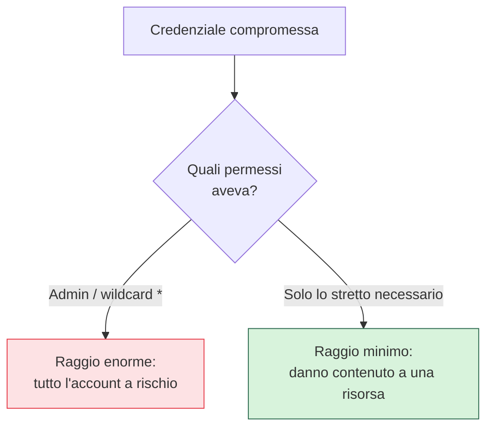

## Perché conta

L'[IAM]() ti dà il potere di concedere permessi con
precisione chirurgica. Il **privilegio minimo** è la disciplina di usarlo bene: dare a ogni identità
*solo* i permessi che le servono per il suo compito, e nulla di più. Non è un vezzo da puristi: è ciò
che trasforma una credenziale rubata da catastrofe a incidente contenuto. Se un'applicazione
compromessa può leggere un solo bucket, il danno finisce lì; se poteva fare `*` su tutto, hai perso
l'intero account.

## Il raggio d'esplosione



La domanda che conta dopo ogni compromissione è "cosa poteva fare questa identità?". Il privilegio
minimo è ciò che rende la risposta accettabile. Si chiama **raggio d'esplosione (blast radius)**: ogni
permesso in più lo allarga.

## I tre antipattern da evitare

```text {hl_lines=[1,2,3]}
"Action": "*"             → può fare QUALSIASI cosa su quel servizio
"Resource": "*"           → su QUALSIASI risorsa, non solo le sue
ruolo admin "per comodità" → assegnato a un'app che ne usa il 2%
```

I wildcard sono comodi mentre sviluppi e letali in produzione. Il pattern giusto è l'opposto:
**partire da zero permessi e aggiungere solo ciò che fallisce** — far girare l'applicazione, guardare
quali chiamate API vengono negate, concedere *esattamente* quelle. Gli strumenti di analisi degli
accessi dei provider (access analyzer, policy advisor) aiutano a scoprire i permessi concessi ma mai
usati, da rimuovere.

## Temporaneo batte permanente

Il privilegio minimo ha anche una dimensione *temporale*. Permessi elevati che servono di rado (un
deploy, un'operazione d'emergenza) non vanno lasciati sempre attivi: meglio concederli **just-in-time**,
a scadenza, con un ruolo assumibile solo quando serve e con tracciamento. Un permesso che esiste solo
per i dieci minuti in cui serve non può essere abusato il resto del tempo.


<details>
<summary><strong>Domanda:</strong> partire da zero e aggiungere ogni permesso che fallisce è lentissimo e frustrante. In un team che deve consegnare, non è più pragmatico dare permessi larghi e stringere "dopo"?</summary>
<p>È la trappola più comune e più costosa del cloud, perché quel "dopo" non arriva quasi mai —
e lo sanno bene anche gli attaccanti. Dare permessi larghi "per ora" crea tre problemi che si saldano.
Primo, <em>il dopo non viene</em>: una volta che l'app funziona con permessi larghi, nessuno torna a
stringerli, perché restringere rischia di rompere qualcosa in produzione e non dà alcun beneficio
visibile — è lavoro invisibile che si fa solo dopo un incidente. Secondo, <em>i permessi larghi
diventano invisibili</em>: con decine di ruoli e wildcard sparsi, nessuno sa più chi può fare cosa, e
quando audit o incidente arrivano, scopri che mezza organizzazione aveva accesso admin "temporaneo" da
due anni. Terzo, <em>l'abitudine si propaga</em>: il ruolo largo copiato una volta viene riusato, e la
larghezza diventa lo standard di fatto. Il punto pragmatico vero è che partire stretti costa <em>meno</em>
nel tempo, non di più: oggi gli strumenti generano la policy minima dai log di utilizzo quasi
automaticamente, parti da una policy di sviluppo permissiva <em>in ambiente di test</em>, registri cosa
usa davvero, e promuovi in produzione la versione stretta già pronta. Così la velocità in sviluppo resta,
ma ciò che va in produzione è già minimo. La scorciatoia "largo ora, stretto dopo" non è pragmatismo: è
debito di sicurezza che si paga tutto insieme, con gli interessi, il giorno del breach.</p>
</details>


## Conclusione

Il privilegio minimo contiene il raggio d'esplosione di ogni credenziale compromessa: niente wildcard,
si parte da zero e si allarga solo sul necessario, si preferisce il temporaneo al permanente. Ma c'è
un'intera classe di identità che spesso riceve permessi troppo larghi e credenziali troppo durature:
le applicazioni e i server. Come darglieli in modo sicuro è il tema dell'[identità dei
workload](), prossimo capitolo.
