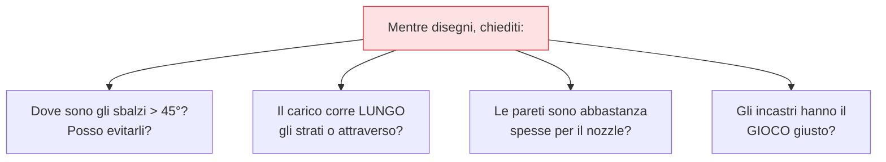

## Perché conta

Molti problemi che abbiamo risolto con [supporti](),
[calibrazione]() e orientamento si possono evitare
*prima*, nel momento in cui il pezzo viene disegnato. Un modello scaricato o progettato senza pensare
alla FDM può essere bellissimo sullo schermo e impossibile da stampare bene. **Progettare per la
stampa** (design for manufacturing applicato alla FDM) significa tenere a mente i vincoli della
tecnologia già nel CAD. È ciò che separa un file da un oggetto che funziona.

## Pensare a strati



La singola abitudine più utile è *immaginare il pezzo mentre cresce strato su strato*. Dove cadrà la
plastica nel vuoto? Dove sarà debole lungo Z? Questa visione anticipa i problemi che altrimenti
scopriresti solo a stampa fallita.

## Spessori minimi e dettagli

Il pezzo non può avere pareti più sottili di ciò che il nozzle può deporre:

```text {hl_lines=[2,3]}
Nozzle da 0.4mm:
  parete minima robusta ≈ 0.8–1.2mm  (2-3 larghezze di linea) → sotto, è fragile o non si stampa
  dettagli/testo in rilievo ≥ 0.4mm di larghezza, embossed meglio di engraved
  fori: tendono a stampare leggermente più PICCOLI → maggiorali o calibra
```

Progettare pareti troppo sottili porta a difetti o fragilità; testo o dettagli sotto la risoluzione
del nozzle semplicemente spariscono. In rilievo (embossed) stampa meglio che inciso (engraved).

## Tolleranze: il segreto degli incastri

Due pezzi che devono combaciare non vanno disegnati alle dimensioni nominali: la stampa ha
imprecisioni, e un incastro "esatto" risulterà bloccato. Si lascia un **gioco (tolerance/clearance)**:

```text {hl_lines=[2,3]}
Gioco tipico tra parti che si incastrano (dipende dalla macchina → calibra con un test):
  accoppiamento scorrevole (si muove)   → ~0.3–0.5mm di gioco totale
  accoppiamento fisso (a pressione)     → ~0.1–0.2mm
→ il valore dipende dal tuo FLUSSO calibrato: fai un test di tolleranze una volta e riusalo
```

È qui che il [flusso calibrato]() paga: dimensioni
accurate rendono prevedibili gli incastri. Il gioco giusto per la tua macchina si trova con un piccolo
test una volta per tutte.

## Evitare i supporti by design

Le tecniche per non aver bisogno di supporti nascono nel CAD:

- **Smussi (chamfer) al posto di sbalzi netti**: un sottosquadro a 45° si stampa senza supporti; uno a
  90° no. Smussare il bordo inferiore di una sporgenza spesso elimina il supporto.
- **Orientare la feature critica**: disegnare pensando a come il pezzo starà sul piano.
- **Spezzare e assemblare**: un pezzo complesso diviso in parti stampabili senza supporti, poi
  incollate, esce meglio di un unico blocco pieno di supporti.
- **Fori orizzontali a goccia**: un foro tondo in verticale sulla parete fa un brutto sbalzo in cima;
  sagomarlo a goccia (teardrop) lo rende auto-supportante.


<details>
<summary><strong>Domanda:</strong> queste regole di design valgono solo se progetto da zero. Se scarico modelli già fatti (da repository online), a cosa mi servono?</summary>
<p>Servono eccome, perché cambiano completamente come <em>scegli, valuti e sistemi</em> i modelli che
scarichi — passare da consumatore passivo a lettore critico di un file è forse il salto più utile che
questo capitolo ti dà anche se non apri mai un CAD. Primo, la <em>valutazione</em>: sapendo le regole,
guardi l'anteprima di un modello e capisci subito se è pensato per la FDM o no. Vedi sbalzi a 90° che
genereranno supporti ovunque, pareti sottilissime che usciranno fragili, dettagli sotto la risoluzione
del nozzle che spariranno, fori verticali che faranno brutti sbalzi in cima. Due modelli dello stesso
oggetto possono essere uno un piacere da stampare e l'altro un incubo, e ora sai distinguerli <em>prima</em>
di sprecare ore e filamento. Secondo, l'<em>orientamento e lo slicing</em>: anche su un modello altrui,
le decisioni di come posizionarlo, dove servono supporti e come bilanciare resistenza ed estetica sono
tue, e le prendi meglio se capisci perché quel pezzo è fatto così. Terzo, la <em>riparazione e
l'adattamento</em>: moltissimi modelli scaricati vanno ritoccati — un incastro troppo stretto perché il
designer aveva una macchina diversa dalla tua, un foro da allargare, un supporto da smussare via, una
base da aggiungere contro il warping. Sapere che le tolleranze dipendono dalla <em>tua</em> calibrazione
ti dice che l'incastro "non è colpa tua né del file": va adattato al tuo flusso, e con un minimo di
editing (anche solo scalare, tagliare, aggiungere uno smusso) lo sistemi. Quarto, la <em>diagnosi</em>:
quando un modello scaricato stampa male, le regole di design ti dicono se il problema è nel file (sbalzo
impossibile, parete troppo fine) o nella tua macchina (calibrazione), così non insegui il parametro
sbagliato. E infine, prima o poi vorrai <em>modificare</em> o combinare modelli, o disegnare un piccolo
adattatore, un supporto, una staffa su misura — i casi in cui la stampa 3D diventa davvero utile sono
spesso pezzi che <em>non</em> esistono già online, ed è lì che il design proprio ripaga. In breve: le
regole non servono solo a creare, servono a <em>leggere</em>, scegliere, adattare e riparare ciò che
stampi, che il file lo abbia fatto tu o qualcun altro.</p>
</details>


## Conclusione

Progettare per la FDM significa pensare a strati, spessori minimi adeguati al nozzle, tolleranze per
gli incastri (che il flusso calibrato rende prevedibili) e geometrie che evitano i supporti —
smussi, fori a goccia, pezzi divisi. Valgono anche per scegliere e adattare i modelli altrui. A questo
punto conosci tutto il processo; resta l'abilità che unisce tutto: leggere un pezzo venuto male e
risalire alla causa. È il troubleshooting dei difetti, l'ultimo capitolo.
