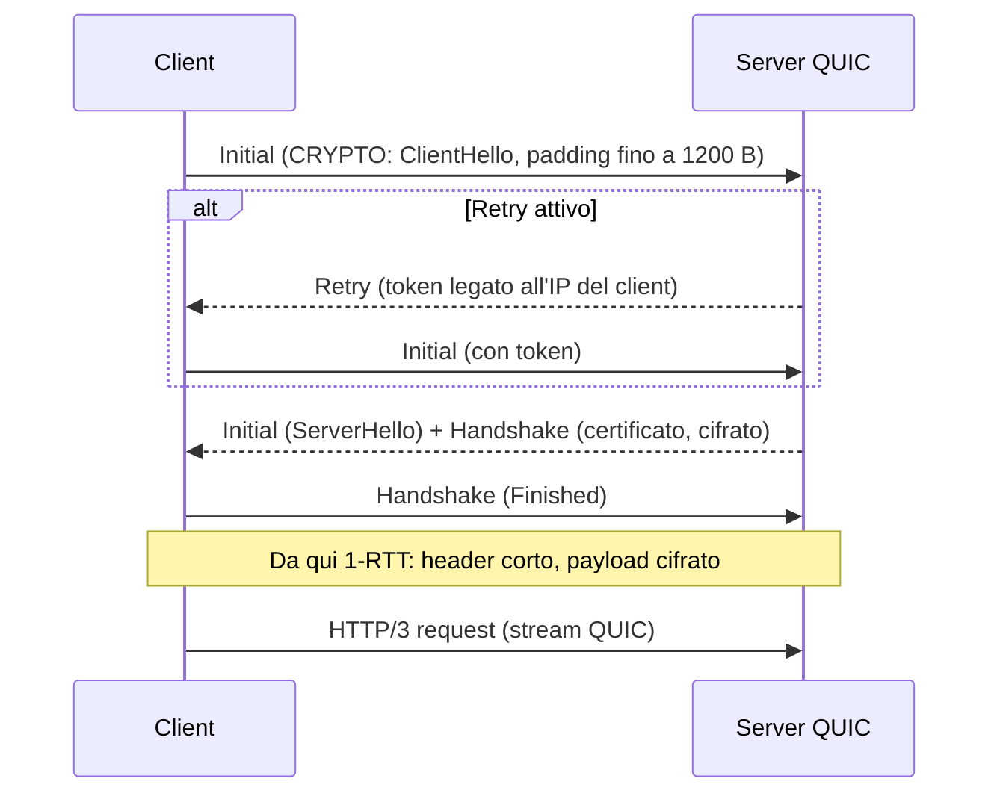

Per vent'anni "il web" ha voluto dire TCP 443. Un firewall stateful, un proxy che fa [TLS inspection]() e un IDS che legge l'SNI partivano tutti da quell'ipotesi. **QUIC** (RFC 9000) sposta HTTP su UDP, cifra quasi tutto il trasporto e porta il traffico su UDP/443: i controlli esistenti non si rompono con un errore, semplicemente smettono di vedere.

## Perché conta

Browser e CDN usano già HTTP/3 di default quando il server lo annuncia con l'header `Alt-Svc`. Se la rete blocca UDP/443 male, o non lo blocca affatto senza averci pensato, il risultato è uno di questi tre: il traffico bypassa l'ispezione, il browser perde secondi nel fallback a TCP, oppure un server QUIC pubblico diventa un riflettore per attacchi spoofati.

Il terzo caso dipende dal fatto che UDP non ha handshake: chi risponde non sa se l'indirizzo sorgente è vero. QUIC lo gestisce con un limite esplicito: finché il client non è validato, il server non può inviare più di tre volte i byte ricevuti (RFC 9000, §8.1). Il client deve quindi gonfiare il primo datagramma Initial ad almeno 1200 byte (§14.1), e il fattore massimo di amplificazione resta:

$$A = \frac{B_{risposta}}{B_{richiesta}} \le 3 \qquad \text{es. } \frac{3600}{1200} = 3$$

Per confronto, l'[amplificazione NTP monlist]() arrivava a centinaia di volte. Ma 3 non è 1: senza l'[anti-spoofing]() a monte, un server QUIC resta un amplificatore minore.

## Come funziona



Le differenze rilevanti per chi difende la rete:

- **Initial non è segreto.** Le chiavi dei pacchetti Initial derivano dal Destination Connection ID tramite un salt pubblico (RFC 9001, §5.2): chiunque, un IDS compreso, può decifrarli e leggere il ClientHello con SNI, a meno di [ECH]().
- **Dopo l'handshake, tutto il resto è cifrato:** numeri di pacchetto, ACK, stream. Niente flag SYN/FIN/RST da osservare, quindi niente tracking di stato affidabile.
- **Il Connection ID sopravvive ai cambi di IP**: la *connection migration* rompe l'assunto "una connessione = una 5-tupla".
- Il certificato del server viaggia nell'handshake cifrato, non in chiaro come in TLS 1.2.

## L'attacco

Il primo abuso è la ricognizione e l'amplificazione: un host che risponde a Initial da sorgenti arbitrarie conferma di parlare QUIC. Per misurare il proprio server in un lab (mai su sistemi altrui), si cattura il traffico mentre un client reale apre una connessione:

```bash
# terminale 1: cattura sul server di lab
sudo tcpdump -ni eth0 -w quic.pcap 'udp port 443'

# terminale 2: un handshake HTTP/3 completo
curl --http3-only -sI https://lab.example.net/ -o /dev/null

# bilancio dei byte per direzione
tshark -r quic.pcap -q -z conv,udp
```

Con `tshark -r quic.pcap -Y quic.long.packet_type==0 -V` si vedono anche gli Initial decifrati, perché Wireshark ricalcola le chiavi dal DCID. Per un attaccante vale lo stesso: non c'è nulla di segreto nei primi pacchetti da cui estrarre l'SNI. La seconda superficie è il flood di Initial con sorgenti falsificate: ogni Initial obbliga il server a eseguire operazioni crittografiche e ad allocare stato, un costo CPU asimmetrico simile a quello del [SYN flood]().

## La difesa

Lato server, il **Retry** sposta il costo sul client: il server risponde con un token legato all'IP sorgente e non alloca stato finché non lo riceve indietro. Il prezzo è un RTT in più, quindi lo si attiva sotto attacco o per client non noti. In nginx:

```nginx {hl_lines=[3,5,6]}
server {
    listen 443 ssl;
    listen 443 quic reuseport;
    http2 on;
    http3 on;
    quic_retry on;
    add_header Alt-Svc 'h3=":443"; ma=86400' always;
    ssl_protocols TLSv1.3;
    ssl_certificate     /etc/ssl/example.com.pem;
    ssl_certificate_key /etc/ssl/example.com.key;
}
```

Lato rete la scelta è politica. Se l'ispezione TLS è un requisito, si blocca UDP/443 in uscita: i browser ripiegano su TCP in pochi istanti. Se HTTP/3 è accettato, lo si limita per sorgente e lo si tratta come traffico cifrato opaco:

```bash {hl_lines=[4,9]}
table inet filter {
    chain forward {
        type filter hook forward priority 0; policy drop;
        iifname "lan" udp dport 443 reject with icmp port-unreachable comment "policy: solo TCP via proxy"
        ct state established,related accept
    }
    chain input {
        type filter hook input priority 0; policy drop;
        udp dport 443 meter quic_flood { ip saddr limit rate over 50/second } drop
        udp dport 443 accept
    }
}
```

Il `reject` (invece di `drop`) evita il timeout: il browser capisce subito che UDP non passa e usa TCP. Il rate limit per sorgente non sostituisce il Retry, ma lo affianca. Per il rilevamento, un IDS come [Suricata]() decifra gli Initial e può applicare regole sull'SNI; per il resto serve visibilità sull'endpoint, come previsto dal [Zero Trust]().

## Lab

Con il server nginx sopra e un client sulla stessa rete di lab:

1. Cattura un handshake HTTP/3 e calcola $A$ tra byte inviati dal server e dal client prima della validazione.
2. Attiva `quic_retry on` e ripeti: cosa cambia nella sequenza dei pacchetti?
3. Applica la regola `reject` su UDP/443 al client: quanto impiega il browser a caricare la pagina e su quale protocollo?


<details><summary>Soluzione</summary>
<p>1. Il client invia un Initial da 1200 byte; il server non supera i 3600 byte prima della validazione, quindi $A \le 3$. Valori reali di solito sono inferiori perché il certificato è compresso o breve.</p>
<p>2. Compare un pacchetto Retry dopo il primo Initial, il client ripete l'Initial con il token: un RTT in più, ma il server non ha allocato alcuno stato per un IP non verificato.</p>
<p>3. Con <code>reject</code> il client riceve subito un ICMP port-unreachable e usa HTTP/2 su TCP quasi senza ritardo; con <code>drop</code> aspetterebbe un timeout. <code>curl -I --http2 https://lab.example.net</code> conferma il protocollo.</p>
</details>


## Conclusione

QUIC non è meno sicuro di TCP+TLS: ha anti-amplification, address validation e TLS 1.3 obbligatorio. Cambia dove si guarda. I controlli basati su stato TCP e flag non funzionano più, l'ispezione deve decidere se bloccare UDP/443 o accettarlo come opaco, e il server deve usare il Retry quando teme lo spoofing.

**Prossimo nella serie:** altri protocolli cifrati sul perimetro · [Torna alla roadmap]()
