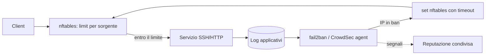

## Perché conta

Ogni servizio esposto su Internet (SSH, un login web, un'API) riceve tentativi di accesso automatici, ogni minuto. Una password debole o una API senza limiti sono questione di tempo. Il **rate limiting** non sostituisce l'autenticazione forte ([MFA resistente al phishing](), [SSH hardening]()), ma alza il costo dell'attacco e riduce rumore nei log e carico sul servizio. Si affianca a [SYN flood e SYN cookies]() e al [firewall stateful]().

## Come funziona

Ci sono tre livelli, da combinare. **Kernel/firewall**: contare i nuovi pacchetti per sorgente con un *token bucket* e scartare l'eccesso. **Log-driven**: un demone legge i log applicativi, riconosce i fallimenti di autenticazione e inserisce l'IP in un set di ban (fail2ban). **Reputazione condivisa**: un agent come CrowdSec rileva scenari di abuso e distribuisce le decisioni ad altri nodi.



Il token bucket ha capacità $b$ (burst) e rinnovo $r$ token al secondo. In una finestra $T$ passano al massimo

$$N(T) = b + r\,T$$

richieste. Con $r = 6/\text{min} = 0{,}1/\text{s}$ e $b = 5$, in un'ora si ottengono al più $5 + 360 = 365$ tentativi per sorgente. Contro uno spazio di $K$ password candidate, il tempo atteso per esaurirlo è $T \approx (K - b)/r$: con $K = 10^6$ si passa da pochi minuti (senza limite, a migliaia di tentativi/s) a $\approx 10^7$ secondi, circa 115 giorni, per singolo IP. Il limite per IP si aggira però distribuendo l'attacco su molti indirizzi: per questo serve anche il livello di reputazione.

## L'attacco

Il traffico da contenere è il *credential stuffing* o il brute force su un servizio. Per **verificare la propria difesa** su un sistema di laboratorio che controlli tu, basta generare molti tentativi di login falliti:

```bash
# Solo su host di lab: 30 tentativi SSH falliti in sequenza
for i in $(seq 1 30); do
  ssh -o BatchMode=yes -o ConnectTimeout=2 -o PreferredAuthentications=password \
      utente-finto@10.10.0.20 true 2>/dev/null
done

# Lato server: cosa vede il log
journalctl -u ssh -n 20 --no-pager | grep -i "failed\|invalid"
```

Senza protezioni, ogni tentativo viene valutato e finisce nei log; il numero di righe `Failed password` è la metrica da osservare prima e dopo la difesa.

## La difesa

**1. Limite per sorgente in nftables**, con un set dinamico che banna per 10 minuti chi supera la soglia:

```nft {hl_lines=[3,4,9,10]}
table inet filter {
    set ssh_abusers {
        type ipv4_addr; flags dynamic, timeout; timeout 10m
    }
    chain input {
        type filter hook input priority 0; policy drop;
        ct state established,related accept
        iif lo accept
        tcp dport 22 ip saddr @ssh_abusers drop
        tcp dport 22 ct state new meter ssh_rate { ip saddr limit rate over 6/minute burst 5 packets } \
            add @ssh_abusers { ip saddr } drop
        tcp dport 22 accept
    }
}
```

**2. fail2ban** quando la decisione dipende dal contenuto del log (password errata, utente inesistente), che il firewall non vede:

```ini {hl_lines=[3,4,5]}
# /etc/fail2ban/jail.d/sshd.local
[sshd]
enabled  = true
maxretry = 4
findtime = 10m
bantime  = 1h
banaction = nftables-multiport
backend  = systemd
```

`bantime.increment = true` allunga il ban per i recidivi. Attenzione a `ignoreip`: inserisci gli IP di gestione, per non chiuderti fuori.

**3. CrowdSec**: l'agent applica *scenari* ai log e un *bouncer* (qui per nftables) applica le decisioni, incluse quelle della community.

```bash
sudo cscli collections install crowdsecurity/sshd crowdsecurity/nginx
sudo apt install crowdsec-firewall-bouncer-nftables
sudo cscli decisions list          # ban attivi
sudo cscli metrics                 # eventi letti e scenari scattati
```

**4. Livello applicativo.** Per HTTP, limita le richieste e rispondi con `429` e `Retry-After` ([RFC 6585](https://www.rfc-editor.org/rfc/rfc6585)):

```nginx
limit_req_zone $binary_remote_addr zone=login:10m rate=5r/m;
location /login {
    limit_req zone=login burst=5 nodelay;
    limit_req_status 429;
}
```

Due avvertenze. Dietro NAT o proxy molti utenti condividono un IP: limita per account o per header affidabile, non solo per IP. E un ban automatico è un'arma a doppio taglio: se un attaccante spoofa gli IP sorgente di UDP o fa arrivare falsi fallimenti, può far bannare utenti legittimi (vedi [anti-spoofing BCP 38]()). Invia i ban al [SIEM]() per rivederli.

## Lab

1. Avvia una VM con `sshd` e le regole nftables sopra. Dal client esegui il ciclo di 30 tentativi: dopo quanti tentativi la connessione viene scartata?
2. Controlla `nft list set inet filter ssh_abusers` e l'elemento con il suo timeout.
3. Installa fail2ban con la jail sopra e ripeti con `PubkeyAuthentication=no`. Quanti `Failed password` compaiono nel log prima del ban? Calcola $N(T)$ per $b=5$, $r=0{,}1/\text{s}$, $T=60$ s.


<details><summary>Soluzione</summary>
<p>Con <code>burst 5</code> e <code>6/minute</code> i primi 5 nuovi collegamenti passano, poi il sesto in rapida successione supera il limite: l'IP finisce in <code>ssh_abusers</code> con timeout di 10 minuti e i pacchetti successivi sono scartati. Con fail2ban il ban scatta dopo <code>maxretry = 4</code> fallimenti nella finestra <code>findtime</code>: nel log compaiono quindi 4 righe <code>Failed password</code>, poi l'IP viene inserito nel set. Per il calcolo: $N(60) = 5 + 0{,}1 \cdot 60 = 11$ richieste al massimo in un minuto.</p>
</details>


## Conclusione

Il rate limiting non risolve l'autenticazione debole, ma trasforma un attacco da migliaia di tentativi al secondo in uno da pochi al minuto, e gli IP recidivi finiscono fuori dal gioco. La combinazione pratica è: limite nel firewall, ban da log con fail2ban o CrowdSec, limiti applicativi con `429`, e un occhio ai falsi positivi.

**Prossimo nella serie:** un nuovo approfondimento sul perimetro di rete · [Torna alla roadmap]()
